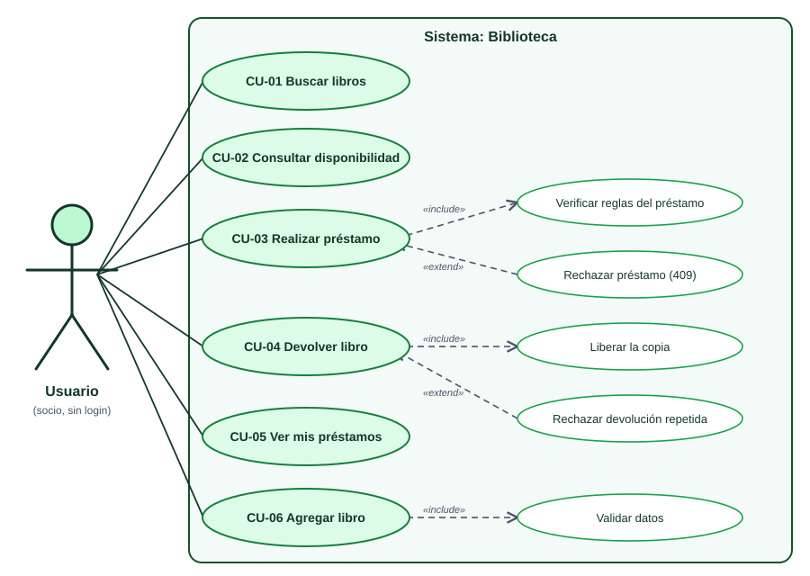
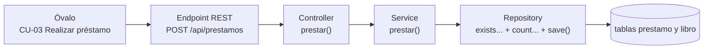

# 00 · Diagrama UML de casos de uso (antes de construir)

> El modelo responde *"¿qué necesita poder hacer el usuario?"*. Diseñar, programar y verificar son actividades iterativas: un hallazgo puede obligar a revisar el modelo.

## 1. El diagrama

Incluye al Usuario (un socio, sin login), la frontera del sistema y seis objetivos: buscar libros, consultar disponibilidad, realizar préstamo, devolver libro, ver mis préstamos y agregar libro. Las relaciones de validación y rechazo deben leerse con las precisiones siguientes; no representan una equivalencia general entre errores y extensiones UML. Consultar [el atlas y la ficha de préstamo](10-atlas-diagramas-biblioteca.md).

## 2. ¿Cómo se lee? (la teoría)

| Elemento | Cómo se dibuja | Qué significa |
|---|---|---|
| **Actor** | El **monito** | Quien **usa** el sistema desde afuera. Es un *rol*, no una clase. Aquí hay uno solo: el **Usuario** (no hay login; en pantalla elige con qué socio actúa) |
| **Caso de uso** | Un **óvalo** | Un **objetivo del usuario**, nombrado con un verbo: *Realizar préstamo*, *Devolver libro* |
| **Límite del sistema** | El **rectángulo grande** | Lo que está *dentro* del sistema que construimos. El actor queda **afuera** |
| **Relaciones** | **Líneas** | Ver la tabla siguiente |

| Línea | Nombre | Significado | Ejemplo del proyecto |
|---|---|---|---|
| ─────── | **Asociación** | "El actor participa en este caso de uso" | Usuario — Realizar préstamo |
| - - - ▶ **«include»** | **Inclusión** | Incorpora el comportamiento del caso incluido | *Realizar préstamo* siempre verifica las reglas del préstamo |
| - - - ▶ **«extend»** | **Extensión** | Añade comportamiento bajo condiciones y en puntos de extensión definidos | El rechazo por falta de copias se documenta como flujo alternativo de *Realizar préstamo* |

> La flecha de *include* apunta al caso incluido; la de *extend* apunta al caso extendido. Frecuencia y opcionalidad por sí solas no bastan para decidir la relación. Un error no es automáticamente una extensión.

## 3. ¿Cada óvalo es un método?

No exactamente: un óvalo es un **objetivo del usuario**. Al programar, cada caso principal se convierte en una cadena de piezas:

| Óvalo | ¿Método propio? | Cómo se implementa de verdad |
|---|---|---|
| CU-01 Buscar libros | **Sí** | `GET /api/libros?q=...` → `LibroService.buscar()` |
| CU-02 Consultar disponibilidad | **Sí** | `GET /api/libros/{id}/disponibilidad` → `LibroService.consultarDisponibilidad()` |
| CU-03 Realizar préstamo | **Sí** | `POST /api/prestamos` → `PrestamoService.prestar()` |
| CU-04 Devolver libro | **Sí** | `PATCH /api/prestamos/{id}/devolucion` → `PrestamoService.devolver()` |
| CU-05 Ver mis préstamos | **Sí** | `GET /api/prestamos?socioId=...` → `PrestamoService.listar()` |
| CU-06 Agregar libro | **Sí** | `POST /api/libros` → `LibroService.crear()` |
| Validar datos | **No** | Anotaciones `@NotBlank`, `@Size`, `@Pattern`… en los DTO + `@Valid` en el controller → **400** |
| Verificar reglas del préstamo | **No** (son reglas) | Tres `if` en `prestar()`: duplicado, límite de 3 y copias disponibles |
| Rechazar préstamo | **No** (es una regla) | `PrestamoDuplicadoException`, `LimitePrestamosExcedidoException` o `LibroSinEjemplaresException` → **409** |
| Liberar la copia | **No** | Dentro de `devolver()`: `ejemplaresDisponibles + 1` en la misma transacción |
| Rechazar devolución repetida | **No** (es una regla) | `if` en `devolver()` → `PrestamoYaDevueltoException` → **409** |

> Las reglas de negocio de este proyecto viven en el service. La notación `extend` no determina la clase ni la capa que implementa una regla.

## 4. Casos de uso en detalle

| Caso | Flujo normal | Flujos alternativos |
|---|---|---|
| **CU-03 Realizar préstamo** | El usuario elige un libro con copias libres y pulsa *Prestar*; el sistema descuenta una copia y fija el vencimiento a 14 días | El socio ya tiene ese libro → **409**. El socio ya tiene 3 préstamos activos → **409**. No quedan copias → **409**. Libro o socio inexistente → **404** |
| **CU-04 Devolver libro** | El usuario pulsa *Devolver* en un préstamo activo; el sistema marca la fecha de devolución y suma una copia | El préstamo ya estaba devuelto → **409**. Préstamo inexistente → **404** |
| **CU-02 Consultar disponibilidad** | El sistema informa cuántas copias hay libres | Si no queda ninguna, informa cuándo vence el préstamo que antes volverá. Libro inexistente → **404** |
