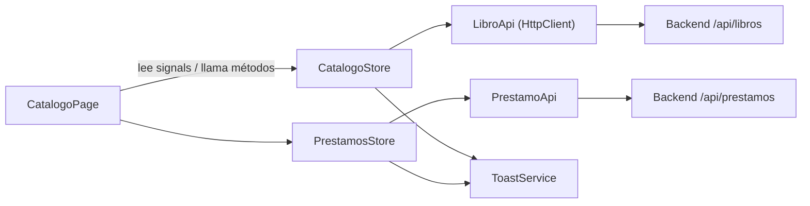

# 03 · Patrones de diseño del proyecto

Un **patrón de diseño** describe una solución recurrente dentro de un contexto y sus consecuencias. Este inventario combina patrones de arquitectura y aplicación con mecanismos y convenciones de Java/Spring. No todos son patrones GoF ni deben agregarse solo para aumentar su cantidad.

| Patrón | Dónde | Problema que resuelve |
|---|---|---|
| **MVC** | Todo el backend / Angular | Separar datos, presentación y control |
| **Service Layer** | `LibroService`, `SocioService`, `PrestamoService` + sus `*Impl` | Concentrar las reglas de negocio en un solo lugar |
| **Repository** | `LibroRepository`, `SocioRepository`, `PrestamoRepository` | Ocultar cómo se consulta la base |
| **DTO** | `CrearPrestamoRequest`, `LibroResponse`… (`record`) | No exponer la entity y validar la entrada |
| **Mapper** | `LibroMapper`, `SocioMapper`, `PrestamoMapper` | Convertir DTO ↔ Entity en un único sitio |
| **Dependency Injection** | Constructores de controller/service | Que Spring entregue las dependencias |
| **Alcance singleton de Spring** | Beans con alcance por defecto | Una instancia por definición de bean y contenedor; no garantiza seguridad entre hilos |
| **Convención JavaBean** | Accesores de `Libro`, `Socio`, `Prestamo` | Acceso convencional a propiedades. JPA exige constructor sin argumentos público o protegido y admite acceso por campo o propiedad |
| **Front Controller** | `DispatcherServlet` de Spring MVC | Un único punto de entrada que reparte a cada controller |
| **Advice** | `GlobalExceptionHandler` (`@RestControllerAdvice`) | Manejar errores de todos los controllers en un lugar |
| **Template View + Post/Redirect/Get** | `controller.web` + `templates/*.html` (Thymeleaf, opcional) | Armar HTML en el servidor y evitar que un refresco repita el POST de un formulario |
| **Bloqueo pesimista** | `LibroRepository.buscarParaActualizar` (`@Lock`) | Que dos préstamos simultáneos no gasten la misma copia |
| **Store / Facade** (Angular) | `CatalogoStore`, `PrestamosStore`, `SociosStore` | Las páginas no hablan con la API; usan un estado central con signals |

## Detalle

### Service Layer
`PrestamoServiceImpl.prestar()` decide si el socio puede llevarse el libro (duplicado, límite y copias). El controller solo traduce HTTP.

### Repository
```java
public interface PrestamoRepository extends JpaRepository<Prestamo, Long> {
    long countBySocioIdAndEstado(Long socioId, EstadoPrestamo estado);   // Spring crea el SELECT COUNT
}
```

### DTO como `record`
Un `record` declara componentes y genera constructor canónico, accesores como `titulo()` (no `getTitulo()`), `equals`, `hashCode` y `toString`. Sus campos son finales, pero la inmutabilidad es superficial: si un componente referencia una lista mutable, su contenido puede cambiar. Es útil para DTOs cuando su estructura y reglas de construcción encajan con el contrato.

### Mapper
Sin librerías de generación de código: cada mapper es una clase `@Component` escrita a mano (`aEntidad`, `aRespuesta`). `PrestamoMapper` además calcula el dato derivado `vencido`.

Este mapper convierte DTO y Entity. No debe confundirse con toda la implementación del patrón Data Mapper del ORM, que conecta objetos y almacenamiento relacional.

### Selección y costo de un patrón

Antes de añadir Strategy, State, Observer o eventos, explicar qué variación o acoplamiento se necesita resolver. Para dos estados de préstamo (`ACTIVO`, `DEVUELTO`) un enum y un `if` son suficientes. Si más adelante hubiera multas, renovaciones y reservas con comportamientos distintos por estado, entonces State o Strategy podrían justificarse. Revisar [09-fundamentos-ingenieria-software.md](09-fundamentos-ingenieria-software.md).

### Advice
Cada excepción se traduce a un código HTTP **y** a un `ApiError` uniforme:

| Excepción | HTTP |
|---|---|
| `RecursoNoEncontradoException` | 404 |
| `LibroSinEjemplaresException`, `LimitePrestamosExcedidoException`, `PrestamoDuplicadoException`, `PrestamoYaDevueltoException`, `DatoDuplicadoException` | 409 |
| `MethodArgumentNotValidException`, `HttpMessageNotReadableException`, `MethodArgumentTypeMismatchException` | 400 |
| `Exception` (cualquier otra) | 500 |

### Bloqueo pesimista
`@Lock(LockModeType.PESSIMISTIC_WRITE)` hace que la consulta sea `SELECT ... FOR UPDATE`: la fila del libro queda reservada hasta que termina la transacción. Es el costo (una espera breve) de garantizar que `ejemplaresDisponibles` nunca sea negativo aunque haya muchos préstamos simultáneos. La tabla además tiene `CHECK (ejemplares_disponibles BETWEEN 0 AND ejemplares_totales)` como última defensa.

### Store / Facade (frontend)
`CatalogoStore` expone `libros` y `resumen` (computed); `PrestamosStore` expone `prestamos`, `activos`, `historial` y `resumen` (computed); `SociosStore` guarda el socio activo. Los métodos de escritura (`prestar`, `devolver`, `crear`) devuelven `Observable<void>` y refrescan la lista. La página solo lee signals y llama métodos.


