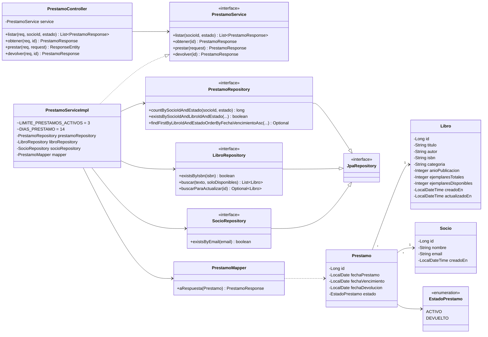
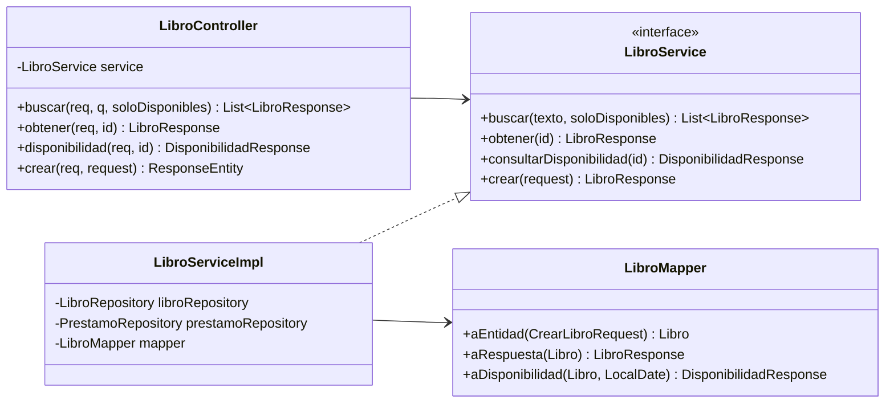
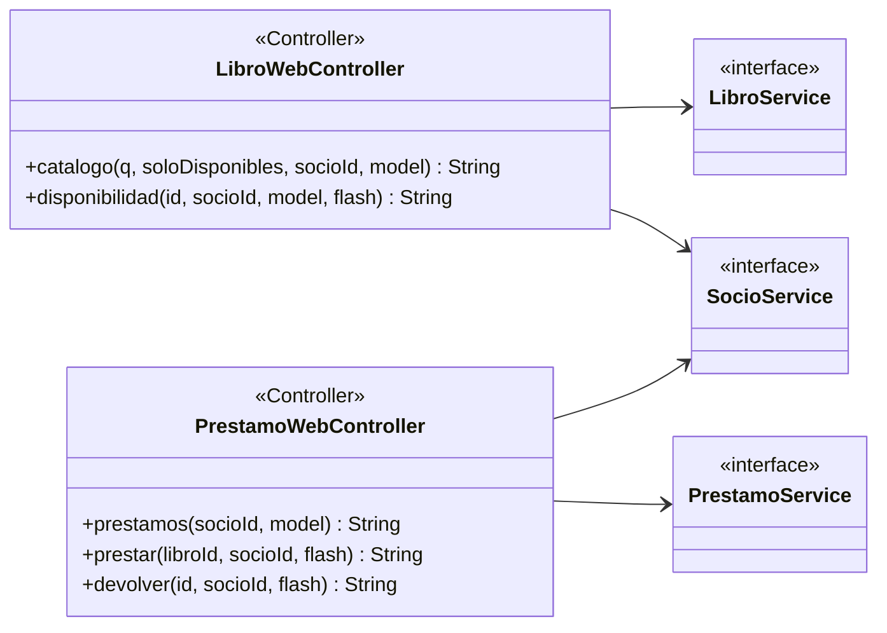
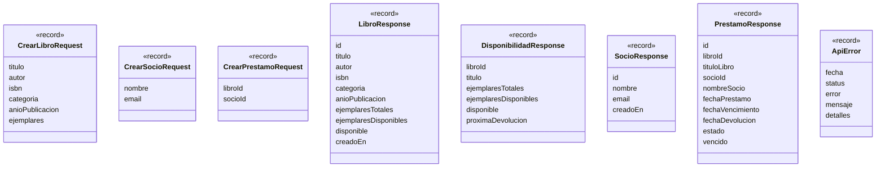
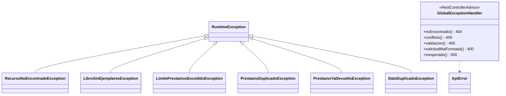

# 04 · UML de clases

Los diagramas están en Mermaid (en VS Code: extensión *Markdown Preview Mermaid Support*, `Ctrl+Shift+V`).

## Backend

Vista parcial centrada en **préstamos**. `LibroController`/`LibroService`/`LibroServiceImpl`/`LibroMapper` y `SocioController`/`SocioService`/`SocioServiceImpl`/`SocioMapper` siguen exactamente el mismo esquema controller → service (interface + impl) → repository + mapper.

## Controllers web (Thymeleaf, opcional)

Usan los **mismos services** que los controllers REST; devuelven el nombre de una plantilla (`libros`, `prestamos`, `disponibilidad`) o una redirección.

## DTO

## Excepciones

## Frontend (Angular)

```mermaid
classDiagram
    direction LR
    class App {
        -SociosStore socios
        +cambiarSocio(evento)
    }
    class CatalogoPage {
        -CatalogoStore store
        -PrestamosStore prestamos
        +consultar(libro)
        +prestar(libro)
        +guardar(request)
    }
    class PrestamosPage {
        -PrestamosStore store
        +devolver(prestamo)
    }
    class LibroCard {
        <<input>> libro, disponibilidad
        <<output>> prestar, consultar
    }
    class LibroForm {
        <<input>> guardando
        <<output>> guardar, cancelar
    }
    class PrestamoCard {
        <<input>> prestamo
        <<output>> devolver
    }
    class CatalogoStore {
        +libros signal
        +resumen computed
        +buscar()
        +cargar()
        +consultarDisponibilidad() Observable
        +crear() Observable
    }
    class PrestamosStore {
        +prestamos signal
        +activos computed
        +historial computed
        +resumen computed
        +cargar(socioId)
        +prestar() Observable
        +devolver() Observable
    }
    class SociosStore {
        +socios signal
        +socioActual computed
        +seleccionar(id)
    }
    class LibroApi
    class PrestamoApi
    class SocioApi
    class ToastService
    class errorInterceptor
    App --> SociosStore
    CatalogoPage --> CatalogoStore
    CatalogoPage --> PrestamosStore
    CatalogoPage --> SociosStore
    CatalogoPage *-- LibroCard
    CatalogoPage *-- LibroForm
    PrestamosPage --> PrestamosStore
    PrestamosPage *-- PrestamoCard
    CatalogoStore --> LibroApi
    PrestamosStore --> PrestamoApi
    SociosStore --> SocioApi
    CatalogoStore --> ToastService
    PrestamosStore --> ToastService
    LibroApi ..> errorInterceptor : HttpClient
```

