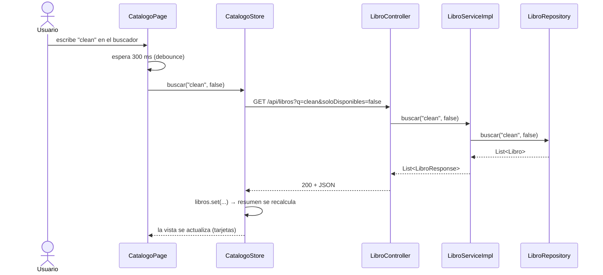
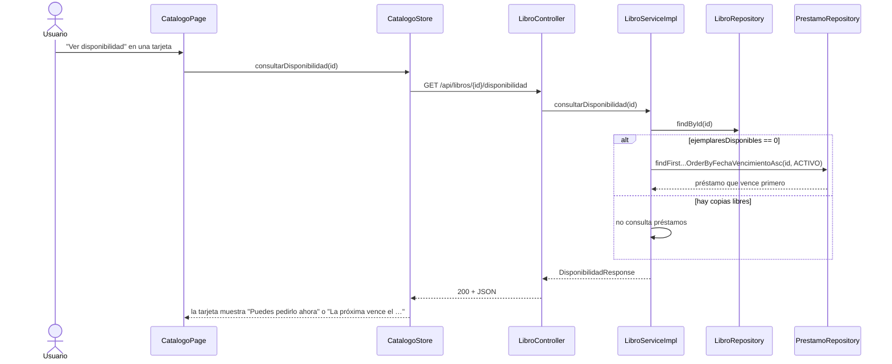
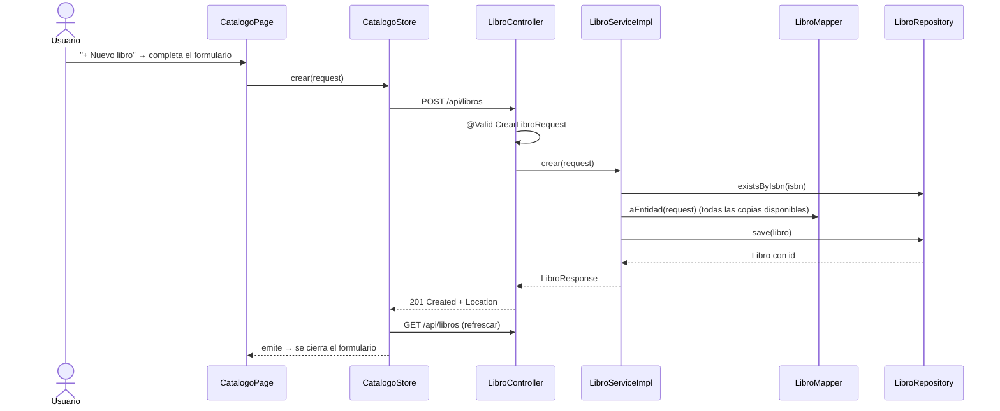
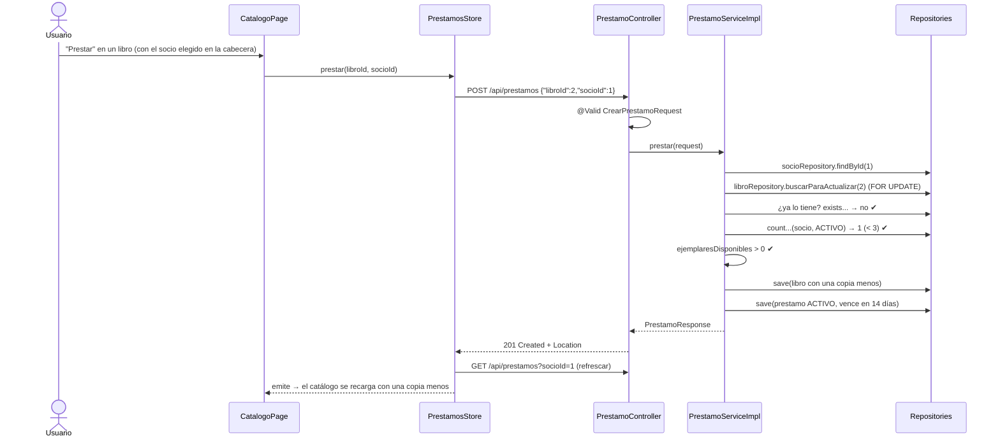
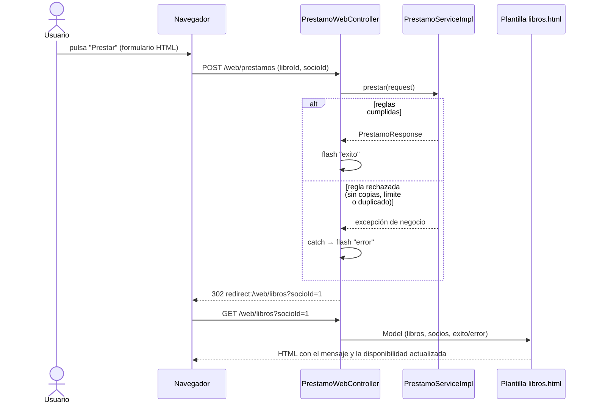
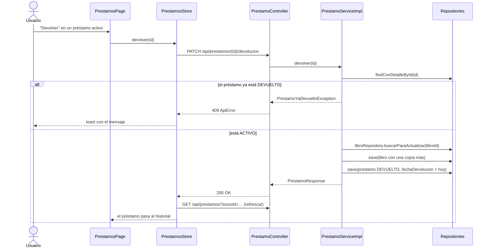
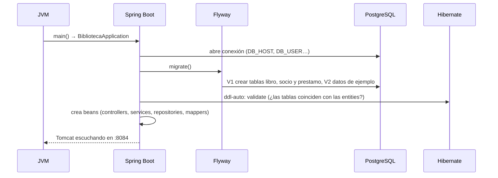

# 05 · UML de secuencia

Cada diagrama muestra **quién llama a quién y en qué orden**.

## 1. Buscar libros (cargar el catálogo)



## 2. Consultar disponibilidad



## 3. Agregar un libro



## 4. Realizar un préstamo — camino feliz



## 4B. Realizar un préstamo desde la vista Thymeleaf (opcional)



Post/Redirect/Get: tras el POST se responde con una redirección, por lo que refrescar la página no repite el préstamo. Las reglas son las mismas que en la API (secuencias 4 y 5).

## 5. Realizar un préstamo — rechazo con 409

```mermaid
sequenceDiagram
    actor U as Usuario
    participant P as CatalogoPage
    participant ST as PrestamosStore
    participant C as PrestamoController
    participant S as PrestamoServiceImpl
    participant R as Repositories
    participant H as GlobalExceptionHandler
    U->>P: "Prestar" un libro cuando el socio ya tiene 3 préstamos
    P->>ST: prestar(libroId, socioId)
    ST->>C: POST /api/prestamos
    C->>S: prestar(request)
    S->>R: findById + buscarParaActualizar
    S->>R: exists... → no
    S->>R: count...(socio, ACTIVO) → 3
    S->>S: warn "loan limit reached"
    S-->>C: LimitePrestamosExcedidoException
    C->>H: (Spring deriva la excepción)
    H-->>ST: 409 ApiError {mensaje: "El socio ya tiene el máximo de 3 préstamos activos…"}
    ST-->>U: toast de error; el catálogo no cambia
```

> El mismo camino (409) ocurre con `PrestamoDuplicadoException` (ya tiene ese libro) y con `LibroSinEjemplaresException` (no quedan copias).

## 6. Devolver un libro



## 7. Arranque del backend


