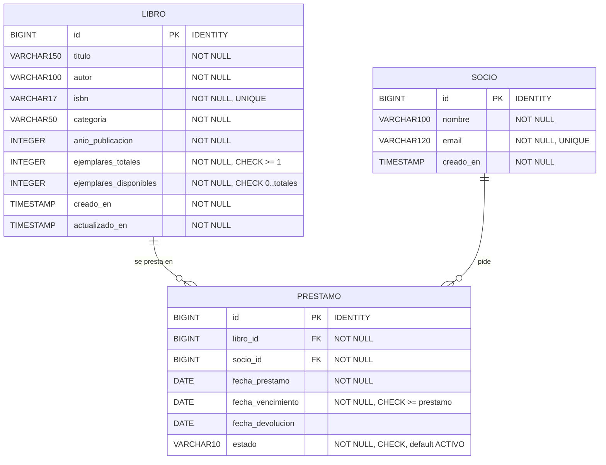

# 06 · Modelo de base de datos

Base `biblioteca_db` · usuario `biblioteca` · PostgreSQL 18. El esquema **lo crea Flyway**; Hibernate solo lo **valida** (`ddl-auto: validate`).

## Diagrama



Tres tablas: un **libro** puede estar en muchos préstamos, un **socio** puede tener muchos préstamos, y cada **préstamo** une exactamente un libro con un socio.

## Columnas y restricciones

### `libro`

| Columna | Tipo | Restricción | Para qué |
|---|---|---|---|
| `id` | `BIGINT GENERATED ALWAYS AS IDENTITY` | PRIMARY KEY | Identificador autogenerado |
| `titulo` | `VARCHAR(150)` | NOT NULL | Título del libro |
| `autor` | `VARCHAR(100)` | NOT NULL | Autor |
| `isbn` | `VARCHAR(17)` | NOT NULL, UNIQUE (`uq_libro_isbn`) | Identificador internacional; no se repite |
| `categoria` | `VARCHAR(50)` | NOT NULL | Para buscar y agrupar |
| `anio_publicacion` | `INTEGER` | NOT NULL | Año de publicación |
| `ejemplares_totales` | `INTEGER` | NOT NULL, `CHECK (>= 1)` | Copias que posee la biblioteca |
| `ejemplares_disponibles` | `INTEGER` | NOT NULL, `CHECK (BETWEEN 0 AND ejemplares_totales)` | Copias libres ahora |
| `creado_en`, `actualizado_en` | `TIMESTAMP` | NOT NULL, default `CURRENT_TIMESTAMP` | Auditoría |

### `socio`

| Columna | Tipo | Restricción | Para qué |
|---|---|---|---|
| `id` | `BIGINT GENERATED ALWAYS AS IDENTITY` | PRIMARY KEY | Identificador |
| `nombre` | `VARCHAR(100)` | NOT NULL | Nombre del socio |
| `email` | `VARCHAR(120)` | NOT NULL, UNIQUE (`uq_socio_email`) | Contacto; no se repite |
| `creado_en` | `TIMESTAMP` | NOT NULL, default `CURRENT_TIMESTAMP` | Auditoría |

### `prestamo`

| Columna | Tipo | Restricción | Para qué |
|---|---|---|---|
| `id` | `BIGINT GENERATED ALWAYS AS IDENTITY` | PRIMARY KEY | Identificador |
| `libro_id` | `BIGINT` | NOT NULL, FOREIGN KEY → `libro(id)` | Libro prestado |
| `socio_id` | `BIGINT` | NOT NULL, FOREIGN KEY → `socio(id)` | Quién lo tiene |
| `fecha_prestamo` | `DATE` | NOT NULL | Día en que se llevó el libro |
| `fecha_vencimiento` | `DATE` | NOT NULL, `CHECK (>= fecha_prestamo)` | Día límite de devolución |
| `fecha_devolucion` | `DATE` | — | `NULL` mientras esté activo |
| `estado` | `VARCHAR(10)` | NOT NULL, default `ACTIVO`, `CHECK (estado IN ('ACTIVO','DEVUELTO'))` | Estado del préstamo |

Índices: `idx_prestamo_socio_estado (socio_id, estado)` (contar y listar préstamos de un socio), `idx_prestamo_libro_estado (libro_id, estado)` (buscar el préstamo que vence primero) y el **índice único parcial** `uq_prestamo_activo (socio_id, libro_id) WHERE estado = 'ACTIVO'`.

> **¿Por qué `CHECK` si ya hay validaciones en Java?** Defensa en profundidad: aunque alguien inserte datos directo en la base, no puede dejar `ejemplares_disponibles` negativo ni mayor que los totales, ni guardar un estado inválido.
>
> **¿Qué hace el índice único parcial?** Impide que el mismo socio tenga **dos préstamos ACTIVOS del mismo libro**, pero permite que lo pida de nuevo cuando ya lo devolvió (los `DEVUELTO` no cuentan). Es la regla del service, repetida en la base.
>
> **¿Dónde viven el límite de 3 y el plazo de 14 días?** En el **service**, no en la base: son reglas de negocio que cambian más seguido que el esquema.

## Mapeo Java ↔ tabla

| Campo | Columna | Anotación |
|---|---|---|
| `Libro.id`, `Socio.id`, `Prestamo.id` | `id` | `@Id @GeneratedValue(IDENTITY)` |
| `Prestamo.estado` | `estado` | `@Enumerated(EnumType.STRING)` (se guarda el texto, no el número) |
| `Prestamo.libro` / `Prestamo.socio` | `libro_id` / `socio_id` | `@ManyToOne(fetch = LAZY)` + `@JoinColumn` |
| `Libro.anioPublicacion` | `anio_publicacion` | `@Column(name = "anio_publicacion")` |
| `Libro.ejemplaresDisponibles` | `ejemplares_disponibles` | `@Column(name = "ejemplares_disponibles")` |
| `creadoEn` | `creado_en` | `updatable = false`, llenado por `@PrePersist` |
| `Libro.actualizadoEn` | `actualizado_en` | actualizado por `@PreUpdate` |

## Migraciones Flyway

| Archivo | Contenido |
|---|---|
| `V1__crear_tablas_biblioteca.sql` | Crea las tres tablas, los `CHECK`, las claves foráneas y los índices |
| `V2__datos_iniciales.sql` | **6 libros, 3 socios y 3 préstamos de ejemplo** (uno vigente, uno vencido y uno devuelto) |

```text
src/main/resources/db/migration/
├── V1__crear_tablas_biblioteca.sql
└── V2__datos_iniciales.sql
```

Los datos de ejemplo están pensados para probar las reglas sin crear nada:

| Libro | Copias (libres/total) | Situación |
|---|---|---|
| 1 · Cien años de soledad | 3 / 3 | Todas libres (Camila ya lo devolvió) |
| 2 · Clean Code | 1 / 2 | Ana tiene una copia (vigente) |
| 3 · Don Quijote de la Mancha | **0 / 1** | **Agotado**: Luis lo tiene y su préstamo está **vencido** |
| 4 · Introducción a los algoritmos | 2 / 2 | Libres |
| 5 · La casa de los espíritus | 2 / 2 | Libres |
| 6 · Sapiens | 3 / 3 | Libres |

Flyway guarda lo ya aplicado en la tabla `flyway_schema_history` junto con un *checksum* de cada archivo.

> ⚠️ **Una migración ya aplicada NUNCA se edita.** Si cambias una letra, Flyway detecta el checksum distinto y el arranque falla. Los cambios van en un archivo **nuevo**: `V3__...sql`, `V4__...sql`…

Ejemplo de cambio futuro (agregar un campo `editorial`):

```sql
-- V3__agregar_editorial.sql
ALTER TABLE libro ADD COLUMN editorial VARCHAR(80);
```

## Usuario y permisos (PostgreSQL 15+)

Desde PostgreSQL 15 el esquema `public` no es escribible por cualquier usuario, por eso el script incluye `GRANT ALL ON SCHEMA public`:

```sql
CREATE USER biblioteca WITH PASSWORD 'biblioteca';
CREATE DATABASE biblioteca_db OWNER biblioteca;
\connect biblioteca_db
GRANT ALL ON SCHEMA public TO biblioteca;
```

(Está en `biblioteca-backend/crear-bd.sql`.)

## Consultas útiles

```sql
SELECT id, titulo, ejemplares_disponibles, ejemplares_totales FROM libro ORDER BY titulo;
SELECT p.id, l.titulo, s.nombre, p.fecha_vencimiento, p.estado
  FROM prestamo p JOIN libro l ON l.id = p.libro_id JOIN socio s ON s.id = p.socio_id ORDER BY p.id;
-- ¿el inventario cuadra? (debe devolver 0 filas)
SELECT l.id FROM libro l
 WHERE l.ejemplares_disponibles <>
       l.ejemplares_totales - (SELECT count(*) FROM prestamo p WHERE p.libro_id = l.id AND p.estado = 'ACTIVO');
SELECT version, description, success FROM flyway_schema_history;
```
