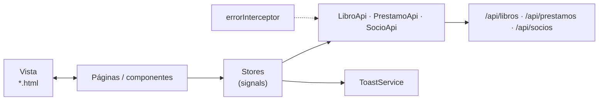

# 08 · Guía del frontend: Angular 21 paso a paso

> Angular 21 · standalone · zoneless · **signals** · Vitest · **sin librerías extra**.
> El proyecto terminado está en `biblioteca-frontend/`. Los bloques de código de esta guía se generan **directamente desde esos archivos**.

## Mapa

```text
src/app
├── core
│   ├── models        api-error.ts · libro.model.ts · socio.model.ts · prestamo.model.ts
│   ├── api           libro.api.ts · socio.api.ts · prestamo.api.ts
│   └── interceptors  error.interceptor.ts
├── shared
│   ├── ui            toast.service.ts · toast.ts
│   └── util          fechas.ts
├── features
│   ├── socios        socios.store.ts
│   ├── catalogo      catalogo.store.ts (+ spec) · pages/catalogo.page · components/libro-card · libro-form
│   └── prestamos     prestamos.store.ts (+ spec) · pages/prestamos.page · components/prestamo-card
├── app.config.ts · app.routes.ts · app.ts/html/css
proxy.conf.json
```



## Teoría previa

| Concepto | Qué es | Dónde se usa |
|---|---|---|
| **Componente standalone** | Componente que declara sus propios `imports`; no hay `NgModule` | Todos |
| **Signal** | Valor reactivo: `signal(0)`, se lee `x()`, se cambia `x.set()` | `libros`, `prestamos`, `socioActualId`… |
| **computed** | Signal derivada que se recalcula sola | `resumen`, `activos`, `historial`, `socioActual` |
| **effect** | Código que se ejecuta cuando cambian los signals que lee | `PrestamosPage` recarga al cambiar de socio |
| **Zoneless** | Angular no usa `zone.js`; la vista se actualiza cuando cambian signals | Toda la app |
| **Store / Facade** | Un servicio que concentra el estado y las operaciones | `CatalogoStore`, `PrestamosStore`, `SociosStore` |
| **Interceptor** | Función que ve toda petición/respuesta HTTP | `errorInterceptor` |
| **`input()` / `output()`** | Datos que entran / eventos que salen de un componente | `LibroCard`, `PrestamoCard`, `LibroForm` |
| **Formularios reactivos** | El formulario se define en TypeScript con `Validators` | `LibroForm`, buscador |

## Paso 1 · Proyecto, proxy y puertos

```powershell
cd biblioteca-frontend
npm install
npm start          # http://localhost:4201
```

El proxy reenvía `/api` al backend (puerto **8084**), así el front no depende de CORS. Está registrado en `angular.json` (`serve.options.proxyConfig`).

<!-- archivo: proxy.conf.json -->
```json
{
  "/api": {
    "target": "http://localhost:8084",
    "secure": false
  }
}
```

> `npm start` ejecuta `ng serve --port 4201`. Si el puerto está ocupado: `npx ng serve --port 4300` y agrega `http://localhost:4300` a `CORS_ORIGINS` solo si no usas el proxy.

## Paso 2 · Modelos (`core/models`)

Reflejan los DTO del backend. **Los códigos coinciden con los enums de Java.**

<!-- archivo: src/app/core/models/libro.model.ts -->
```typescript
/** Libro tal como lo entrega la API (GET /api/libros). Las fechas llegan como texto ISO. */
export interface Libro {
  id: number;
  titulo: string;
  autor: string;
  isbn: string;
  categoria: string;
  anioPublicacion: number;
  ejemplaresTotales: number;
  ejemplaresDisponibles: number;
  disponible: boolean;
  creadoEn: string;
}

/** Datos para agregar un libro (POST). Todas sus copias nacen disponibles. */
export interface LibroRequest {
  titulo: string;
  autor: string;
  isbn: string;
  categoria: string;
  anioPublicacion: number;
  ejemplares: number;
}

/** Respuesta de GET /api/libros/{id}/disponibilidad. */
export interface Disponibilidad {
  libroId: number;
  titulo: string;
  ejemplaresTotales: number;
  ejemplaresDisponibles: number;
  disponible: boolean;
  proximaDevolucion: string | null;
}

/** Reglas que el formulario repite para avisar antes de enviar (el backend las valida igual). */
export const REGLAS_LIBRO = {
  tituloMaxLargo: 150,
  autorMaxLargo: 100,
  categoriaMaxLargo: 50,
  isbnPatron: /^[0-9Xx-]{10,17}$/,
  anioMin: 1000,
  anioMax: 2100,
  ejemplaresMin: 1,
  ejemplaresMax: 100,
} as const;
```

<!-- archivo: src/app/core/models/socio.model.ts -->
```typescript
/** Persona inscrita en la biblioteca (GET /api/socios). */
export interface Socio {
  id: number;
  nombre: string;
  email: string;
  creadoEn: string;
}
```

<!-- archivo: src/app/core/models/prestamo.model.ts -->
```typescript
export type EstadoPrestamo = 'ACTIVO' | 'DEVUELTO';

/** Préstamo tal como lo entrega la API. "vencido" lo calcula el backend (ACTIVO con fecha ya pasada). */
export interface Prestamo {
  id: number;
  libroId: number;
  tituloLibro: string;
  socioId: number;
  nombreSocio: string;
  fechaPrestamo: string;
  fechaVencimiento: string;
  fechaDevolucion: string | null;
  estado: EstadoPrestamo;
  vencido: boolean;
}

/** Datos para prestar (POST): las fechas las calcula el servidor. */
export interface PrestamoRequest {
  libroId: number;
  socioId: number;
}

/** Máximo de préstamos activos por socio (el backend lo exige igual). */
export const LIMITE_PRESTAMOS_ACTIVOS = 3;

/** Días que dura un préstamo. */
export const DIAS_PRESTAMO = 14;
```

- `LIMITE_PRESTAMOS_ACTIVOS = 3` repite la regla del backend para **avisar visualmente**; el que manda es el servidor.
- `REGLAS_LIBRO` repite los máximos del DTO para el formulario.

<!-- archivo: src/app/core/models/api-error.ts -->
```typescript
/** Error ya traducido a un mensaje que la interfaz puede mostrar tal cual. */
export class ApiError extends Error {
  constructor(
    message: string,
    readonly status: number,
  ) {
    super(message);
    this.name = 'ApiError';
  }
}
```

## Paso 3 · API e interceptor (`core/api`, `core/interceptors`)

Cada `*Api` es **el único lugar que conoce las rutas HTTP** de su recurso:

<!-- archivo: src/app/core/api/libro.api.ts -->
```typescript
import { HttpClient, HttpParams } from '@angular/common/http';
import { Injectable, inject } from '@angular/core';
import { Observable } from 'rxjs';

import { Disponibilidad, Libro, LibroRequest } from '../models/libro.model';

/** Único lugar que conoce las rutas HTTP del catálogo (Spring Boot, /api/libros). */
@Injectable({ providedIn: 'root' })
export class LibroApi {
  private readonly http = inject(HttpClient);
  private readonly base = '/api/libros';

  buscar(texto: string, soloDisponibles: boolean): Observable<Libro[]> {
    let params = new HttpParams().set('soloDisponibles', soloDisponibles);
    if (texto.trim()) {
      params = params.set('q', texto.trim());
    }
    return this.http.get<Libro[]>(this.base, { params });
  }

  disponibilidad(id: number): Observable<Disponibilidad> {
    return this.http.get<Disponibilidad>(`${this.base}/${id}/disponibilidad`);
  }

  crear(request: LibroRequest): Observable<Libro> {
    return this.http.post<Libro>(this.base, request);
  }
}
```

`buscar` arma los parámetros con `HttpParams` (`q` solo si hay texto). Angular se encarga de codificar la URL.

<!-- archivo: src/app/core/api/prestamo.api.ts -->
```typescript
import { HttpClient, HttpParams } from '@angular/common/http';
import { Injectable, inject } from '@angular/core';
import { Observable } from 'rxjs';

import { Prestamo, PrestamoRequest } from '../models/prestamo.model';

/** Único lugar que conoce las rutas HTTP de los préstamos (Spring Boot, /api/prestamos). */
@Injectable({ providedIn: 'root' })
export class PrestamoApi {
  private readonly http = inject(HttpClient);
  private readonly base = '/api/prestamos';

  listarDeSocio(socioId: number): Observable<Prestamo[]> {
    return this.http.get<Prestamo[]>(this.base, { params: new HttpParams().set('socioId', socioId) });
  }

  prestar(request: PrestamoRequest): Observable<Prestamo> {
    return this.http.post<Prestamo>(this.base, request);
  }

  devolver(id: number): Observable<Prestamo> {
    return this.http.patch<Prestamo>(`${this.base}/${id}/devolucion`, null);
  }
}
```

Un `PATCH` a `/api/prestamos/{id}/devolucion` **sin cuerpo** (`null`) registra la devolución.

<!-- archivo: src/app/core/api/socio.api.ts -->
```typescript
import { HttpClient } from '@angular/common/http';
import { Injectable, inject } from '@angular/core';
import { Observable } from 'rxjs';

import { Socio } from '../models/socio.model';

@Injectable({ providedIn: 'root' })
export class SocioApi {
  private readonly http = inject(HttpClient);

  listar(): Observable<Socio[]> {
    return this.http.get<Socio[]>('/api/socios');
  }
}
```

El interceptor convierte cualquier error en un `ApiError` con **mensaje legible** (el `mensaje` y `detalles` que manda `ApiError.java`; o "No hay conexión…" si el backend está apagado):

<!-- archivo: src/app/core/interceptors/error.interceptor.ts -->
```typescript
import { HttpErrorResponse, HttpInterceptorFn } from '@angular/common/http';
import { catchError, throwError } from 'rxjs';

import { ApiError } from '../models/api-error';

/** Forma del error que responde el backend (ApiError.java). */
interface ProblemaHttp {
  mensaje?: string;
  detalles?: string[];
}

/** Convierte cualquier error HTTP en un ApiError con un mensaje legible. */
export const errorInterceptor: HttpInterceptorFn = (req, next) =>
  next(req).pipe(
    catchError((error: HttpErrorResponse) =>
      throwError(() => new ApiError(mensajeDe(error), error.status)),
    ),
  );

function mensajeDe(error: HttpErrorResponse): string {
  if (error.status === 0) {
    return 'No hay conexión con el servidor. ¿Está encendido el backend?';
  }
  const problema = error.error as ProblemaHttp | null;
  const detalles = problema?.detalles?.length ? ` (${problema.detalles.join('. ')})` : '';
  return problema?.mensaje ? `${problema.mensaje}${detalles}` : 'Ocurrió un error inesperado';
}
```

## Paso 4 · Avisos y utilidades (`shared`)

`ToastService` mantiene una lista de avisos en un signal; `Toast` los dibuja. Desaparecen solos a los 4 segundos.

<!-- archivo: src/app/shared/ui/toast.service.ts -->
```typescript
import { Injectable, signal } from '@angular/core';

export interface Aviso {
  id: number;
  tipo: 'exito' | 'error';
  mensaje: string;
}

const DURACION_MS = 4000;

@Injectable({ providedIn: 'root' })
export class ToastService {
  private siguienteId = 0;
  readonly avisos = signal<Aviso[]>([]);

  exito(mensaje: string): void {
    this.mostrar('exito', mensaje);
  }

  error(mensaje: string): void {
    this.mostrar('error', mensaje);
  }

  descartar(id: number): void {
    this.avisos.update((lista) => lista.filter((aviso) => aviso.id !== id));
  }

  private mostrar(tipo: Aviso['tipo'], mensaje: string): void {
    const id = ++this.siguienteId;
    this.avisos.update((lista) => [...lista, { id, tipo, mensaje }]);
    setTimeout(() => this.descartar(id), DURACION_MS);
  }
}
```

<!-- archivo: src/app/shared/ui/toast.ts -->
```typescript
import { Component, inject } from '@angular/core';

import { ToastService } from './toast.service';

@Component({
  selector: 'app-toast',
  template: `
    <div class="toasts" aria-live="polite">
      @for (aviso of toast.avisos(); track aviso.id) {
        <div class="toast" [class.toast-error]="aviso.tipo === 'error'">
          <span>{{ aviso.mensaje }}</span>
          <button type="button" class="toast-cerrar" aria-label="Cerrar aviso" (click)="toast.descartar(aviso.id)">✕</button>
        </div>
      }
    </div>
  `,
})
export class Toast {
  protected readonly toast = inject(ToastService);
}
```

`formatearFecha` **no usa `Date`** para mostrar fechas: así se evitan corrimientos de un día por zona horaria.

<!-- archivo: src/app/shared/util/fechas.ts -->
```typescript
/** "2026-10-31" -> "31-10-2026" (sin pasar por Date, para evitar corrimientos de zona horaria). */
export function formatearFecha(iso: string): string {
  const [anio, mes, dia] = iso.split('-');
  return `${dia}-${mes}-${anio}`;
}
```

## Paso 5 · Los Stores

Patrón **Store/Facade con signals**. Las páginas **leen** signals y **llaman** métodos; nunca hablan con la API.

### `SociosStore`: el socio activo

No hay login: quien usa el sistema elige en la cabecera con qué socio actúa. Los demás stores y páginas leen `socioActual`.

<!-- archivo: src/app/features/socios/socios.store.ts -->
```typescript
import { Injectable, computed, inject, signal } from '@angular/core';

import { SocioApi } from '../../core/api/socio.api';
import { ApiError } from '../../core/models/api-error';
import { Socio } from '../../core/models/socio.model';
import { ToastService } from '../../shared/ui/toast.service';

/**
 * Socios y "socio activo" (Store/Facade con signals). No hay login: quien usa el sistema
 * elige en la cabecera con qué socio actúa, y el catálogo y los préstamos leen esa elección.
 */
@Injectable({ providedIn: 'root' })
export class SociosStore {
  private readonly api = inject(SocioApi);
  private readonly toast = inject(ToastService);

  readonly socios = signal<Socio[]>([]);
  readonly socioActualId = signal<number | null>(null);

  readonly socioActual = computed(() => this.socios().find((s) => s.id === this.socioActualId()) ?? null);

  cargar(): void {
    this.api.listar().subscribe({
      next: (socios) => {
        this.socios.set(socios);
        if (this.socioActual() === null) {
          this.socioActualId.set(socios[0]?.id ?? null);
        }
      },
      error: (e: ApiError) => this.toast.error(e.message),
    });
  }

  seleccionar(id: number | null): void {
    this.socioActualId.set(id);
  }
}
```

### `CatalogoStore`: buscar, disponibilidad, agregar

<!-- archivo: src/app/features/catalogo/catalogo.store.ts -->
```typescript
import { Injectable, computed, inject, signal } from '@angular/core';
import { EMPTY, Observable, catchError, finalize, map, switchMap, tap } from 'rxjs';

import { LibroApi } from '../../core/api/libro.api';
import { ApiError } from '../../core/models/api-error';
import { Disponibilidad, Libro, LibroRequest } from '../../core/models/libro.model';
import { ToastService } from '../../shared/ui/toast.service';

/**
 * Estado del catálogo (patrón Store/Facade con signals).
 * Las páginas leen signals y llaman a métodos; nunca hablan con la API directamente.
 */
@Injectable({ providedIn: 'root' })
export class CatalogoStore {
  private readonly api = inject(LibroApi);
  private readonly toast = inject(ToastService);

  /** Libros que cumplen la búsqueda actual. */
  readonly libros = signal<Libro[]>([]);
  readonly cargando = signal(false);
  readonly error = signal<string | null>(null);

  /** Criterio de búsqueda vigente (la página lo cambia con buscar()). */
  readonly texto = signal('');
  readonly soloDisponibles = signal(false);

  /** Contadores del resultado. */
  readonly resumen = computed(() => {
    const libros = this.libros();
    const conCopias = libros.filter((l) => l.disponible).length;
    return { total: libros.length, conCopias, agotados: libros.length - conCopias };
  });

  /** Cambia el criterio y vuelve a consultar. */
  buscar(texto: string, soloDisponibles: boolean): void {
    this.texto.set(texto);
    this.soloDisponibles.set(soloDisponibles);
    this.cargar();
  }

  /** Vuelve a consultar con el criterio vigente. */
  cargar(): void {
    this.cargando.set(true);
    this.error.set(null);
    this.refrescar()
      .pipe(finalize(() => this.cargando.set(false)))
      .subscribe({ error: (e: ApiError) => this.error.set(e.message) });
  }

  /** Cuántas copias hay y cuándo vuelve la próxima. Emite solo si salió bien. */
  consultarDisponibilidad(id: number): Observable<Disponibilidad> {
    return this.api.disponibilidad(id).pipe(catchError(this.fallar));
  }

  /** Agrega un libro y refresca la lista. Emite solo si salió bien (la pantalla cierra el formulario). */
  crear(request: LibroRequest): Observable<void> {
    return this.api.crear(request).pipe(
      switchMap(() => this.refrescar()),
      tap(() => this.toast.exito('Libro agregado al catálogo')),
      catchError(this.fallar),
    );
  }

  private refrescar(): Observable<void> {
    return this.api.buscar(this.texto(), this.soloDisponibles()).pipe(
      tap((libros) => this.libros.set(libros)),
      map(() => undefined),
    );
  }

  /** Muestra el error y corta el flujo: el Observable termina sin emitir. */
  private readonly fallar = (error: ApiError): Observable<never> => {
    this.toast.error(error.message);
    return EMPTY;
  };
}
```

| Pieza | Tipo | Para qué |
|---|---|---|
| `libros` | `signal` | Libros que cumplen la búsqueda actual |
| `texto`, `soloDisponibles` | `signal` | El criterio vigente |
| `resumen` | `computed` | `total`, `conCopias` y `agotados` |
| `buscar / cargar` | métodos | Cambian el criterio y consultan |
| `consultarDisponibilidad / crear` | `Observable` | Llaman a la API y **emiten solo si salió bien** |
| `fallar` | función | Muestra el error en un toast y **corta** el flujo con `EMPTY` |

### `PrestamosStore`: prestar y devolver

<!-- archivo: src/app/features/prestamos/prestamos.store.ts -->
```typescript
import { Injectable, computed, inject, signal } from '@angular/core';
import { EMPTY, Observable, catchError, finalize, map, switchMap, tap } from 'rxjs';

import { PrestamoApi } from '../../core/api/prestamo.api';
import { ApiError } from '../../core/models/api-error';
import { LIMITE_PRESTAMOS_ACTIVOS, Prestamo } from '../../core/models/prestamo.model';
import { ToastService } from '../../shared/ui/toast.service';

/**
 * Préstamos del socio activo (patrón Store/Facade con signals).
 * Los métodos de escritura devuelven Observable<void> y refrescan la lista.
 */
@Injectable({ providedIn: 'root' })
export class PrestamosStore {
  private readonly api = inject(PrestamoApi);
  private readonly toast = inject(ToastService);

  /** Todos los préstamos (activos e historial) del socio cuya lista se cargó. */
  readonly prestamos = signal<Prestamo[]>([]);
  readonly cargando = signal(false);
  readonly error = signal<string | null>(null);

  private socioId: number | null = null;

  readonly activos = computed(() => this.prestamos().filter((p) => p.estado === 'ACTIVO'));
  readonly historial = computed(() => this.prestamos().filter((p) => p.estado === 'DEVUELTO'));

  /** Contadores y si el socio llegó al límite de préstamos activos. */
  readonly resumen = computed(() => {
    const activos = this.activos();
    return {
      activos: activos.length,
      vencidos: activos.filter((p) => p.vencido).length,
      devueltos: this.historial().length,
      limiteAlcanzado: activos.length >= LIMITE_PRESTAMOS_ACTIVOS,
    };
  });

  /** Carga los préstamos de un socio. */
  cargar(socioId: number): void {
    this.socioId = socioId;
    this.cargando.set(true);
    this.error.set(null);
    this.refrescar()
      .pipe(finalize(() => this.cargando.set(false)))
      .subscribe({ error: (e: ApiError) => this.error.set(e.message) });
  }

  /** Presta un libro. Las reglas (copias, límite de 3, duplicado) las valida el backend. */
  prestar(libroId: number, socioId: number): Observable<void> {
    return this.api.prestar({ libroId, socioId }).pipe(
      tap(() => (this.socioId = socioId)),
      switchMap(() => this.refrescar()),
      tap(() => this.toast.exito('Préstamo realizado')),
      catchError(this.fallar),
    );
  }

  devolver(id: number): Observable<void> {
    return this.api.devolver(id).pipe(
      switchMap(() => this.refrescar()),
      tap(() => this.toast.exito('Devolución registrada')),
      catchError(this.fallar),
    );
  }

  /** Vuelve a pedir la lista del socio al servidor. */
  private refrescar(): Observable<void> {
    if (this.socioId === null) {
      return EMPTY;
    }
    return this.api.listarDeSocio(this.socioId).pipe(
      tap((prestamos) => this.prestamos.set(prestamos)),
      map(() => undefined),
    );
  }

  /** Muestra el error y corta el flujo: el Observable termina sin emitir. */
  private readonly fallar = (error: ApiError): Observable<never> => {
    this.toast.error(error.message);
    return EMPTY;
  };
}
```

| Pieza | Tipo | Para qué |
|---|---|---|
| `prestamos` | `signal` | Todos los préstamos del socio (activos e historial) |
| `activos`, `historial` | `computed` | Separan por `estado` |
| `resumen` | `computed` | `activos`, `vencidos`, `devueltos` y `limiteAlcanzado` (≥ 3) |
| `prestar / devolver` | `Observable<void>` | Llaman a la API, **refrescan la lista** y emiten **solo si salió bien** |

> **Por qué `Observable<void>` que emite solo en éxito:** la página cierra el formulario o recarga el catálogo dentro del `subscribe(next)`. Si el servidor rechaza (p. ej. **409** por límite o por falta de copias), no emite: el usuario ve el toast y la pantalla queda como estaba.

### Pruebas de los stores (Vitest + `HttpTestingController`)

<!-- archivo: src/app/features/catalogo/catalogo.store.spec.ts -->
```typescript
import { TestBed } from '@angular/core/testing';
import { provideHttpClient, withInterceptors } from '@angular/common/http';
import { HttpTestingController, provideHttpClientTesting } from '@angular/common/http/testing';

import { errorInterceptor } from '../../core/interceptors/error.interceptor';
import { Libro } from '../../core/models/libro.model';
import { CatalogoStore } from './catalogo.store';

const ahora = '2026-10-15T10:00:00';
function libro(id: number, disponibles: number): Libro {
  return {
    id, titulo: `Libro ${id}`, autor: 'Autor', isbn: '978-0132350884', categoria: 'Novela',
    anioPublicacion: 2000, ejemplaresTotales: 3, ejemplaresDisponibles: disponibles,
    disponible: disponibles > 0, creadoEn: ahora,
  };
}

describe('CatalogoStore', () => {
  let store: CatalogoStore;
  let http: HttpTestingController;

  beforeEach(() => {
    TestBed.configureTestingModule({
      providers: [provideHttpClient(withInterceptors([errorInterceptor])), provideHttpClientTesting()],
    });
    store = TestBed.inject(CatalogoStore);
    http = TestBed.inject(HttpTestingController);
  });

  afterEach(() => http.verify());

  const peticionLibros = () => http.expectOne((r) => r.url === '/api/libros' && r.method === 'GET');

  it('carga el catálogo completo', () => {
    store.cargar();
    expect(store.cargando()).toBe(true);

    const req = peticionLibros();
    expect(req.request.params.has('q')).toBe(false);
    expect(req.request.params.get('soloDisponibles')).toBe('false');
    req.flush([libro(1, 2)]);

    expect(store.libros().length).toBe(1);
    expect(store.cargando()).toBe(false);
  });

  it('busca por texto y manda los filtros al servidor', () => {
    store.buscar('  clean ', true);

    const req = peticionLibros();
    expect(req.request.params.get('q')).toBe('clean');
    expect(req.request.params.get('soloDisponibles')).toBe('true');
    req.flush([libro(2, 1)]);

    expect(store.libros()[0].id).toBe(2);
    expect(store.texto()).toBe('  clean ');
  });

  it('calcula cuántos libros tienen copias y cuántos están agotados', () => {
    store.cargar();
    peticionLibros().flush([libro(1, 2), libro(2, 0), libro(3, 0)]);

    expect(store.resumen()).toEqual({ total: 3, conCopias: 1, agotados: 2 });
  });

  it('guarda el mensaje si el servidor no responde', () => {
    store.cargar();
    peticionLibros().error(new ProgressEvent('error'), { status: 0 });

    expect(store.error()).toContain('No hay conexión');
    expect(store.cargando()).toBe(false);
  });

  it('consulta la disponibilidad de un libro', () => {
    let recibida: number | null = null;

    store.consultarDisponibilidad(3).subscribe((d) => (recibida = d.ejemplaresDisponibles));

    http.expectOne('/api/libros/3/disponibilidad').flush({
      libroId: 3, titulo: 'Libro 3', ejemplaresTotales: 1, ejemplaresDisponibles: 0,
      disponible: false, proximaDevolucion: '2026-11-05',
    });

    expect(recibida).toBe(0);
  });

  it('crea con POST y recarga la lista', () => {
    let terminado = false;

    store
      .crear({ titulo: 'Nuevo', autor: 'A', isbn: '978-0132350884', categoria: 'Novela', anioPublicacion: 2020, ejemplares: 2 })
      .subscribe(() => (terminado = true));

    const post = http.expectOne('/api/libros');
    expect(post.request.method).toBe('POST');
    post.flush(libro(9, 2));
    peticionLibros().flush([libro(9, 2)]);

    expect(terminado).toBe(true);
    expect(store.libros().length).toBe(1);
  });

  it('si el servidor rechaza el ISBN repetido (409) no emite', () => {
    let terminado = false;

    store
      .crear({ titulo: 'Nuevo', autor: 'A', isbn: '978-0132350884', categoria: 'Novela', anioPublicacion: 2020, ejemplares: 2 })
      .subscribe(() => (terminado = true));

    http
      .expectOne('/api/libros')
      .flush({ mensaje: 'Ya existe un registro con ISBN 978-0132350884' }, { status: 409, statusText: 'Conflict' });

    expect(terminado).toBe(false);
  });
});
```

<!-- archivo: src/app/features/prestamos/prestamos.store.spec.ts -->
```typescript
import { TestBed } from '@angular/core/testing';
import { provideHttpClient, withInterceptors } from '@angular/common/http';
import { HttpTestingController, provideHttpClientTesting } from '@angular/common/http/testing';

import { errorInterceptor } from '../../core/interceptors/error.interceptor';
import { Prestamo } from '../../core/models/prestamo.model';
import { PrestamosStore } from './prestamos.store';

function prestamo(id: number, estado: Prestamo['estado'], vencido = false): Prestamo {
  return {
    id, libroId: id, tituloLibro: `Libro ${id}`, socioId: 1, nombreSocio: 'Ana Pérez',
    fechaPrestamo: '2026-10-01', fechaVencimiento: '2026-10-15',
    fechaDevolucion: estado === 'DEVUELTO' ? '2026-10-10' : null, estado, vencido,
  };
}

describe('PrestamosStore', () => {
  let store: PrestamosStore;
  let http: HttpTestingController;

  beforeEach(() => {
    TestBed.configureTestingModule({
      providers: [provideHttpClient(withInterceptors([errorInterceptor])), provideHttpClientTesting()],
    });
    store = TestBed.inject(PrestamosStore);
    http = TestBed.inject(HttpTestingController);
  });

  afterEach(() => http.verify());

  const listaDelSocio = () => http.expectOne((r) => r.url === '/api/prestamos' && r.method === 'GET');

  function cargarDatos(prestamos: Prestamo[]): void {
    store.cargar(1);
    listaDelSocio().flush(prestamos);
  }

  it('carga los préstamos del socio pidiendo solo los suyos', () => {
    store.cargar(1);
    expect(store.cargando()).toBe(true);

    const req = listaDelSocio();
    expect(req.request.params.get('socioId')).toBe('1');
    req.flush([prestamo(1, 'ACTIVO')]);

    expect(store.prestamos().length).toBe(1);
    expect(store.cargando()).toBe(false);
  });

  it('separa los préstamos activos del historial y cuenta los vencidos', () => {
    cargarDatos([prestamo(1, 'ACTIVO'), prestamo(2, 'ACTIVO', true), prestamo(3, 'DEVUELTO')]);

    expect(store.activos().map((p) => p.id)).toEqual([1, 2]);
    expect(store.historial().map((p) => p.id)).toEqual([3]);
    expect(store.resumen()).toEqual({ activos: 2, vencidos: 1, devueltos: 1, limiteAlcanzado: false });
  });

  it('avisa cuando el socio llega al límite de 3 préstamos activos', () => {
    cargarDatos([prestamo(1, 'ACTIVO'), prestamo(2, 'ACTIVO'), prestamo(3, 'ACTIVO')]);

    expect(store.resumen().limiteAlcanzado).toBe(true);
  });

  it('guarda el mensaje si el servidor no responde', () => {
    store.cargar(1);
    listaDelSocio().error(new ProgressEvent('error'), { status: 0 });

    expect(store.error()).toContain('No hay conexión');
    expect(store.cargando()).toBe(false);
  });

  it('presta con POST y recarga los préstamos del socio', () => {
    cargarDatos([]);
    let terminado = false;

    store.prestar(5, 1).subscribe(() => (terminado = true));

    const post = http.expectOne('/api/prestamos');
    expect(post.request.method).toBe('POST');
    expect(post.request.body).toEqual({ libroId: 5, socioId: 1 });
    post.flush(prestamo(7, 'ACTIVO'));
    listaDelSocio().flush([prestamo(7, 'ACTIVO')]);

    expect(terminado).toBe(true);
    expect(store.activos().length).toBe(1);
  });

  it('si el servidor rechaza el préstamo (409) no emite y deja la lista igual', () => {
    cargarDatos([prestamo(1, 'ACTIVO')]);
    let terminado = false;

    store.prestar(5, 1).subscribe(() => (terminado = true));

    http
      .expectOne('/api/prestamos')
      .flush({ mensaje: 'No quedan ejemplares disponibles' }, { status: 409, statusText: 'Conflict' });

    expect(terminado).toBe(false);
    expect(store.prestamos().length).toBe(1);
  });

  it('devuelve con PATCH y recarga: el préstamo pasa al historial', () => {
    cargarDatos([prestamo(1, 'ACTIVO')]);

    store.devolver(1).subscribe();

    const patch = http.expectOne('/api/prestamos/1/devolucion');
    expect(patch.request.method).toBe('PATCH');
    patch.flush(prestamo(1, 'DEVUELTO'));
    listaDelSocio().flush([prestamo(1, 'DEVUELTO')]);

    expect(store.activos().length).toBe(0);
    expect(store.historial().length).toBe(1);
  });
});
```

```powershell
npx ng test --watch=false     # 14 pruebas en verde
```

## Paso 6 · La tarjeta del libro (`libro-card`)

Componente **presentacional**: recibe el libro por `input()` y avisa con `output()`. No conoce los stores.

<!-- archivo: src/app/features/catalogo/components/libro-card/libro-card.ts -->
```typescript
import { ChangeDetectionStrategy, Component, computed, input, output } from '@angular/core';

import { Disponibilidad, Libro } from '../../../../core/models/libro.model';
import { formatearFecha } from '../../../../shared/util/fechas';

/** Tarjeta de un libro. Componente presentacional: recibe datos y avisa con eventos. */
@Component({
  selector: 'app-libro-card',
  changeDetection: ChangeDetectionStrategy.OnPush,
  templateUrl: './libro-card.html',
  styleUrl: './libro-card.css',
})
export class LibroCard {
  readonly libro = input.required<Libro>();
  /** Resultado de "Ver disponibilidad" (null mientras no se consulta). */
  readonly disponibilidad = input<Disponibilidad | null>(null);
  /** Si hay un socio elegido que puede pedir prestado (el backend valida las reglas igual). */
  readonly puedePrestar = input(false);
  readonly ocupado = input(false);

  readonly prestar = output<Libro>();
  readonly consultar = output<Libro>();

  protected readonly proxima = computed(() => {
    const iso = this.disponibilidad()?.proximaDevolucion;
    return iso ? formatearFecha(iso) : null;
  });
}
```

<!-- archivo: src/app/features/catalogo/components/libro-card/libro-card.html -->
```html
<article class="tarjeta" [class.agotado]="!libro().disponible">
  <header class="cabecera">
    <span class="chip chip-neutro">{{ libro().categoria }}</span>
    <h3 class="titulo">{{ libro().titulo }}</h3>
    <p class="autor">{{ libro().autor }} · {{ libro().anioPublicacion }}</p>
  </header>

  <p class="isbn">ISBN {{ libro().isbn }}</p>

  <div class="estado">
    @if (libro().disponible) {
      <span class="chip chip-ok">{{ libro().ejemplaresDisponibles }} de {{ libro().ejemplaresTotales }} disponibles</span>
    } @else {
      <span class="chip chip-alerta">Agotado · 0 de {{ libro().ejemplaresTotales }}</span>
    }
  </div>

  @if (disponibilidad(); as d) {
    <p class="detalle" role="status">
      @if (d.disponible) {
        Puedes pedirlo ahora: quedan {{ d.ejemplaresDisponibles }} copia(s).
      } @else if (proxima(); as fecha) {
        Todas las copias están prestadas. La próxima vence el {{ fecha }}.
      } @else {
        Todas las copias están prestadas.
      }
    </p>
  }

  <footer class="acciones">
    <button type="button" class="btn btn-chico" (click)="consultar.emit(libro())">Ver disponibilidad</button>
    <button type="button" class="btn btn-chico btn-primario"
      [disabled]="!libro().disponible || !puedePrestar() || ocupado()"
      [title]="!puedePrestar() ? 'Elige un socio en la cabecera' : !libro().disponible ? 'No quedan copias' : 'Prestar este libro'"
      (click)="prestar.emit(libro())">Prestar</button>
  </footer>
</article>
```

- Muestra **título, autor, categoría, ISBN** y un chip de **disponibilidad**: verde `2 de 3 disponibles` o rojo `Agotado`.
- **Ver disponibilidad** emite `consultar`; la página guarda el resultado y la tarjeta muestra `La próxima vence el …` si no quedan copias.
- **Prestar** se deshabilita si no hay copias, si no hay socio elegido o mientras se procesa (evita doble clic). El título del botón explica por qué.

<!-- archivo: src/app/features/catalogo/components/libro-card/libro-card.css -->
```css
:host { display: block; }

.tarjeta {
  background: var(--superficie); border: 1px solid var(--borde); border-radius: .8rem;
  padding: .9rem 1rem; display: grid; gap: .55rem; height: 100%; align-content: start;
  box-shadow: 0 2px 8px rgb(60 50 20 / .08);
}
.tarjeta.agotado { background: #faf6ee; }

.cabecera { display: grid; gap: .3rem; justify-items: start; }
.titulo { margin: 0; font-size: 1.05rem; font-weight: 700; overflow-wrap: anywhere; }
.autor { margin: 0; font-size: .88rem; color: var(--texto-suave); }
.isbn { margin: 0; font-size: .78rem; color: var(--texto-suave); font-variant-numeric: tabular-nums; }

.detalle { margin: 0; font-size: .85rem; padding: .45rem .6rem; border-radius: .5rem; background: var(--aviso-fondo); color: var(--aviso-texto); }

.acciones {
  display: flex; justify-content: space-between; align-items: center; gap: .4rem; flex-wrap: wrap;
  padding-top: .6rem; border-top: 1px solid var(--borde);
}
```

## Paso 7 · El formulario de libro (`libro-form`)

Formulario reactivo en un diálogo. Las validaciones **reflejan las del DTO**: título, autor y categoría obligatorios; ISBN con patrón; año entre 1000 y 2100; ejemplares entre 1 y 100.

<!-- archivo: src/app/features/catalogo/components/libro-form/libro-form.ts -->
```typescript
import { ChangeDetectionStrategy, Component, inject, input, output } from '@angular/core';
import { FormBuilder, ReactiveFormsModule, Validators } from '@angular/forms';

import { LibroRequest, REGLAS_LIBRO } from '../../../../core/models/libro.model';

/** Formulario (en un diálogo) para agregar un libro. Las validaciones repiten las del DTO del backend. */
@Component({
  selector: 'app-libro-form',
  changeDetection: ChangeDetectionStrategy.OnPush,
  imports: [ReactiveFormsModule],
  templateUrl: './libro-form.html',
  styleUrl: './libro-form.css',
})
export class LibroForm {
  private readonly fb = inject(FormBuilder).nonNullable;

  readonly guardando = input(false);

  readonly guardar = output<LibroRequest>();
  readonly cancelar = output<void>();

  protected readonly reglas = REGLAS_LIBRO;

  protected readonly form = this.fb.group({
    titulo: ['', [Validators.required, Validators.pattern(/\S/), Validators.maxLength(REGLAS_LIBRO.tituloMaxLargo)]],
    autor: ['', [Validators.required, Validators.pattern(/\S/), Validators.maxLength(REGLAS_LIBRO.autorMaxLargo)]],
    isbn: ['', [Validators.required, Validators.pattern(REGLAS_LIBRO.isbnPatron)]],
    categoria: ['', [Validators.required, Validators.pattern(/\S/), Validators.maxLength(REGLAS_LIBRO.categoriaMaxLargo)]],
    anioPublicacion: [
      new Date().getFullYear(),
      [Validators.required, Validators.min(REGLAS_LIBRO.anioMin), Validators.max(REGLAS_LIBRO.anioMax)],
    ],
    ejemplares: [
      1,
      [Validators.required, Validators.min(REGLAS_LIBRO.ejemplaresMin), Validators.max(REGLAS_LIBRO.ejemplaresMax)],
    ],
  });

  protected enviar(): void {
    if (this.form.invalid) {
      this.form.markAllAsTouched();
      return;
    }
    const v = this.form.getRawValue();
    this.guardar.emit({
      titulo: v.titulo.trim(),
      autor: v.autor.trim(),
      isbn: v.isbn.trim(),
      categoria: v.categoria.trim(),
      anioPublicacion: Number(v.anioPublicacion),
      ejemplares: Number(v.ejemplares),
    });
  }
}
```

<!-- archivo: src/app/features/catalogo/components/libro-form/libro-form.html -->
```html
<div class="fondo" (click)="cancelar.emit()">
  <form class="dialogo" [formGroup]="form" (ngSubmit)="enviar()" (click)="$event.stopPropagation()"
    role="dialog" aria-modal="true" aria-labelledby="titulo-dialogo">
    <h2 id="titulo-dialogo">Nuevo libro</h2>

    <label class="grupo">
      <span>Título *</span>
      <input class="campo" formControlName="titulo" [maxlength]="reglas.tituloMaxLargo" autofocus />
      @if (form.controls.titulo.touched && form.controls.titulo.invalid) {
        <small class="error">El título es obligatorio (máx. {{ reglas.tituloMaxLargo }} caracteres)</small>
      }
    </label>

    <label class="grupo">
      <span>Autor *</span>
      <input class="campo" formControlName="autor" [maxlength]="reglas.autorMaxLargo" />
      @if (form.controls.autor.touched && form.controls.autor.invalid) {
        <small class="error">El autor es obligatorio (máx. {{ reglas.autorMaxLargo }} caracteres)</small>
      }
    </label>

    <div class="fila">
      <label class="grupo">
        <span>ISBN *</span>
        <input class="campo" formControlName="isbn" placeholder="978-0132350884" maxlength="17" />
        @if (form.controls.isbn.touched && form.controls.isbn.invalid) {
          <small class="error">Entre 10 y 17 dígitos o guiones</small>
        }
      </label>
      <label class="grupo">
        <span>Categoría *</span>
        <input class="campo" formControlName="categoria" [maxlength]="reglas.categoriaMaxLargo" />
        @if (form.controls.categoria.touched && form.controls.categoria.invalid) {
          <small class="error">La categoría es obligatoria</small>
        }
      </label>
    </div>

    <div class="fila">
      <label class="grupo">
        <span>Año de publicación *</span>
        <input class="campo" type="number" formControlName="anioPublicacion" [min]="reglas.anioMin" [max]="reglas.anioMax" />
        @if (form.controls.anioPublicacion.touched && form.controls.anioPublicacion.invalid) {
          <small class="error">Entre {{ reglas.anioMin }} y {{ reglas.anioMax }}</small>
        }
      </label>
      <label class="grupo">
        <span>Ejemplares *</span>
        <input class="campo" type="number" formControlName="ejemplares" [min]="reglas.ejemplaresMin" [max]="reglas.ejemplaresMax" />
        @if (form.controls.ejemplares.touched && form.controls.ejemplares.invalid) {
          <small class="error">Entre {{ reglas.ejemplaresMin }} y {{ reglas.ejemplaresMax }}</small>
        }
      </label>
    </div>

    <div class="acciones">
      <button type="button" class="btn" (click)="cancelar.emit()">Cancelar</button>
      <button type="submit" class="btn btn-primario" [disabled]="guardando()">
        {{ guardando() ? 'Guardando…' : 'Guardar' }}
      </button>
    </div>
  </form>
</div>
```

- `Validators.required` + `Validators.pattern(/\S/)` rechazan un título de solo espacios (como `@NotBlank`).
- `form.markAllAsTouched()` hace aparecer los mensajes si se intenta guardar un formulario inválido.

## Paso 8 · La página del catálogo (`pages/catalogo.page`)

<!-- archivo: src/app/features/catalogo/pages/catalogo.page.ts -->
```typescript
import { ChangeDetectionStrategy, Component, DestroyRef, OnInit, inject, signal } from '@angular/core';
import { takeUntilDestroyed } from '@angular/core/rxjs-interop';
import { FormControl, ReactiveFormsModule } from '@angular/forms';
import { debounceTime, merge } from 'rxjs';

import { Disponibilidad, Libro, LibroRequest } from '../../../core/models/libro.model';
import { PrestamosStore } from '../../prestamos/prestamos.store';
import { SociosStore } from '../../socios/socios.store';
import { CatalogoStore } from '../catalogo.store';
import { LibroCard } from '../components/libro-card/libro-card';
import { LibroForm } from '../components/libro-form/libro-form';

/** Pantalla principal: buscar libros, ver su disponibilidad y prestarlos. Solo habla con los stores. */
@Component({
  selector: 'app-catalogo-page',
  changeDetection: ChangeDetectionStrategy.OnPush,
  imports: [ReactiveFormsModule, LibroCard, LibroForm],
  templateUrl: './catalogo.page.html',
  styleUrl: './catalogo.page.css',
})
export class CatalogoPage implements OnInit {
  protected readonly store = inject(CatalogoStore);
  protected readonly socios = inject(SociosStore);
  private readonly prestamos = inject(PrestamosStore);
  private readonly destroyRef = inject(DestroyRef);

  protected readonly busqueda = new FormControl('', { nonNullable: true });
  protected readonly soloDisponibles = new FormControl(false, { nonNullable: true });

  protected readonly formularioAbierto = signal(false);
  protected readonly guardando = signal(false);
  /** Libro que se está prestando en este momento (evita doble clic). */
  protected readonly prestandoId = signal<number | null>(null);
  /** Última disponibilidad consultada por libro. */
  protected readonly disponibilidades = signal<Partial<Record<number, Disponibilidad>>>({});

  ngOnInit(): void {
    this.store.cargar();
    // la búsqueda espera 300 ms tras dejar de escribir; el filtro de disponibles consulta de inmediato
    merge(this.busqueda.valueChanges.pipe(debounceTime(300)), this.soloDisponibles.valueChanges)
      .pipe(takeUntilDestroyed(this.destroyRef))
      .subscribe(() => this.store.buscar(this.busqueda.value, this.soloDisponibles.value));
  }

  protected limpiar(): void {
    this.busqueda.setValue('', { emitEvent: false });
    this.soloDisponibles.setValue(false, { emitEvent: false });
    this.store.buscar('', false);
  }

  protected consultar(libro: Libro): void {
    this.store.consultarDisponibilidad(libro.id).subscribe((d) => {
      this.disponibilidades.update((actual) => ({ ...actual, [libro.id]: d }));
    });
  }

  protected prestar(libro: Libro): void {
    const socio = this.socios.socioActual();
    if (!socio) {
      return;
    }
    this.prestandoId.set(libro.id);
    this.prestamos.prestar(libro.id, socio.id).subscribe({
      next: () => {
        this.limpiarDisponibilidad(libro.id);
        this.store.cargar();
      },
      complete: () => this.prestandoId.set(null),
    });
  }

  protected guardar(request: LibroRequest): void {
    this.guardando.set(true);
    this.store.crear(request).subscribe({
      next: () => this.formularioAbierto.set(false),
      complete: () => this.guardando.set(false),
    });
  }

  private limpiarDisponibilidad(id: number): void {
    this.disponibilidades.update(({ [id]: _descartada, ...resto }) => resto);
  }
}
```

- El **buscador** es un `FormControl`; `debounceTime(300)` espera a que el usuario deje de escribir antes de consultar. El filtro *Solo disponibles* consulta de inmediato (`merge`).
- `takeUntilDestroyed` cancela la suscripción cuando se destruye la página.
- `prestar` usa el **socio de la cabecera** y, si sale bien, recarga el catálogo (la copia ya se descontó).

<!-- archivo: src/app/features/catalogo/pages/catalogo.page.html -->
```html
<div class="encabezado">
  <div>
    <h1>Catálogo</h1>
    <p class="sub">
      {{ store.resumen().total }} libros · {{ store.resumen().conCopias }} con copias disponibles ·
      {{ store.resumen().agotados }} agotados
    </p>
  </div>
  <button type="button" class="btn btn-primario" (click)="formularioAbierto.set(true)">+ Nuevo libro</button>
</div>

<div class="buscador" role="search">
  <input class="campo" type="search" [formControl]="busqueda"
    placeholder="Buscar por título, autor, ISBN o categoría…" aria-label="Buscar libros" />
  <label class="solo">
    <input type="checkbox" [formControl]="soloDisponibles" /> Solo disponibles
  </label>
  <button type="button" class="btn" (click)="limpiar()">Limpiar</button>
</div>

@if (!socios.socioActual()) {
  <p class="aviso-socio" role="status">Elige un socio en la cabecera para poder prestar libros.</p>
}

@if (store.error(); as error) {
  <div class="aviso-error" role="alert">
    {{ error }} <button type="button" class="btn btn-chico" (click)="store.cargar()">Reintentar</button>
  </div>
}

<section class="rejilla" aria-label="Libros del catálogo">
  @for (libro of store.libros(); track libro.id) {
    <app-libro-card
      [libro]="libro"
      [disponibilidad]="disponibilidades()[libro.id] ?? null"
      [puedePrestar]="socios.socioActual() !== null"
      [ocupado]="prestandoId() === libro.id"
      (consultar)="consultar($event)"
      (prestar)="prestar($event)"
    />
  } @empty {
    <p class="vacia">{{ store.cargando() ? 'Cargando…' : 'No hay libros que coincidan con la búsqueda' }}</p>
  }
</section>

@if (formularioAbierto()) {
  <app-libro-form
    [guardando]="guardando()"
    (guardar)="guardar($event)"
    (cancelar)="formularioAbierto.set(false)"
  />
}
```

- `@for … @empty` dibuja el mensaje cuando la búsqueda no encuentra nada.
- El aviso amarillo aparece mientras no haya socio elegido.

<!-- archivo: src/app/features/catalogo/pages/catalogo.page.css -->
```css
.encabezado { display: flex; justify-content: space-between; align-items: center; gap: 1rem; margin-bottom: 1rem; }
h1 { margin: 0; font-size: 1.6rem; }
.sub { margin: 0; color: var(--texto-suave); font-size: .9rem; }

.buscador { display: flex; align-items: center; gap: .75rem; flex-wrap: wrap; margin-bottom: 1rem; }
.buscador .campo { flex: 1 1 18rem; }
.solo { display: flex; align-items: center; gap: .4rem; font-size: .9rem; font-weight: 600; white-space: nowrap; }

.aviso-socio { margin: 0 0 .75rem; font-size: .88rem; padding: .5rem .8rem; border-radius: .6rem; background: var(--aviso-fondo); color: var(--aviso-texto); }
.aviso-error { background: var(--alerta-fondo); border: 1px solid var(--peligro); color: var(--alerta-texto); padding: .6rem .9rem; border-radius: .6rem; margin-bottom: .75rem; }

/* auto-fill + minmax(0, ...): las tarjetas se reparten el ancho sin generar scroll lateral */
.rejilla { display: grid; grid-template-columns: repeat(auto-fill, minmax(min(100%, 17rem), 1fr)); gap: .9rem; align-items: stretch; }
.vacia { grid-column: 1 / -1; margin: 0; text-align: center; color: var(--texto-suave); padding: 2rem 0; }

@media (max-width: 480px) {
  .encabezado { flex-wrap: wrap; }
}
```

> **Sin scroll lateral:** el truco es `grid-template-columns: repeat(auto-fill, minmax(min(100%, 17rem), 1fr))`: las tarjetas se reparten el ancho y, en pantallas angostas, pasan a una columna.

## Paso 9 · Mis préstamos (`prestamo-card` y `pages/prestamos.page`)

<!-- archivo: src/app/features/prestamos/components/prestamo-card/prestamo-card.ts -->
```typescript
import { ChangeDetectionStrategy, Component, computed, input, output } from '@angular/core';

import { Prestamo } from '../../../../core/models/prestamo.model';
import { formatearFecha } from '../../../../shared/util/fechas';

/** Fila/tarjeta de un préstamo. Componente presentacional: recibe datos y avisa con eventos. */
@Component({
  selector: 'app-prestamo-card',
  changeDetection: ChangeDetectionStrategy.OnPush,
  templateUrl: './prestamo-card.html',
  styleUrl: './prestamo-card.css',
})
export class PrestamoCard {
  readonly prestamo = input.required<Prestamo>();
  readonly ocupado = input(false);

  readonly devolver = output<Prestamo>();

  protected readonly desde = computed(() => formatearFecha(this.prestamo().fechaPrestamo));
  protected readonly hasta = computed(() => formatearFecha(this.prestamo().fechaVencimiento));
  protected readonly devuelto = computed(() => {
    const iso = this.prestamo().fechaDevolucion;
    return iso ? formatearFecha(iso) : null;
  });
}
```

<!-- archivo: src/app/features/prestamos/components/prestamo-card/prestamo-card.html -->
```html
<article class="tarjeta" [class.vencido]="prestamo().vencido" [class.devuelto]="prestamo().estado === 'DEVUELTO'">
  <div class="principal">
    <h3 class="titulo">{{ prestamo().tituloLibro }}</h3>
    <p class="fechas">
      Prestado el {{ desde() }} · vence el {{ hasta() }}@if (devuelto(); as d) { · devuelto el {{ d }} }
    </p>
  </div>

  <div class="lado">
    @if (prestamo().estado === 'DEVUELTO') {
      <span class="chip chip-neutro">Devuelto</span>
    } @else if (prestamo().vencido) {
      <span class="chip chip-alerta">Vencido</span>
    } @else {
      <span class="chip chip-ok">En préstamo</span>
    }

    @if (prestamo().estado === 'ACTIVO') {
      <button type="button" class="btn btn-chico btn-primario" [disabled]="ocupado()"
        (click)="devolver.emit(prestamo())">Devolver</button>
    }
  </div>
</article>
```

<!-- archivo: src/app/features/prestamos/components/prestamo-card/prestamo-card.css -->
```css
:host { display: block; }

.tarjeta {
  background: var(--superficie); border: 1px solid var(--borde); border-radius: .75rem;
  padding: .75rem 1rem; display: flex; justify-content: space-between; align-items: center; gap: .75rem; flex-wrap: wrap;
  box-shadow: 0 2px 8px rgb(60 50 20 / .06);
}
.tarjeta.vencido { border-color: var(--peligro); background: #fff7f5; }
.tarjeta.devuelto { opacity: .8; }

.principal { min-width: 0; flex: 1 1 14rem; }
.titulo { margin: 0; font-size: 1rem; font-weight: 700; overflow-wrap: anywhere; }
.fechas { margin: .15rem 0 0; font-size: .82rem; color: var(--texto-suave); }

.lado { display: flex; align-items: center; gap: .6rem; }
```

La página muestra **lo que el socio tiene en su poder** y su **historial**:

<!-- archivo: src/app/features/prestamos/pages/prestamos.page.ts -->
```typescript
import { ChangeDetectionStrategy, Component, effect, inject, signal } from '@angular/core';
import { RouterLink } from '@angular/router';

import { LIMITE_PRESTAMOS_ACTIVOS, Prestamo } from '../../../core/models/prestamo.model';
import { SociosStore } from '../../socios/socios.store';
import { PrestamoCard } from '../components/prestamo-card/prestamo-card';
import { PrestamosStore } from '../prestamos.store';

/** Préstamos del socio elegido en la cabecera: lo que tiene en su poder y su historial. Solo habla con los stores. */
@Component({
  selector: 'app-prestamos-page',
  changeDetection: ChangeDetectionStrategy.OnPush,
  imports: [PrestamoCard, RouterLink],
  templateUrl: './prestamos.page.html',
  styleUrl: './prestamos.page.css',
})
export class PrestamosPage {
  protected readonly store = inject(PrestamosStore);
  protected readonly socios = inject(SociosStore);

  protected readonly limite = LIMITE_PRESTAMOS_ACTIVOS;
  /** Préstamo que se está devolviendo en este momento (evita doble clic). */
  protected readonly devolviendoId = signal<number | null>(null);

  constructor() {
    // cada vez que cambia el socio de la cabecera se vuelven a pedir sus préstamos
    effect(() => {
      const socio = this.socios.socioActual();
      if (socio) {
        this.store.cargar(socio.id);
      }
    });
  }

  protected devolver(prestamo: Prestamo): void {
    this.devolviendoId.set(prestamo.id);
    this.store.devolver(prestamo.id).subscribe({ complete: () => this.devolviendoId.set(null) });
  }
}
```

`effect` observa `socios.socioActual()`: cada vez que cambia el socio de la cabecera se vuelven a pedir sus préstamos.

<!-- archivo: src/app/features/prestamos/pages/prestamos.page.html -->
```html
<div class="encabezado">
  <div>
    <h1>Mis préstamos</h1>
    @if (socios.socioActual(); as socio) {
      <p class="sub">{{ socio.nombre }} · {{ store.resumen().activos }} de {{ limite }} préstamos activos</p>
    } @else {
      <p class="sub">Elige un socio en la cabecera</p>
    }
  </div>
  <a class="btn btn-primario" routerLink="/catalogo">Buscar libros</a>
</div>

@if (store.error(); as error) {
  <div class="aviso aviso-error" role="alert">
    {{ error }}
    @if (socios.socioActual(); as socio) {
      <button type="button" class="btn btn-chico" (click)="store.cargar(socio.id)">Reintentar</button>
    }
  </div>
}

@if (store.resumen().limiteAlcanzado) {
  <p class="aviso aviso-limite" role="status">Límite alcanzado: devuelve un libro antes de pedir otro.</p>
}
@if (store.resumen().vencidos > 0) {
  <p class="aviso aviso-limite" role="status">Tienes {{ store.resumen().vencidos }} préstamo(s) vencido(s): devuélvelos cuanto antes.</p>
}

<section aria-label="En préstamo">
  <h2>En préstamo <span class="contador">{{ store.resumen().activos }} / {{ limite }}</span></h2>
  <div class="lista">
    @for (prestamo of store.activos(); track prestamo.id) {
      <app-prestamo-card [prestamo]="prestamo" [ocupado]="devolviendoId() === prestamo.id" (devolver)="devolver($event)" />
    } @empty {
      <p class="vacia">{{ store.cargando() ? 'Cargando…' : 'No tienes libros en préstamo' }}</p>
    }
  </div>
</section>

<section aria-label="Historial">
  <h2>Historial <span class="contador">{{ store.resumen().devueltos }}</span></h2>
  <div class="lista">
    @for (prestamo of store.historial(); track prestamo.id) {
      <app-prestamo-card [prestamo]="prestamo" />
    } @empty {
      <p class="vacia">Aún no hay devoluciones</p>
    }
  </div>
</section>
```

- El encabezado muestra `n de 3 préstamos activos` y avisa cuando se llega al **límite**.
- Un préstamo `vencido` se destaca en rojo.

<!-- archivo: src/app/features/prestamos/pages/prestamos.page.css -->
```css
.encabezado { display: flex; justify-content: space-between; align-items: center; gap: 1rem; margin-bottom: 1rem; flex-wrap: wrap; }
h1 { margin: 0; font-size: 1.6rem; }
h2 { margin: 1.4rem 0 .6rem; font-size: 1.05rem; text-transform: uppercase; letter-spacing: .04em; color: var(--texto-suave); }
.contador { margin-left: .4rem; color: var(--primario); font-weight: 800; }
.sub { margin: 0; color: var(--texto-suave); font-size: .9rem; }

.aviso { margin: 0 0 .6rem; padding: .55rem .85rem; border-radius: .6rem; font-size: .9rem; }
.aviso-error { background: var(--alerta-fondo); border: 1px solid var(--peligro); color: var(--alerta-texto); }
.aviso-limite { background: var(--aviso-fondo); color: var(--aviso-texto); }

.lista { display: grid; gap: .6rem; }
.vacia { margin: 0; color: var(--texto-suave); font-size: .9rem; padding: .8rem 0; }
```

## Paso 10 · Cabecera, configuración y rutas

La cabecera tiene la navegación y el **selector de socio**:

<!-- archivo: src/app/app.ts -->
```typescript
import { ChangeDetectionStrategy, Component, OnInit, inject } from '@angular/core';
import { RouterLink, RouterLinkActive, RouterOutlet } from '@angular/router';

import { SociosStore } from './features/socios/socios.store';
import { Toast } from './shared/ui/toast';

/** Layout principal: cabecera (navegación + socio activo) + zona donde el router dibuja cada pantalla. */
@Component({
  selector: 'app-root',
  changeDetection: ChangeDetectionStrategy.OnPush,
  imports: [RouterOutlet, RouterLink, RouterLinkActive, Toast],
  templateUrl: './app.html',
  styleUrl: './app.css',
})
export class App implements OnInit {
  protected readonly socios = inject(SociosStore);

  ngOnInit(): void {
    this.socios.cargar();
  }

  protected cambiarSocio(evento: Event): void {
    const valor = (evento.target as HTMLSelectElement).value;
    this.socios.seleccionar(valor ? Number(valor) : null);
  }
}
```

<!-- archivo: src/app/app.html -->
```html
<header class="barra">
  <div class="barra-interior">
    <a class="marca" routerLink="/catalogo"><span class="marca-logo">📚</span> Biblioteca IPSS</a>

    <nav class="menu" aria-label="Secciones">
      <a routerLink="/catalogo" routerLinkActive="activo">Catálogo</a>
      <a routerLink="/prestamos" routerLinkActive="activo">Mis préstamos</a>
    </nav>

    <label class="socio">
      <span>Socio</span>
      <select [value]="socios.socioActualId() ?? ''" (change)="cambiarSocio($event)" aria-label="Socio que realiza los préstamos">
        @for (socio of socios.socios(); track socio.id) {
          <option [value]="socio.id" [selected]="socio.id === socios.socioActualId()">{{ socio.nombre }}</option>
        } @empty {
          <option value="">Sin socios</option>
        }
      </select>
    </label>
  </div>
</header>

<main class="contenido">
  <router-outlet />
</main>

<app-toast />
```

<!-- archivo: src/app/app.css -->
```css
.barra { background: var(--barra); color: #f5f1e8; padding: .7rem 1rem; }
.barra-interior { max-width: 80rem; margin: 0 auto; display: flex; align-items: center; flex-wrap: wrap; gap: .5rem 1.5rem; }
.marca { color: inherit; text-decoration: none; font-weight: 700; font-size: 1.15rem; display: flex; align-items: center; gap: .55rem; }
.marca-logo { font-size: 1.4rem; line-height: 1; }
.menu { display: flex; gap: .25rem; flex: 1; }
.menu a { color: #cfe3dc; text-decoration: none; padding: .35rem .8rem; border-radius: .5rem; font-weight: 600; font-size: .92rem; }
.menu a:hover { background: rgb(255 255 255 / .1); }
.menu a.activo { background: #f5f1e8; color: var(--barra); }
.socio { display: flex; align-items: center; gap: .5rem; font-size: .85rem; color: #cfe3dc; }
.socio select { padding: .35rem .6rem; border-radius: .5rem; border: 1px solid #3f6158; background: #2a4a42; color: #fff; font: inherit; }
.contenido { max-width: 80rem; margin: 0 auto; padding: 1.25rem 1rem; }

@media (max-width: 640px) {
  .menu { order: 3; flex-basis: 100%; }
}
```

<!-- archivo: src/app/app.config.ts -->
```typescript
import { ApplicationConfig, provideBrowserGlobalErrorListeners } from '@angular/core';
import { provideHttpClient, withInterceptors } from '@angular/common/http';
import { provideRouter } from '@angular/router';

import { routes } from './app.routes';
import { errorInterceptor } from './core/interceptors/error.interceptor';

export const appConfig: ApplicationConfig = {
  providers: [
    provideBrowserGlobalErrorListeners(),
    provideRouter(routes),
    provideHttpClient(withInterceptors([errorInterceptor])),
  ]
};
```

<!-- archivo: src/app/app.routes.ts -->
```typescript
import { Routes } from '@angular/router';

/** Cada pantalla se carga "perezosamente" (lazy loading): solo se descarga cuando se visita. */
export const routes: Routes = [
  { path: '', pathMatch: 'full', redirectTo: 'catalogo' },
  {
    path: 'catalogo',
    title: 'Catálogo · Biblioteca IPSS',
    loadComponent: () => import('./features/catalogo/pages/catalogo.page').then((m) => m.CatalogoPage),
  },
  {
    path: 'prestamos',
    title: 'Mis préstamos · Biblioteca IPSS',
    loadComponent: () => import('./features/prestamos/pages/prestamos.page').then((m) => m.PrestamosPage),
  },
  { path: '**', redirectTo: 'catalogo' },
];
```

`loadComponent` hace *lazy loading*: cada pantalla se descarga solo cuando se visita.

## Paso 11 · Estilos globales

Diseño propio, tema claro tipo "papel" con verde bosque (distinto del tablero oscuro de la clase anterior):

<!-- archivo: src/styles.css -->
```css
/* Estilos globales: tema claro "papel". Variables de diseño + clases reutilizables (botones, campos y avisos). */
:root {
  --fondo: #f5f1e8;
  --barra: #1f3a34;
  --superficie: #fffdf8;              /* tarjetas y diálogos */
  --superficie-alta: #efe9da;         /* hover y botones */
  --borde: #e0d9c6;
  --texto: #2a2a26;
  --texto-suave: #6b6558;

  --primario: #1f6f5c;
  --primario-oscuro: #175a4a;
  --acento: #c2410c;

  --ok-fondo: #dcf3e4;
  --ok-texto: #14532d;
  --alerta-fondo: #fde2e0;
  --alerta-texto: #8a1c14;
  --aviso-fondo: #fdf0cf;
  --aviso-texto: #7a4b00;

  --peligro: #b42318;
}

* { box-sizing: border-box; }

body {
  margin: 0;
  font-family: system-ui, -apple-system, 'Segoe UI', Roboto, sans-serif;
  background: var(--fondo);
  color: var(--texto);
  line-height: 1.5;
  min-height: 100vh;
}

.btn {
  display: inline-flex; align-items: center; justify-content: center;
  padding: .5rem .95rem; border-radius: .6rem; border: 1px solid var(--borde);
  background: var(--superficie); color: var(--texto);
  font: inherit; font-weight: 600; font-size: .9rem; text-decoration: none; cursor: pointer;
}
.btn:hover { background: var(--superficie-alta); }
.btn:focus-visible, .campo:focus-visible { outline: 2px solid var(--primario); outline-offset: 2px; }
.btn:disabled { opacity: .45; cursor: not-allowed; }
.btn-primario { background: var(--primario); border-color: var(--primario); color: #fff; }
.btn-primario:hover { background: var(--primario-oscuro); }
.btn-chico { padding: .25rem .7rem; font-size: .82rem; }

.campo {
  width: 100%; padding: .5rem .75rem; border-radius: .6rem; border: 1px solid var(--borde);
  background: #fff; color: var(--texto); font: inherit;
}
.campo.ng-invalid.ng-touched { border-color: var(--peligro); }

.chip { display: inline-block; padding: .1rem .6rem; border-radius: 999px; font-size: .75rem; font-weight: 700; }
.chip-ok { background: var(--ok-fondo); color: var(--ok-texto); }
.chip-alerta { background: var(--alerta-fondo); color: var(--alerta-texto); }
.chip-aviso { background: var(--aviso-fondo); color: var(--aviso-texto); }
.chip-neutro { background: var(--superficie-alta); color: var(--texto-suave); }

/* ---- Avisos (toast) ---- */
.toasts {
  position: fixed; right: 1rem; bottom: 1rem; z-index: 60;
  display: grid; gap: .5rem; max-width: min(24rem, calc(100vw - 2rem));
}
.toast {
  display: flex; align-items: center; justify-content: space-between; gap: .75rem;
  padding: .75rem 1rem; border-radius: .6rem;
  background: #14532d; color: #fff; border: 1px solid #1b7f3b; box-shadow: 0 8px 24px rgb(0 0 0 / .25);
}
.toast-error { background: #7a1a12; border-color: var(--peligro); }
.toast-cerrar { background: none; border: 0; color: inherit; font-size: 1rem; cursor: pointer; line-height: 1; }
```

## Paso 12 · Verificar

| Prueba | Resultado esperado |
|---|---|
| Abrir <http://localhost:4201> | Catálogo con 6 libros, selector de socio (*Ana Pérez*) en la cabecera, **sin scroll lateral** |
| Redimensionar a 1366, 1024, 800 y 375 px | Las tarjetas se acomodan en 4, 3, 2 y 1 columnas; sin scroll horizontal en ninguno |
| Escribir `cervantes` en el buscador | Queda solo *Don Quijote de la Mancha* (tras 300 ms) |
| Marcar *Solo disponibles* | El *Quijote* desaparece de la lista |
| **Ver disponibilidad** en el *Quijote* | Aviso: "Todas las copias están prestadas. La próxima vence el …" |
| **+ Nuevo libro** con el título vacío | Mensaje de validación; no se envía |
| Agregar un libro con un ISBN ya existente | Toast de error 409; el formulario sigue abierto |
| **Prestar** *Cien años de soledad* como Ana | Toast "Préstamo realizado"; el libro baja a *2 de 3 disponibles* |
| Prestar hasta tener 3 préstamos y pedir un cuarto | Toast 409 por límite |
| Ir a **Mis préstamos** | Los libros de Ana en préstamo, con `n de 3 préstamos activos` |
| Cambiar el socio a **Luis Rojas** | Aparece el *Quijote* como **Vencido** |
| **Devolver** el *Quijote* | Toast "Devolución registrada"; pasa al historial; en el catálogo vuelve a *1 de 1 disponibles* |
| Apagar el backend y recargar | Aviso *"No hay conexión con el servidor"* con botón *Reintentar* |

```powershell
npx ng build          # compila para producción
npx ng test --watch=false
```
