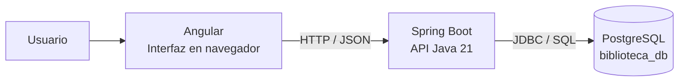
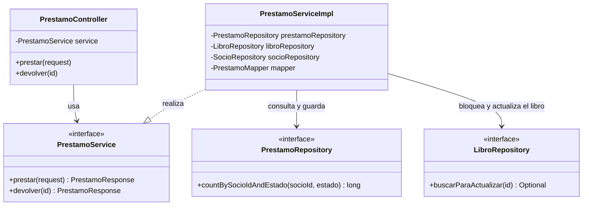
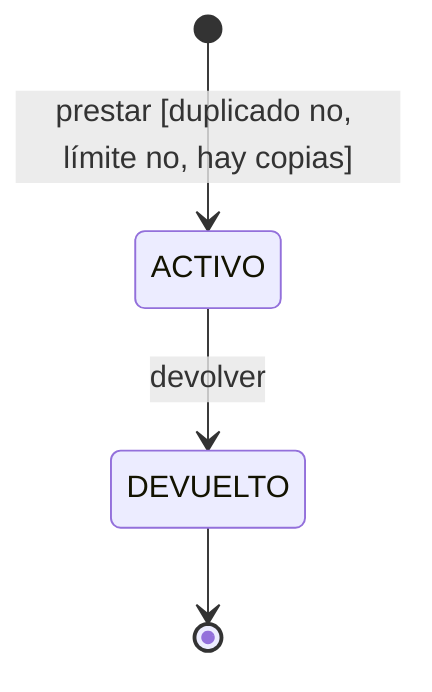
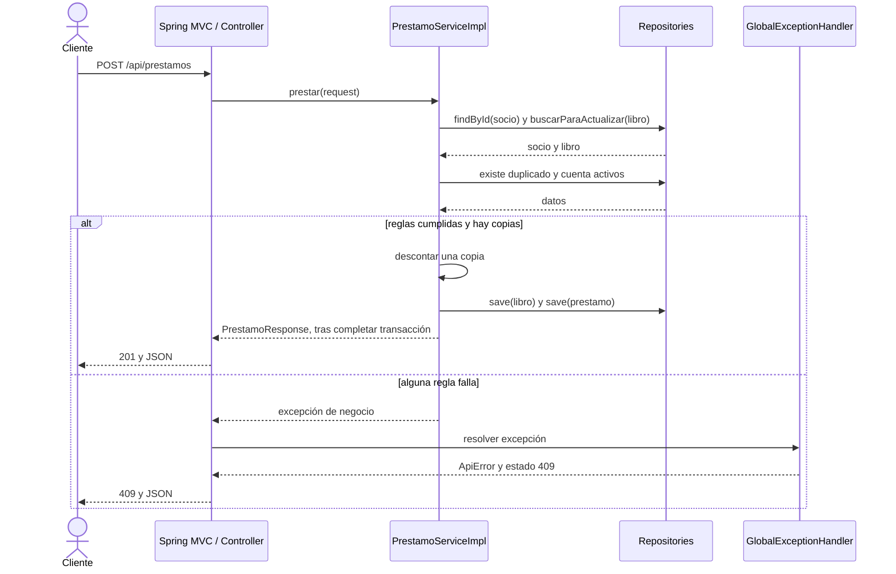
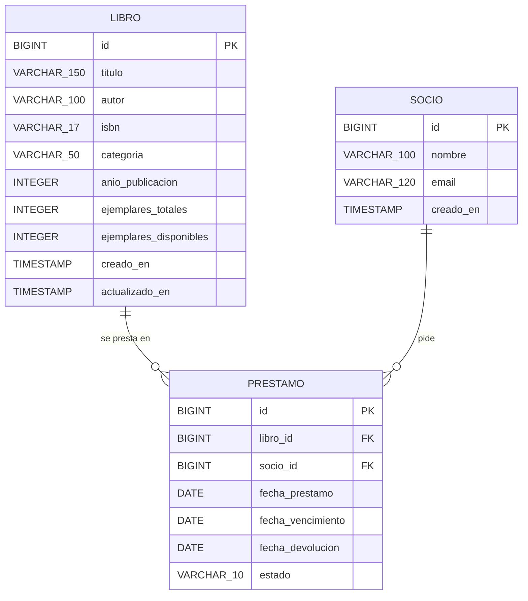
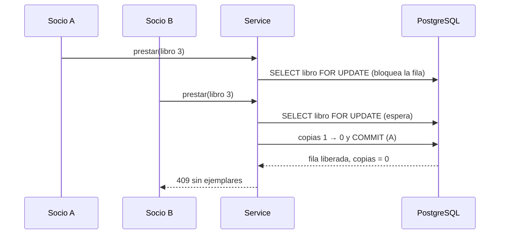

# 10 · Atlas de diagramas y decisiones de la Biblioteca

Complemento del [guion teórico](09-fundamentos-ingenieria-software.md). Estas versiones Mermaid facilitan mantener la documentación junto al código.

## Cómo evaluar un diagrama

Un diagrama útil responde una pregunta concreta, declara su alcance y usa símbolos con significado consistente. Revisar nombres contra el código, dirección de dependencias, condiciones de error y nivel de detalle. No mezclar clases Java con servidores sin explicar los niveles. Actualizar el modelo cuando cambia una regla.

La secuencia recomendada es: necesidad del usuario, criterio de aceptación, modelo que permita discutirlo, implementación y evidencia. Los diagramas ayudan a conversar y descubrir errores antes de modificar código; no sustituyen pruebas ni decisiones documentadas.

## 1. Alcance y casos de uso

**Pregunta:** ¿qué objetivos satisface el sistema para el usuario?

El actor es un rol externo. Los objetivos actuales son buscar libros, consultar disponibilidad, realizar préstamo, devolver libro, ver mis préstamos y agregar libro. Las asociaciones indican participación, no secuencia.

Ficha de caso de uso:

| Elemento | Realizar préstamo |
|---|---|
| Actor | Usuario (socio) |
| Precondición | Existen el socio y el libro |
| Entrada | `libroId` y `socioId` |
| Camino principal | Buscar socio y libro, comprobar duplicado, límite y copias, descontar una copia, crear el préstamo a 14 días y responder |
| Alternativas | Socio o libro inexistente: 404. Libro ya prestado al socio, 3 préstamos activos o sin copias: 409 |
| Postcondición de éxito | Hay un préstamo `ACTIVO` y una copia menos disponible |
| Postcondición de rechazo | La operación no persiste ningún cambio |

`include` representa comportamiento incorporado por otro caso de uso y `extend` una extensión condicionada en puntos definidos. Un error no es automáticamente un caso `extend`. En este ejercicio es más claro documentar rechazos como flujos alternativos.

## 2. Contenedores actuales

**Pregunta:** ¿qué unidades ejecutan el sistema y cómo se comunican?

Un contenedor C4 es una aplicación o almacén de datos. No implica Docker. En desarrollo Angular (puerto 4201) usa su proxy hacia la API en el puerto 8084. Esta vista no determina dónde se desplegará producción. Fuente conceptual: [C4](https://c4model.com/diagrams).

## 3. Clases y responsabilidades actuales

**Pregunta:** ¿quién conoce a quién y quién implementa el contrato?

Vista parcial: omite el mapper, `SocioRepository` y las operaciones que no aportan a *prestar* y *devolver*. La realización usa línea discontinua y triángulo hueco hacia el contrato. Las referencias no indican orden temporal; para eso se usa secuencia. Fuente de notación: [UML 2.5.1](https://www.omg.org/spec/UML/2.5.1).

## 4. Estados y guardas actuales

**Pregunta:** ¿qué cambios son válidos y bajo qué condiciones?

El máximo es tres préstamos `ACTIVO` por socio y una copia libre como mínimo. `DEVUELTO` es final: devolver de nuevo se rechaza con 409. Un préstamo `ACTIVO` puede estar *vencido*, pero eso se calcula con la fecha y no es un estado almacenado.

Ejercicio: enumerar las combinaciones (estado del préstamo) × (acción). Dos son válidas (`prestar` al crear y `devolver` desde `ACTIVO`) y una es inválida (`devolver` desde `DEVUELTO`). Así el diagrama produce una matriz de pruebas.

## 5. Secuencia de préstamo y rechazo

**Pregunta:** ¿cómo colaboran los objetos y dónde se interrumpe un intento inválido?

Precondición del fragmento: socio y libro existentes. La vista agrupa infraestructura web y omite el mapper y el proxy transaccional. Spring MVC invoca el mecanismo de manejo de excepciones; el controller no llama manualmente al handler. `save()` no equivale necesariamente a un `UPDATE` inmediato: JPA puede diferirlo al flush. La respuesta exitosa ocurre después de completar la transacción del servicio.

## 6. Modelo persistente actual

**Pregunta:** ¿qué datos conserva realmente el sistema?

Tres tablas de negocio. El SQL define identidad, obligatoriedad, `UNIQUE` en ISBN y correo, `CHECK` en estado, en fechas y en el rango de copias disponibles, e índices por (socio, estado) y (libro, estado). `fecha_devolucion` es opcional. No agregar relaciones a autores, editoriales o sedes como si ya existieran. El historial de un préstamo está en sus fechas; no hay bitácora de cambios.

## 7. Riesgo concurrente actual

**Pregunta:** ¿qué pasa si dos socios piden la última copia a la vez?

El bloqueo pesimista evita que ambas transacciones lean `1` a la vez. **Es una mitigación de diseño; falta una prueba concurrente real contra PostgreSQL que la demuestre.** El `CHECK` de la tabla es la última defensa: un contador fuera de rango haría fallar el `UPDATE`.

## 8. Propuestas (no implementadas)

| Propuesta | Para qué | Costo |
|---|---|---|
| Multas y bloqueo por préstamos vencidos | Incentivar la devolución a tiempo | Regla nueva en `prestar()` y migración `V3` |
| Reservas con lista de espera | Libros agotados | Nueva entidad y eventos al devolver |
| Roles (bibliotecario / socio) | Que solo el bibliotecario agregue libros | Autenticación y autorización |
| Pruebas con Testcontainers | Validar JPQL, bloqueo y migraciones | Requiere Docker |
