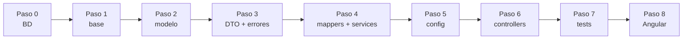
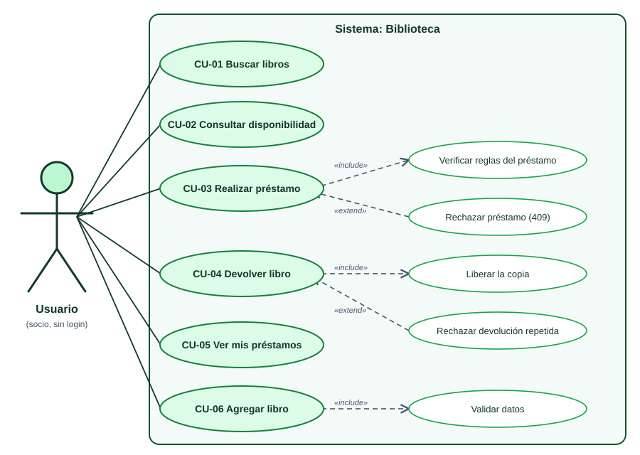
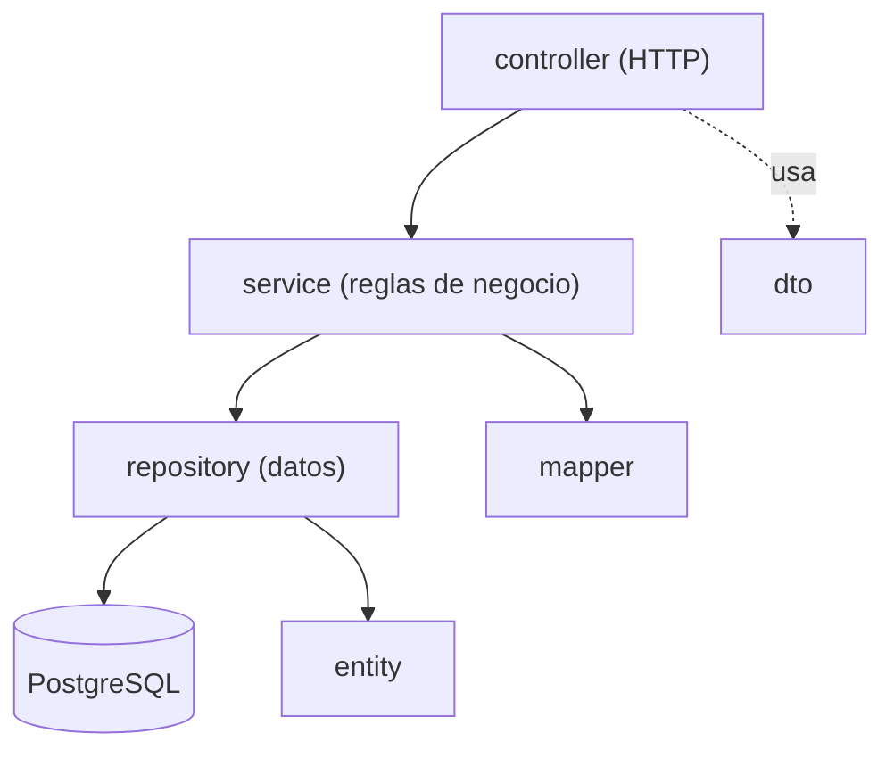
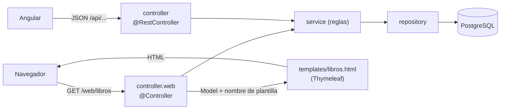

# Guía completa paso a paso: Backend del Sistema de Biblioteca

> Java 21 · Spring Boot 3.5 · PostgreSQL 18 · **Java puro, sin Lombok**.
> Partes de `biblioteca-backend-base` (proyecto en blanco que ya arranca) y lo completas paso a paso hasta tener `biblioteca-backend`.
> **Cada paso termina en: compilar → levantar → verificar.** El proyecto debe poder arrancar al terminar cada paso.

> ### 📌 Ruta de trabajo con los alumnos (partir desde el base)
> `biblioteca-backend-base` **ya trae hechos** los pasos 2 y 3 completos (enums, entity, repository, dto y exception) **y los mappers del Paso 4** (archivos 4.1 a 4.3). Esos archivos están en el base y sus bloques de esta guía sirven para **leerlos y entender cómo funcionan**, no para volver a escribirlos.
>
> **Se continúa desde el Paso 4, Archivo 4.4 (`LibroService`)** y se completan:
> 1. **service** (interfaces, archivos 4.4 a 4.6) y **service.impl** (archivos 4.7 a 4.9, donde viven las reglas de negocio),
> 2. **Paso 4B (opcional): controllers web con Thymeleaf**, para ver el sistema funcionando en el navegador *antes* de tener Swagger y Angular. Las plantillas HTML ya vienen en el base,
> 3. **config** (Paso 5),
> 4. **controller** REST (Paso 6),
> 5. y luego los tests (Paso 7) y Angular (Paso 8). Al pasar a Angular, Thymeleaf se **apaga con una propiedad**, sin borrar código.
>
> El base **compila y arranca sin errores** aunque esos paquetes estén vacíos: nada de lo que ya trae depende de ellos. Solo falta que aparezcan los endpoints en Swagger (Paso 6).

## Mapa del proceso

| Paso | Qué haces | Paquetes | Verificas | En el base |
|---|---|---|---|---|
| 0 | Preparar entorno y base de datos | — | Conexión con `psql` | — |
| 1 | Levantar el proyecto base | — | Flyway aplica V1 y V2; Swagger vacío | — |
| 2 | Modelo | `enums`, `entity`, `repository` | Hibernate valida las tablas | ✔ ya hecho |
| 3 | DTOs, excepciones y handler | `dto`, `exception` | Arranca sin errores | ✔ ya hecho |
| 4 | Mappers y Services | `mapper`, `service`, `service.impl` | Spring inyecta los beans | mappers ✔ ya hechos · **services: continuar desde 4.4** |
| 4B | **Opcional:** primera pantalla con Thymeleaf | `controller.web` (+ `templates`) | Catálogo y préstamos en `http://localhost:8084/web/libros` | plantillas y CSS ✔ ya hechos · **`controller.web` ✎ falta** |
| 5 | Configuración | `config` | Título en Swagger | ✎ falta |
| 6 | Controllers | `controller` | Probar los endpoints en Swagger (incluidos los 409) | ✎ falta |
| 7 | Tests | `src/test` | `.\mvnw.cmd test` en verde | ✎ falta |
| 8 | Conectar con Angular | — | Catálogo y préstamos funcionando | ✎ falta |



---

## Fase de análisis: diagrama de casos de uso (antes de construir)



*(Detalle y teoría en [00-casos-de-uso.md](00-casos-de-uso.md).)*

- El **actor** (el monito) es el **Usuario**; está fuera del sistema.
- Cada **óvalo principal** (Buscar, Consultar disponibilidad, Prestar, Devolver, Ver mis préstamos, Agregar libro) se convierte en **un endpoint**.
- **«include» = siempre** (*Realizar préstamo* siempre verifica las reglas). **«extend» = a veces** (*Rechazar préstamo* solo si no hay copias, hay límite o hay duplicado).
- Los óvalos auxiliares son **reglas de negocio**: vivirán en el **Service**.

| Óvalo | Endpoint | Método del service |
|---|---|---|
| CU-01 Buscar libros | `GET /api/libros?q=...` | `LibroService.buscar()` |
| CU-02 Consultar disponibilidad | `GET /api/libros/{id}/disponibilidad` | `LibroService.consultarDisponibilidad()` |
| CU-03 Realizar préstamo | `POST /api/prestamos` | `PrestamoService.prestar()` |
| CU-04 Devolver libro | `PATCH /api/prestamos/{id}/devolucion` | `PrestamoService.devolver()` |
| CU-05 Ver mis préstamos | `GET /api/prestamos?socioId=...` | `PrestamoService.listar()` |
| CU-06 Agregar libro | `POST /api/libros` | `LibroService.crear()` |

---

## Teoría previa (léela antes de empezar)

### 0. Vocabulario Java que usarás

| Término | Qué es | Ejemplo |
|---|---|---|
| **package** | Carpeta lógica que agrupa clases | `cl.ipss.biblioteca.entity` |
| **class** | Molde para crear objetos | `Libro` |
| **interface** | Contrato: qué métodos existen, sin implementarlos | `PrestamoService` |
| **enum** | Conjunto cerrado de valores | `EstadoPrestamo` |
| **record** | Clase inmutable concisa para datos | `PrestamoResponse` |
| **annotation** | Etiqueta `@Algo` que da instrucciones a Spring/JPA/Validation | `@Entity`, `@Service` |
| **constructor** | Método que crea el objeto | `public Libro() {}` |
| **getter / setter** | Métodos para leer / modificar un campo | `getTitulo()`, `setTitulo(...)` |
| **excepción** | Objeto que representa un error | `LibroSinEjemplaresException` |
| **bean** | Objeto que **Spring crea y administra** | un `@Service` |
| **relación** | Una entity que apunta a otra (clave foránea) | `Prestamo` → `Libro` y `Socio` |

> **Sin Lombok:** en este proyecto los getters, setters y logs se escriben **a mano**. Así compila en cualquier IDE sin plugins.

### 1. Arquitectura MVC en capas



Una capa **solo habla con la de abajo**. Más detalle en [02-teoria-mvc.md](02-teoria-mvc.md).

### 2. DTO vs Entity

La **Entity** representa la tabla; el **DTO** representa lo que viaja por HTTP. Si mezclaras ambos, el cliente podría enviar campos que no debe (p. ej. fijar `ejemplaresDisponibles` o la fecha de vencimiento). Por eso `CrearPrestamoRequest` solo trae `libroId` y `socioId`.

### 3. Programar contra interfaces

Los controllers usan `LibroService`, `SocioService` y `PrestamoService` (interfaces). La lógica está en los `*ServiceImpl`. En los tests se reemplazan por un *mock*.

### 4. Patrones y SOLID

Resumen en [03-patrones-de-diseno.md](03-patrones-de-diseno.md): Service Layer, Repository, DTO, Mapper, Dependency Injection, Singleton, JavaBean, Front Controller, Advice, bloqueo pesimista.

### 5. Reglas de negocio de este proyecto

1. **Sin copias no hay préstamo** (`ejemplaresDisponibles` = 0) → **409**.
2. **Máximo 3 préstamos activos por socio.** El cuarto → **409**.
3. **No se pide dos veces el mismo libro** sin devolverlo → **409**.
4. **Una devolución se registra una vez**; la segunda → **409**. Al devolver se **suma una copia**.
5. **Plazo de 14 días**: lo calcula el sistema (el cliente no envía fechas).
6. Errores: **404** no existe · **400** datos inválidos · **409** conflicto · **500** inesperado.

---

## Paso 0 · Preparar el entorno y la base de datos

### Requisitos

| Herramienta | Versión | Comprobar |
|---|---|---|
| JDK | **21** | `java -version` |
| PostgreSQL | 18 | `psql --version` |
| IDE | IntelliJ, VS Code o Eclipse | — |

> **Windows:** si `java -version` muestra otra versión (p. ej. 1.8), apunta `JAVA_HOME` a un JDK 21 en la misma terminal:
> ```powershell
> $env:JAVA_HOME = "C:\ruta\a\jdk-21"
> $env:Path = "$env:JAVA_HOME\bin;$env:Path"
> ```

### 1. Crear la base de datos (una sola vez)

Usa el puerto y la clave de **tu** PostgreSQL 18:

```powershell
psql -U postgres -h localhost -p 5432 -c "CREATE DATABASE biblioteca_db;"
```

> Si tienes PostgreSQL 14 y 18 instalados, uno usa el 5432 y el otro el 5433. Para saber a cuál te conectaste:
> `psql -U postgres -h localhost -p 5433 -c "SHOW server_version;"`

> **¿Prefieres pgAdmin?** Es lo mismo: clic derecho en *Databases → Create → Database…* → nombre `biblioteca_db`.

**✅ Verificar:** `psql -U postgres -h localhost -p 5432 -c "\l"` muestra la base `biblioteca_db`.

### 2. ¿Con qué usuario se conecta el backend?

Crear la base **no define el usuario**: el usuario es el de la conexión con la que el backend entra a PostgreSQL. El backend lee estas variables (valores por defecto entre paréntesis):

| Variable | Qué es | Por defecto |
|---|---|---|
| `DB_USER` | Usuario de PostgreSQL | `biblioteca` |
| `DB_PASSWORD` | Su clave | `biblioteca` |
| `DB_PORT` | Puerto del servidor | `5432` |
| `DB_NAME` | Nombre de la base | `biblioteca_db` |

**Opción A · Usar el mismo usuario con el que entras a pgAdmin.** Casi siempre es `postgres` con la clave que definiste al instalar PostgreSQL 18. Como el proyecto trae por defecto el usuario `biblioteca`, aquí **sí** debes indicar el usuario y la clave antes de levantar el backend (y el puerto si no es el 5432):

```powershell
$env:DB_USER = "postgres"
$env:DB_PASSWORD = "la_clave_de_postgres"
# $env:DB_PORT = "5433"     # solo si tu PostgreSQL 18 no usa el 5432
```

> ¿Cuál es mi puerto? En pgAdmin: clic derecho sobre el servidor → *Properties → Connection → Port*. O en el *Query Tool*: `SHOW port;`

**Opción B · Crear un usuario propio para esta aplicación** (es la que usa el proyecto por defecto: usuario `biblioteca`, clave `biblioteca`). Es lo habitual: un usuario por aplicación. En pgAdmin abre el **Query Tool sobre la base `biblioteca_db`** (clic derecho en `biblioteca_db` → *Query Tool*), pega este script y ejecútalo con **F5**. Es el archivo [`crear-bd-pgadmin.sql`](../biblioteca-backend-base/crear-bd-pgadmin.sql):

<!-- archivo: crear-bd-pgadmin.sql -->
```sql
-- Para pgAdmin (Query Tool). NO usa comandos de psql, así que se ejecuta completo con F5.
-- Antes: crear la base biblioteca_db (clic derecho en Databases > Create > Database...) y abrir el Query Tool SOBRE esa base.
-- Se puede repetir sin errores: crea el usuario o le actualiza la clave si ya existe.

-- Crea el usuario (o le actualiza la clave si ya existe)
DO $$
BEGIN
    IF NOT EXISTS (SELECT FROM pg_roles WHERE rolname = 'biblioteca') THEN
        CREATE USER biblioteca WITH PASSWORD 'biblioteca';
    ELSE
        ALTER USER biblioteca WITH PASSWORD 'biblioteca';
    END IF;
END
$$;

-- Lo hace dueño de la base: así Flyway puede crear las tablas y los datos
ALTER DATABASE biblioteca_db OWNER TO biblioteca;
GRANT ALL PRIVILEGES ON DATABASE biblioteca_db TO biblioteca;
-- Desde PostgreSQL 15 el esquema public ya no es escribible por cualquiera: sin esto Flyway falla.
GRANT ALL ON SCHEMA public TO biblioteca;
```

> ⚠️ **En pgAdmin usa SOLO este script.** El archivo `crear-bd.sql` (más abajo) contiene comandos de `psql` (`\gexec`, `\connect`) y en el Query Tool de pgAdmin **falla completo sin crear el usuario**.

**✅ Verificar:** en el mismo Query Tool ejecuta `SELECT rolname FROM pg_roles WHERE rolname = 'biblioteca';`. Debe devolver una fila.

Luego levanta el backend con ese usuario (o no definas nada: `biblioteca` / `biblioteca` ya son los valores por defecto):

```powershell
$env:DB_USER = "biblioteca"
$env:DB_PASSWORD = "biblioteca"
.\mvnw.cmd spring-boot:run
```

> **Alternativa por terminal (solo `psql`):** el proyecto trae [`crear-bd.sql`](../biblioteca-backend-base/crear-bd.sql), que hace **todo de una vez**: crea (o actualiza) el usuario, crea la base si no existe y da los permisos. Se puede ejecutar varias veces sin errores. Ejecútalo como `postgres` desde la carpeta del proyecto:
>
> ```powershell
> psql -U postgres -h localhost -p 5432 -f crear-bd.sql
> ```
>
> Usa comandos propios de `psql` (`\gexec`, `\connect`), por eso se ejecuta con `psql` y **no** en el Query Tool de pgAdmin; en pgAdmin usa `crear-bd-pgadmin.sql` (Opción B).

Contenido de `crear-bd.sql`:

<!-- archivo: crear-bd.sql -->
```sql
-- SOLO para psql (usa \gexec y \connect). En pgAdmin NO sirve: usa crear-bd-pgadmin.sql.
-- Ejecutar como superusuario (postgres). Se puede repetir sin errores: crea lo que falta y actualiza lo demás.
--   psql -U postgres -h localhost -p 5432 -f crear-bd.sql

-- Crea el usuario (o le actualiza la clave si ya existe)
DO $$
BEGIN
    IF NOT EXISTS (SELECT FROM pg_roles WHERE rolname = 'biblioteca') THEN
        CREATE USER biblioteca WITH PASSWORD 'biblioteca';
    ELSE
        ALTER USER biblioteca WITH PASSWORD 'biblioteca';
    END IF;
END
$$;

-- Crea la base solo si no existe (CREATE DATABASE no puede ir dentro de un bloque DO)
SELECT 'CREATE DATABASE biblioteca_db OWNER biblioteca'
WHERE NOT EXISTS (SELECT FROM pg_database WHERE datname = 'biblioteca_db')\gexec

\connect biblioteca_db

-- Lo hace dueño de la base: así Flyway puede crear las tablas y los datos
ALTER DATABASE biblioteca_db OWNER TO biblioteca;
GRANT ALL PRIVILEGES ON DATABASE biblioteca_db TO biblioteca;
-- Desde PostgreSQL 15 el esquema public ya no es escribible por cualquiera: sin esto Flyway falla.
GRANT ALL ON SCHEMA public TO biblioteca;
```

**¿Por qué hace falta `GRANT ALL ON SCHEMA public`?** Desde PostgreSQL 15 los usuarios normales ya no pueden crear tablas en el esquema `public` por defecto. Como el dueño de la base ya puede, el `GRANT` es una segunda garantía. Sin ellos Flyway fallaría con *permission denied for schema public*.

**¿Cómo saber si el usuario y la clave están bien?** Antes de levantar el backend prueba la conexión:

```powershell
psql -U biblioteca -h localhost -p 5432 -d biblioteca_db -c "SELECT current_user;"
```

Si pide clave y responde `biblioteca`, el backend podrá conectarse igual. Si dice *password authentication failed*, el usuario o la clave no coinciden.

### 3. Las 3 formas de configurar usuario y clave

Por defecto el backend usa `biblioteca` / `biblioteca` (valores por defecto de `application.yml`: `${DB_USER:biblioteca}`).

**Forma 1 · Editar `application.yml`** (la más simple, pero cambia un archivo versionado):

```yaml
spring:
  datasource:
    username: tu_usuario
    password: tu_clave
```

**Forma 2 · Variables de entorno en la terminal** (PowerShell):

```powershell
$env:DB_USER = "postgres"
$env:DB_PASSWORD = "tu_clave"
# $env:DB_PORT = "5433"     # solo si tu PostgreSQL no usa el 5432
.\mvnw.cmd spring-boot:run
```

**Forma 3 · Variables en el IDE** (no ensucia el repositorio):
- IntelliJ: *Run → Edit Configurations → Environment variables* → `DB_USER=...;DB_PASSWORD=...`
- VS Code: en `launch.json`, la clave `"env": { "DB_USER": "...", "DB_PASSWORD": "..." }`
- Eclipse: *Run Configurations → Environment*.

Variables disponibles: `DB_HOST, DB_PORT, DB_NAME, DB_USER, DB_PASSWORD, SERVER_PORT, CORS_ORIGINS, LOG_LEVEL_APP, WEB_THYMELEAF`.

### Errores de conexión comunes

| Mensaje | Causa | Solución |
|---|---|---|
| `password authentication failed for user "biblioteca"` (o *la autentificación password falló*) | El usuario no existe o la clave no coincide (por ejemplo, el script no se ejecutó completo) | Revisa `DB_PASSWORD`/`DB_USER`. Para reponer la clave en pgAdmin: `ALTER USER biblioteca WITH PASSWORD 'biblioteca';` |
| `syntax error at or near "\"` al ejecutar el script en pgAdmin | Se pegó `crear-bd.sql` (comandos de `psql`) en el Query Tool y no se creó el usuario | Usa [`crear-bd-pgadmin.sql`](../biblioteca-backend-base/crear-bd-pgadmin.sql) (Opción B) |
| `role "biblioteca" does not exist` | El usuario por defecto del proyecto aún no existe | Ejecuta el script de la **Opción B** (o usa `postgres` con la Opción A) |
| `database "biblioteca_db" does not exist` | No creaste la base, o está mal escrito `DB_NAME` | Crea `biblioteca_db` (punto 1 de este paso) |
| `Connection refused` | Puerto equivocado o PostgreSQL apagado | Verifica el puerto con `SHOW port;` y defínelo con `DB_PORT`; revisa que el servicio esté en ejecución |
| `permission denied for schema public` (Flyway) | El usuario no puede crear tablas (PostgreSQL 15+) | Conectado a `biblioteca_db`: `ALTER DATABASE biblioteca_db OWNER TO biblioteca;` y `GRANT ALL ON SCHEMA public TO biblioteca;` |
| `Port 8084 was already in use` | Otro proceso usa el puerto | Ciérralo o define `SERVER_PORT` |
| Cambié el `application.yml` y sigue igual | La aplicación no se reinició | Detén y vuelve a ejecutar; en Eclipse: *Project → Clean…* |
| En otra terminal vuelve a fallar | Las variables `$env:` valen solo para la terminal donde se definieron | Defínelas de nuevo, o usa la Forma 1 o la Forma 3 |

### ✅ Verificar

```powershell
$env:PGPASSWORD = "biblioteca"
psql -U biblioteca -h localhost -p 5432 -d biblioteca_db -c "select 1"
```

Debe responder `1`.

---

## Paso 1 · Levantar el proyecto base y verificar la conexión

Abre la carpeta `biblioteca-backend-base`. Trae:

| Archivo | Para qué |
|---|---|
| `pom.xml` | Dependencias (solo las necesarias: web, validation, **thymeleaf (vista opcional)**, data-jpa, postgresql, flyway, springdoc, test) |
| `src/main/resources/templates/`, `static/web.css` y `static/favicon.ico` | Las 4 plantillas HTML de Thymeleaf, su CSS y el icono de la pestaña (**ya vienen hechos**; se usan en el Paso 4B) |
| `src/main/resources/application.yml` | Puerto, base de datos, logs |
| `db/migration/V1__crear_tablas_biblioteca.sql` y `V2__datos_iniciales.sql` | Esquema y datos de ejemplo (6 libros, 3 socios, 3 préstamos) |
| `BibliotecaApplication.java` | Punto de entrada |
| `enums`, `entity`, `repository`, `dto`, `exception`, `mapper` | **Ya vienen hechos** (pasos 2, 3 y los mappers del 4) |
| `package-info.java` en `service`, `service.impl`, `controller.web`, `config` y `controller` | Un `TODO` que indica qué crear en cada paso (**se continúa desde `service`**) |

### `application.yml`

<!-- archivo: src/main/resources/application.yml -->
```yaml
server:
  port: ${SERVER_PORT:8084}

spring:
  application:
    name: biblioteca-backend
  datasource:
    # Cambia el puerto/usuario/clave con variables de entorno si tu Postgres es distinto
    url: jdbc:postgresql://${DB_HOST:localhost}:${DB_PORT:5432}/${DB_NAME:biblioteca_db}
    username: ${DB_USER:biblioteca}
    password: ${DB_PASSWORD:biblioteca}
  jpa:
    open-in-view: false
    hibernate:
      ddl-auto: validate      # el esquema lo crea Flyway, Hibernate solo lo valida
    properties:
      hibernate:
        format_sql: true
  flyway:
    enabled: true
    locations: classpath:db/migration
  thymeleaf:
    cache: false             # al editar una plantilla se ve el cambio sin reiniciar (solo para desarrollo)

app:
  web:
    enabled: ${WEB_THYMELEAF:true}   # false = sin páginas Thymeleaf (/web/...); se usa solo la API con Angular
  cors:
    allowed-origins: ${CORS_ORIGINS:http://localhost:4201}

# -------------------------------------------------
# LOGGING (SLF4J + Logback, ya incluidos en Spring Boot; sin Lombok)
# -------------------------------------------------
logging:
  file:
    name: logs/${spring.application.name}.log
  logback:
    rollingpolicy:
      max-file-size: 10MB
      file-name-pattern: ${LOG_FILE}.%d{yyyy-MM-dd}.%i
      max-history: 7
  level:
    root: INFO
    cl.ipss: ${LOG_LEVEL_APP:INFO}       # DEBUG agrega más detalle (p. ej. las respuestas 404/409)
    org.springframework.web: INFO
    org.hibernate.SQL: DEBUG               # muestra el SQL que ejecuta Hibernate
    org.hibernate.type.descriptor.sql: INFO
```

**Explicación:** `app.web.enabled` (variable `WEB_THYMELEAF`) enciende o apaga las páginas Thymeleaf del Paso 4B, y `spring.thymeleaf.cache: false` hace que al editar una plantilla se vea el cambio sin reiniciar. `ddl-auto: validate` hace que Hibernate **solo compruebe** que las tablas coinciden con las entities; el esquema lo crea Flyway. `${DB_USER:biblioteca}` significa "usa la variable `DB_USER`, o `biblioteca` si no existe". El log va a `logs/biblioteca-backend.log` con rotación (10 MB, 7 días). Puertos: backend **8084**, Angular **4201**, para poder tener abiertos a la vez los proyectos de las clases anteriores.

### Migraciones Flyway

`V1__crear_tablas_biblioteca.sql`:

<!-- archivo: src/main/resources/db/migration/V1__crear_tablas_biblioteca.sql -->
```sql
-- V1: catálogo de libros, socios de la biblioteca y préstamos
CREATE TABLE libro (
    id                     BIGINT GENERATED ALWAYS AS IDENTITY PRIMARY KEY,
    titulo                 VARCHAR(150) NOT NULL,
    autor                  VARCHAR(100) NOT NULL,
    isbn                   VARCHAR(17)  NOT NULL,
    categoria              VARCHAR(50)  NOT NULL,
    anio_publicacion       INTEGER      NOT NULL,
    ejemplares_totales     INTEGER      NOT NULL,
    ejemplares_disponibles INTEGER      NOT NULL,
    creado_en              TIMESTAMP    NOT NULL DEFAULT CURRENT_TIMESTAMP,
    actualizado_en         TIMESTAMP    NOT NULL DEFAULT CURRENT_TIMESTAMP,

    CONSTRAINT uq_libro_isbn UNIQUE (isbn),
    CONSTRAINT ck_libro_totales CHECK (ejemplares_totales >= 1),
    CONSTRAINT ck_libro_disponibles CHECK (ejemplares_disponibles BETWEEN 0 AND ejemplares_totales)
);

CREATE TABLE socio (
    id        BIGINT GENERATED ALWAYS AS IDENTITY PRIMARY KEY,
    nombre    VARCHAR(100) NOT NULL,
    email     VARCHAR(120) NOT NULL,
    creado_en TIMESTAMP    NOT NULL DEFAULT CURRENT_TIMESTAMP,

    CONSTRAINT uq_socio_email UNIQUE (email)
);

CREATE TABLE prestamo (
    id                BIGINT GENERATED ALWAYS AS IDENTITY PRIMARY KEY,
    libro_id          BIGINT      NOT NULL REFERENCES libro (id),
    socio_id          BIGINT      NOT NULL REFERENCES socio (id),
    fecha_prestamo    DATE        NOT NULL,
    fecha_vencimiento DATE        NOT NULL,
    fecha_devolucion  DATE,
    estado            VARCHAR(10) NOT NULL DEFAULT 'ACTIVO',

    CONSTRAINT ck_prestamo_estado CHECK (estado IN ('ACTIVO', 'DEVUELTO')),
    CONSTRAINT ck_prestamo_fechas CHECK (fecha_vencimiento >= fecha_prestamo)
);

CREATE INDEX idx_prestamo_socio_estado ON prestamo (socio_id, estado);
CREATE INDEX idx_prestamo_libro_estado ON prestamo (libro_id, estado);
-- Defensa en profundidad: un socio no puede tener dos préstamos ACTIVOS del mismo libro
CREATE UNIQUE INDEX uq_prestamo_activo ON prestamo (socio_id, libro_id) WHERE estado = 'ACTIVO';
```

`V2__datos_iniciales.sql` (6 libros, 3 socios y 3 préstamos: uno vigente, uno vencido y uno devuelto):

<!-- archivo: src/main/resources/db/migration/V2__datos_iniciales.sql -->
```sql
-- V2: datos de ejemplo para ver algo al levantar el proyecto.
-- Las copias disponibles ya descuentan los préstamos activos de más abajo.
INSERT INTO libro (titulo, autor, isbn, categoria, anio_publicacion, ejemplares_totales, ejemplares_disponibles) VALUES
    ('Cien años de soledad',          'Gabriel García Márquez', '978-0307474728', 'Novela',      1967, 3, 3),
    ('Clean Code',                    'Robert C. Martin',       '978-0132350884', 'Informática', 2008, 2, 1),
    ('Don Quijote de la Mancha',      'Miguel de Cervantes',    '978-8420412146', 'Clásicos',    1605, 1, 0),
    ('Introducción a los algoritmos', 'Thomas H. Cormen',       '978-0262033848', 'Informática', 2009, 2, 2),
    ('La casa de los espíritus',      'Isabel Allende',         '978-8401242304', 'Novela',      1982, 2, 2),
    ('Sapiens',                       'Yuval Noah Harari',      '978-0062316097', 'Historia',    2011, 3, 3);

INSERT INTO socio (nombre, email) VALUES
    ('Ana Pérez',   'ana.perez@ipss.cl'),
    ('Luis Rojas',  'luis.rojas@ipss.cl'),
    ('Camila Soto', 'camila.soto@ipss.cl');

-- Ana tiene Clean Code (vigente); Luis tiene El Quijote (vencido); Camila ya devolvió Cien años de soledad
INSERT INTO prestamo (libro_id, socio_id, fecha_prestamo, fecha_vencimiento, fecha_devolucion, estado) VALUES
    (2, 1, CURRENT_DATE - 3,  CURRENT_DATE + 11, NULL,              'ACTIVO'),
    (3, 2, CURRENT_DATE - 20, CURRENT_DATE - 6,  NULL,              'ACTIVO'),
    (1, 3, CURRENT_DATE - 30, CURRENT_DATE - 16, CURRENT_DATE - 20, 'DEVUELTO');
```

> ⚠️ **Una migración ya aplicada no se edita nunca.** Los cambios van en `V3`, `V4`…

### `BibliotecaApplication`

<!-- archivo: src/main/java/cl/ipss/biblioteca/BibliotecaApplication.java -->
```java
package cl.ipss.biblioteca;

import org.springframework.boot.SpringApplication;
import org.springframework.boot.autoconfigure.SpringBootApplication;

@SpringBootApplication
public class BibliotecaApplication {

    public static void main(String[] args) {
        SpringApplication.run(BibliotecaApplication.class, args);
    }
}
```

`@SpringBootApplication` activa la configuración automática y el escaneo de componentes del paquete `cl.ipss.biblioteca` y sus subpaquetes.

### ✅ Compilar → levantar → verificar

```powershell
.\mvnw.cmd spring-boot:run
```

En el log debes ver:

```text
Migrating schema "public" to version "1 - crear tablas biblioteca"
Migrating schema "public" to version "2 - datos iniciales"
Started BibliotecaApplication in ... seconds
```

Abre <http://localhost:8084/swagger-ui.html>: debe cargar **sin endpoints** (aún no hay controller).

---

## Paso 2 · Crear el MODELO: enum, entities y repositories

> ✔ **En `biblioteca-backend-base` este paso ya viene hecho.** Léelo para entender el modelo; no hace falta volver a escribirlo.

### 🧩 Archivo 2.1 · `EstadoPrestamo` (enum)

**① Crear el paquete** (si aún no existe): `cl.ipss.biblioteca.enums`

- IntelliJ: clic derecho sobre `src/main/java` → *New → Package*.
- VS Code: en el explorador, clic derecho en `src/main/java` → *New Folder* y escribe la ruta con `/` (`cl/ipss/biblioteca/enums`).

**② Crear el archivo** `EstadoPrestamo.java` en `src/main/java/cl/ipss/biblioteca/enums`:

| IDE | Cómo |
|---|---|
| **IntelliJ** | Clic derecho en el paquete → *New → Java Class* → nombre `EstadoPrestamo` → elige **Enum** |
| **VS Code** | Clic derecho en la carpeta → *New File* → `EstadoPrestamo.java` (el servicio de Java sugiere la estructura) |

**③ Código completo** (primera línea: `package`):

<!-- archivo: main/java/cl/ipss/biblioteca/enums/EstadoPrestamo.java -->
```java
package cl.ipss.biblioteca.enums;

/** Estado de un préstamo: ACTIVO mientras el libro sigue con el socio, DEVUELTO cuando ya lo regresó. */
public enum EstadoPrestamo {
    ACTIVO,
    DEVUELTO
}
```

**④ Teoría**

Un **enum** es un conjunto **cerrado** de valores constantes. Evita "strings mágicos" como `"activo"` o `"Activo "`: el compilador solo acepta valores que existen.

**⑤ Explicación del código**

Un préstamo está `ACTIVO` mientras el libro sigue con el socio y pasa a `DEVUELTO` al registrar la devolución. Es el único estado que necesita el negocio: la **disponibilidad** de un libro no es un enum, es un número (`ejemplaresDisponibles`). Si el cliente envía otro valor (`?estado=PERDIDO`), Spring no puede convertirlo y el handler responde **400**.

### 🧩 Archivo 2.2 · `Libro` (class)

**① Crear el paquete** (si aún no existe): `cl.ipss.biblioteca.entity`

- IntelliJ: clic derecho sobre `src/main/java` → *New → Package*.
- VS Code: en el explorador, clic derecho en `src/main/java` → *New Folder* y escribe la ruta con `/` (`cl/ipss/biblioteca/entity`).

**② Crear el archivo** `Libro.java` en `src/main/java/cl/ipss/biblioteca/entity`:

| IDE | Cómo |
|---|---|
| **IntelliJ** | Clic derecho en el paquete → *New → Java Class* → nombre `Libro` → elige **Class** |
| **VS Code** | Clic derecho en la carpeta → *New File* → `Libro.java` (el servicio de Java sugiere la estructura) |

**③ Código completo** (primera línea: `package`):

<!-- archivo: main/java/cl/ipss/biblioteca/entity/Libro.java -->
```java
package cl.ipss.biblioteca.entity;

import jakarta.persistence.Column;
import jakarta.persistence.Entity;
import jakarta.persistence.GeneratedValue;
import jakarta.persistence.GenerationType;
import jakarta.persistence.Id;
import jakarta.persistence.PrePersist;
import jakarta.persistence.PreUpdate;
import jakarta.persistence.Table;

import java.time.LocalDateTime;

/**
 * ENTITY (el "Model" de MVC): representa la tabla libro.
 * Java puro: constructor vacío, getters y setters escritos a mano.
 */
@Entity
@Table(name = "libro")
public class Libro {

    @Id
    @GeneratedValue(strategy = GenerationType.IDENTITY)
    private Long id;

    @Column(nullable = false, length = 150)
    private String titulo;

    @Column(nullable = false, length = 100)
    private String autor;

    @Column(nullable = false, length = 17, unique = true)
    private String isbn;

    @Column(nullable = false, length = 50)
    private String categoria;

    @Column(name = "anio_publicacion", nullable = false)
    private Integer anioPublicacion;

    @Column(name = "ejemplares_totales", nullable = false)
    private Integer ejemplaresTotales;

    @Column(name = "ejemplares_disponibles", nullable = false)
    private Integer ejemplaresDisponibles;

    @Column(name = "creado_en", nullable = false, updatable = false)
    private LocalDateTime creadoEn;

    @Column(name = "actualizado_en", nullable = false)
    private LocalDateTime actualizadoEn;

    /** Constructor vacío: JPA lo exige para crear la entidad al leer de la base. */
    public Libro() {
    }

    // ---------- getters ----------
    public Long getId() {
        return id;
    }

    public String getTitulo() {
        return titulo;
    }

    public String getAutor() {
        return autor;
    }

    public String getIsbn() {
        return isbn;
    }

    public String getCategoria() {
        return categoria;
    }

    public Integer getAnioPublicacion() {
        return anioPublicacion;
    }

    public Integer getEjemplaresTotales() {
        return ejemplaresTotales;
    }

    public Integer getEjemplaresDisponibles() {
        return ejemplaresDisponibles;
    }

    public LocalDateTime getCreadoEn() {
        return creadoEn;
    }

    public LocalDateTime getActualizadoEn() {
        return actualizadoEn;
    }

    // ---------- setters (id y fechas de auditoría los maneja JPA, por eso no tienen) ----------
    public void setTitulo(String titulo) {
        this.titulo = titulo;
    }

    public void setAutor(String autor) {
        this.autor = autor;
    }

    public void setIsbn(String isbn) {
        this.isbn = isbn;
    }

    public void setCategoria(String categoria) {
        this.categoria = categoria;
    }

    public void setAnioPublicacion(Integer anioPublicacion) {
        this.anioPublicacion = anioPublicacion;
    }

    public void setEjemplaresTotales(Integer ejemplaresTotales) {
        this.ejemplaresTotales = ejemplaresTotales;
    }

    public void setEjemplaresDisponibles(Integer ejemplaresDisponibles) {
        this.ejemplaresDisponibles = ejemplaresDisponibles;
    }

    /** Se ejecuta automáticamente justo antes del INSERT. */
    @PrePersist
    void antesDeGuardar() {
        LocalDateTime ahora = LocalDateTime.now();
        this.creadoEn = ahora;
        this.actualizadoEn = ahora;
    }

    /** Se ejecuta automáticamente justo antes del UPDATE. */
    @PreUpdate
    void antesDeActualizar() {
        this.actualizadoEn = LocalDateTime.now();
    }
}
```

**④ Teoría**

Una **entity** es una clase cuyas instancias se guardan como filas de una tabla (JPA). Debe ser un **JavaBean**: constructor vacío + getters/setters. **Sin Lombok**, los escribimos a mano. Solo ponemos setters de lo que realmente se modifica: el `id` y las fechas de auditoría los maneja JPA.

**⑤ Explicación del código**

- `@Entity` y `@Table(name = "libro")`: la clase es la tabla `libro`.
- `@Id @GeneratedValue(strategy = IDENTITY)`: el `id` lo genera la base (columna `GENERATED ALWAYS AS IDENTITY`).
- `@Column(nullable, length, unique)`: refleja las restricciones de la tabla; Hibernate las **valida** al arrancar.
- `@Column(name = "anio_publicacion")`: mapea el nombre `camelCase` al `snake_case` de la columna.
- **`ejemplaresTotales` y `ejemplaresDisponibles`**: el catálogo guarda cuántas copias hay y cuántas están libres. La disponibilidad se consulta y se actualiza con estos dos números.
- `updatable = false` en `creadoEn`: la fecha de creación nunca cambia.
- `@PrePersist` / `@PreUpdate`: JPA los llama justo antes del INSERT / UPDATE para fijar las fechas.
- Constructor vacío: JPA lo exige para crear la entidad al leer de la base.

### 🧩 Archivo 2.3 · `Socio` (class)

**① Crear el paquete** (si aún no existe): `cl.ipss.biblioteca.entity`

- IntelliJ: clic derecho sobre `src/main/java` → *New → Package*.
- VS Code: en el explorador, clic derecho en `src/main/java` → *New Folder* y escribe la ruta con `/` (`cl/ipss/biblioteca/entity`).

**② Crear el archivo** `Socio.java` en `src/main/java/cl/ipss/biblioteca/entity`:

| IDE | Cómo |
|---|---|
| **IntelliJ** | Clic derecho en el paquete → *New → Java Class* → nombre `Socio` → elige **Class** |
| **VS Code** | Clic derecho en la carpeta → *New File* → `Socio.java` (el servicio de Java sugiere la estructura) |

**③ Código completo** (primera línea: `package`):

<!-- archivo: main/java/cl/ipss/biblioteca/entity/Socio.java -->
```java
package cl.ipss.biblioteca.entity;

import jakarta.persistence.Column;
import jakarta.persistence.Entity;
import jakarta.persistence.GeneratedValue;
import jakarta.persistence.GenerationType;
import jakarta.persistence.Id;
import jakarta.persistence.PrePersist;
import jakarta.persistence.Table;

import java.time.LocalDateTime;

/** ENTITY: persona inscrita en la biblioteca que puede pedir libros prestados. */
@Entity
@Table(name = "socio")
public class Socio {

    @Id
    @GeneratedValue(strategy = GenerationType.IDENTITY)
    private Long id;

    @Column(nullable = false, length = 100)
    private String nombre;

    @Column(nullable = false, length = 120, unique = true)
    private String email;

    @Column(name = "creado_en", nullable = false, updatable = false)
    private LocalDateTime creadoEn;

    public Socio() {
    }

    public Long getId() {
        return id;
    }

    public String getNombre() {
        return nombre;
    }

    public String getEmail() {
        return email;
    }

    public LocalDateTime getCreadoEn() {
        return creadoEn;
    }

    public void setNombre(String nombre) {
        this.nombre = nombre;
    }

    public void setEmail(String email) {
        this.email = email;
    }

    @PrePersist
    void antesDeGuardar() {
        this.creadoEn = LocalDateTime.now();
    }
}
```

**④ Teoría**

Otra **entity**. Un **socio** es la persona inscrita en la biblioteca. No es un usuario con clave: el sistema no tiene login (igual que el proyecto de referencia).

**⑤ Explicación del código**

- `unique = true` en `email`: no puede haber dos socios con el mismo correo (la tabla lo repite con `UNIQUE`).
- No hay `@PreUpdate` porque un socio no se edita en este alcance; solo `@PrePersist` para `creadoEn`.

### 🧩 Archivo 2.4 · `Prestamo` (class)

**① Crear el paquete** (si aún no existe): `cl.ipss.biblioteca.entity`

- IntelliJ: clic derecho sobre `src/main/java` → *New → Package*.
- VS Code: en el explorador, clic derecho en `src/main/java` → *New Folder* y escribe la ruta con `/` (`cl/ipss/biblioteca/entity`).

**② Crear el archivo** `Prestamo.java` en `src/main/java/cl/ipss/biblioteca/entity`:

| IDE | Cómo |
|---|---|
| **IntelliJ** | Clic derecho en el paquete → *New → Java Class* → nombre `Prestamo` → elige **Class** |
| **VS Code** | Clic derecho en la carpeta → *New File* → `Prestamo.java` (el servicio de Java sugiere la estructura) |

**③ Código completo** (primera línea: `package`):

<!-- archivo: main/java/cl/ipss/biblioteca/entity/Prestamo.java -->
```java
package cl.ipss.biblioteca.entity;

import cl.ipss.biblioteca.enums.EstadoPrestamo;
import jakarta.persistence.Column;
import jakarta.persistence.Entity;
import jakarta.persistence.EnumType;
import jakarta.persistence.Enumerated;
import jakarta.persistence.FetchType;
import jakarta.persistence.GeneratedValue;
import jakarta.persistence.GenerationType;
import jakarta.persistence.Id;
import jakarta.persistence.JoinColumn;
import jakarta.persistence.ManyToOne;
import jakarta.persistence.Table;

import java.time.LocalDate;

/**
 * ENTITY: un préstamo une a un socio con un libro. Nace ACTIVO y pasa a DEVUELTO al registrar la devolución.
 * Las relaciones son LAZY: el libro y el socio se leen solo cuando se piden.
 */
@Entity
@Table(name = "prestamo")
public class Prestamo {

    @Id
    @GeneratedValue(strategy = GenerationType.IDENTITY)
    private Long id;

    @ManyToOne(fetch = FetchType.LAZY, optional = false)
    @JoinColumn(name = "libro_id", nullable = false)
    private Libro libro;

    @ManyToOne(fetch = FetchType.LAZY, optional = false)
    @JoinColumn(name = "socio_id", nullable = false)
    private Socio socio;

    @Column(name = "fecha_prestamo", nullable = false)
    private LocalDate fechaPrestamo;

    @Column(name = "fecha_vencimiento", nullable = false)
    private LocalDate fechaVencimiento;

    @Column(name = "fecha_devolucion")
    private LocalDate fechaDevolucion;

    @Enumerated(EnumType.STRING)
    @Column(nullable = false, length = 10)
    private EstadoPrestamo estado;

    public Prestamo() {
    }

    public Long getId() {
        return id;
    }

    public Libro getLibro() {
        return libro;
    }

    public Socio getSocio() {
        return socio;
    }

    public LocalDate getFechaPrestamo() {
        return fechaPrestamo;
    }

    public LocalDate getFechaVencimiento() {
        return fechaVencimiento;
    }

    public LocalDate getFechaDevolucion() {
        return fechaDevolucion;
    }

    public EstadoPrestamo getEstado() {
        return estado;
    }

    public void setLibro(Libro libro) {
        this.libro = libro;
    }

    public void setSocio(Socio socio) {
        this.socio = socio;
    }

    public void setFechaPrestamo(LocalDate fechaPrestamo) {
        this.fechaPrestamo = fechaPrestamo;
    }

    public void setFechaVencimiento(LocalDate fechaVencimiento) {
        this.fechaVencimiento = fechaVencimiento;
    }

    public void setFechaDevolucion(LocalDate fechaDevolucion) {
        this.fechaDevolucion = fechaDevolucion;
    }

    public void setEstado(EstadoPrestamo estado) {
        this.estado = estado;
    }
}
```

**④ Teoría**

Una entity con **relaciones**. `@ManyToOne` dice "muchos préstamos pertenecen a un libro (y a un socio)". En la tabla es una **clave foránea** (`libro_id`, `socio_id`). `FetchType.LAZY` significa que el libro o el socio **se leen de la base solo cuando se piden**.

**⑤ Explicación del código**

- `@ManyToOne(fetch = LAZY, optional = false)` + `@JoinColumn(name = "libro_id")`: relación obligatoria con el libro.
- `fechaPrestamo`, `fechaVencimiento` y `fechaDevolucion` son `LocalDate` (solo fecha, sin hora). `fechaDevolucion` es `null` mientras el préstamo esté activo.
- `@Enumerated(EnumType.STRING)`: guarda `"ACTIVO"` y no el número 0.
- Como la relación es `LAZY` y `open-in-view: false`, el mapper debe ejecutarse **dentro de la transacción del service** (por eso el service lo llama antes de terminar).

### 🧩 Archivo 2.5 · `LibroRepository` (interface)

**① Crear el paquete** (si aún no existe): `cl.ipss.biblioteca.repository`

- IntelliJ: clic derecho sobre `src/main/java` → *New → Package*.
- VS Code: en el explorador, clic derecho en `src/main/java` → *New Folder* y escribe la ruta con `/` (`cl/ipss/biblioteca/repository`).

**② Crear el archivo** `LibroRepository.java` en `src/main/java/cl/ipss/biblioteca/repository`:

| IDE | Cómo |
|---|---|
| **IntelliJ** | Clic derecho en el paquete → *New → Java Class* → nombre `LibroRepository` → elige **Interface** |
| **VS Code** | Clic derecho en la carpeta → *New File* → `LibroRepository.java` (el servicio de Java sugiere la estructura) |

**③ Código completo** (primera línea: `package`):

<!-- archivo: main/java/cl/ipss/biblioteca/repository/LibroRepository.java -->
```java
package cl.ipss.biblioteca.repository;

import cl.ipss.biblioteca.entity.Libro;
import jakarta.persistence.LockModeType;
import org.springframework.data.jpa.repository.JpaRepository;
import org.springframework.data.jpa.repository.Lock;
import org.springframework.data.jpa.repository.Query;
import org.springframework.data.repository.query.Param;
import org.springframework.stereotype.Repository;

import java.util.List;
import java.util.Optional;

/**
 * REPOSITORY: acceso a datos. Al extender JpaRepository, Spring genera
 * en tiempo de ejecución save, findById, findAll, deleteById, existsById...
 */
@Repository
public interface LibroRepository extends JpaRepository<Libro, Long> {

    /** Método derivado: Spring crea el SELECT leyendo el nombre del método. */
    boolean existsByIsbn(String isbn);

    /**
     * Búsqueda por texto en título, autor, ISBN o categoría (sin distinguir mayúsculas).
     * El texto nunca es null: con "" el LIKE '%%' devuelve todo el catálogo.
     */
    @Query("""
            select l from Libro l
            where (lower(l.titulo) like lower(concat('%', :texto, '%'))
                or lower(l.autor) like lower(concat('%', :texto, '%'))
                or lower(l.isbn) like lower(concat('%', :texto, '%'))
                or lower(l.categoria) like lower(concat('%', :texto, '%')))
              and (:soloDisponibles = false or l.ejemplaresDisponibles > 0)
            order by l.titulo
            """)
    List<Libro> buscar(@Param("texto") String texto, @Param("soloDisponibles") boolean soloDisponibles);

    /** Lee el libro bloqueando su fila (SELECT ... FOR UPDATE): dos préstamos simultáneos no pueden gastar la misma copia. */
    @Lock(LockModeType.PESSIMISTIC_WRITE)
    @Query("select l from Libro l where l.id = :id")
    Optional<Libro> buscarParaActualizar(@Param("id") Long id);
}
```

**④ Teoría**

Un **repository** es la capa de acceso a datos. Es una **interface**: tú declaras qué quieres y **Spring Data genera la implementación**. Los *métodos derivados* se construyen leyendo el nombre del método; para consultas más complejas se escribe **JPQL** con `@Query`.

**⑤ Explicación del código**

- `extends JpaRepository<Libro, Long>`: hereda `save`, `findById`, `findAll`, `deleteById`, `existsById`…
- `existsByIsbn`: método derivado → `SELECT ... WHERE isbn = ?`. Evita crear dos libros con el mismo ISBN.
- **`buscar`**: consulta **JPQL** (texto entre `"""`) que busca el texto en título, autor, ISBN y categoría con `like` y `lower(...)` (sin distinguir mayúsculas). `:soloDisponibles = false or l.ejemplaresDisponibles > 0` activa o desactiva el filtro. El texto nunca llega `null`: el service lo cambia por `""`.
- **`buscarParaActualizar`**: `@Lock(PESSIMISTIC_WRITE)` genera `SELECT ... FOR UPDATE`. Bloquea la fila del libro hasta que termina la transacción, así **dos préstamos simultáneos no pueden gastar la misma última copia**.

### 🧩 Archivo 2.6 · `SocioRepository` (interface)

**① Crear el paquete** (si aún no existe): `cl.ipss.biblioteca.repository`

- IntelliJ: clic derecho sobre `src/main/java` → *New → Package*.
- VS Code: en el explorador, clic derecho en `src/main/java` → *New Folder* y escribe la ruta con `/` (`cl/ipss/biblioteca/repository`).

**② Crear el archivo** `SocioRepository.java` en `src/main/java/cl/ipss/biblioteca/repository`:

| IDE | Cómo |
|---|---|
| **IntelliJ** | Clic derecho en el paquete → *New → Java Class* → nombre `SocioRepository` → elige **Interface** |
| **VS Code** | Clic derecho en la carpeta → *New File* → `SocioRepository.java` (el servicio de Java sugiere la estructura) |

**③ Código completo** (primera línea: `package`):

<!-- archivo: main/java/cl/ipss/biblioteca/repository/SocioRepository.java -->
```java
package cl.ipss.biblioteca.repository;

import cl.ipss.biblioteca.entity.Socio;
import org.springframework.data.jpa.repository.JpaRepository;
import org.springframework.stereotype.Repository;

@Repository
public interface SocioRepository extends JpaRepository<Socio, Long> {

    boolean existsByEmail(String email);
}
```

**④ Teoría**

Un repository mínimo: solo agrega lo que el negocio necesita además del CRUD heredado.

**⑤ Explicación del código**

`existsByEmail` sirve para rechazar un correo repetido con **409** antes de intentar guardar.

### 🧩 Archivo 2.7 · `PrestamoRepository` (interface)

**① Crear el paquete** (si aún no existe): `cl.ipss.biblioteca.repository`

- IntelliJ: clic derecho sobre `src/main/java` → *New → Package*.
- VS Code: en el explorador, clic derecho en `src/main/java` → *New Folder* y escribe la ruta con `/` (`cl/ipss/biblioteca/repository`).

**② Crear el archivo** `PrestamoRepository.java` en `src/main/java/cl/ipss/biblioteca/repository`:

| IDE | Cómo |
|---|---|
| **IntelliJ** | Clic derecho en el paquete → *New → Java Class* → nombre `PrestamoRepository` → elige **Interface** |
| **VS Code** | Clic derecho en la carpeta → *New File* → `PrestamoRepository.java` (el servicio de Java sugiere la estructura) |

**③ Código completo** (primera línea: `package`):

<!-- archivo: main/java/cl/ipss/biblioteca/repository/PrestamoRepository.java -->
```java
package cl.ipss.biblioteca.repository;

import cl.ipss.biblioteca.entity.Prestamo;
import cl.ipss.biblioteca.enums.EstadoPrestamo;
import org.springframework.data.jpa.repository.EntityGraph;
import org.springframework.data.jpa.repository.JpaRepository;
import org.springframework.stereotype.Repository;

import java.util.List;
import java.util.Optional;

@Repository
public interface PrestamoRepository extends JpaRepository<Prestamo, Long> {

    /** Cuántos préstamos tiene un socio en cierto estado (para el límite de préstamos activos). */
    long countBySocioIdAndEstado(Long socioId, EstadoPrestamo estado);

    boolean existsBySocioIdAndLibroIdAndEstado(Long socioId, Long libroId, EstadoPrestamo estado);

    /** El préstamo activo del libro que vence primero: dice cuándo volverá una copia. */
    Optional<Prestamo> findFirstByLibroIdAndEstadoOrderByFechaVencimientoAsc(Long libroId, EstadoPrestamo estado);

    // @EntityGraph trae libro y socio en la misma consulta (evita una consulta extra por cada fila)
    @EntityGraph(attributePaths = {"libro", "socio"})
    List<Prestamo> findAllByOrderByIdDesc();

    @EntityGraph(attributePaths = {"libro", "socio"})
    List<Prestamo> findBySocioIdOrderByIdDesc(Long socioId);

    @EntityGraph(attributePaths = {"libro", "socio"})
    Optional<Prestamo> findConDetalleById(Long id);
}
```

**④ Teoría**

Los **métodos derivados** pueden combinar varias propiedades con `And`, ordenar con `OrderBy` y recorrer relaciones (`SocioId` = `socio.id`). `@EntityGraph` indica qué relaciones LAZY deben cargarse **en la misma consulta**.

**⑤ Explicación del código**

- `countBySocioIdAndEstado`: cuántos préstamos activos tiene un socio → regla del **límite de 3**.
- `existsBySocioIdAndLibroIdAndEstado`: ¿ya tiene prestado este libro? → regla del **duplicado**.
- `findFirstByLibroIdAndEstadoOrderByFechaVencimientoAsc`: el préstamo activo que vence primero → dice **cuándo vuelve la próxima copia**.
- `findAllByOrderByIdDesc` / `findBySocioIdOrderByIdDesc` / `findConDetalleById` con `@EntityGraph(attributePaths = {"libro", "socio"})`: traen libro y socio juntos (sin una consulta extra por cada fila).


### ✅ Compilar → levantar → verificar (Paso 2)

```powershell
.\mvnw.cmd spring-boot:run
```

Sin errores de Hibernate (`Schema-validation`) y `Started BibliotecaApplication`. Si aparece `missing column`, el nombre de un campo no coincide con la tabla.

---

## Paso 3 · Crear DTOs, excepciones y manejo de errores

> ✔ **En `biblioteca-backend-base` este paso ya viene hecho.** Léelo para entender los DTO y los errores; no hace falta volver a escribirlo.

### 🧩 Archivo 3.1 · `CrearLibroRequest` (record)

**① Crear el paquete** (si aún no existe): `cl.ipss.biblioteca.dto`

- IntelliJ: clic derecho sobre `src/main/java` → *New → Package*.
- VS Code: en el explorador, clic derecho en `src/main/java` → *New Folder* y escribe la ruta con `/` (`cl/ipss/biblioteca/dto`).

**② Crear el archivo** `CrearLibroRequest.java` en `src/main/java/cl/ipss/biblioteca/dto`:

| IDE | Cómo |
|---|---|
| **IntelliJ** | Clic derecho en el paquete → *New → Java Class* → nombre `CrearLibroRequest` → elige **Record** |
| **VS Code** | Clic derecho en la carpeta → *New File* → `CrearLibroRequest.java` (el servicio de Java sugiere la estructura) |

**③ Código completo** (primera línea: `package`):

<!-- archivo: main/java/cl/ipss/biblioteca/dto/CrearLibroRequest.java -->
```java
package cl.ipss.biblioteca.dto;

import jakarta.validation.constraints.Max;
import jakarta.validation.constraints.Min;
import jakarta.validation.constraints.NotBlank;
import jakarta.validation.constraints.NotNull;
import jakarta.validation.constraints.Pattern;
import jakarta.validation.constraints.Size;

/** DTO de entrada para POST /api/libros. Todas las copias nacen disponibles. */
public record CrearLibroRequest(
        @NotBlank(message = "El título es obligatorio")
        @Size(max = 150, message = "El título no puede superar los 150 caracteres")
        String titulo,

        @NotBlank(message = "El autor es obligatorio")
        @Size(max = 100, message = "El autor no puede superar los 100 caracteres")
        String autor,

        @NotBlank(message = "El ISBN es obligatorio")
        @Pattern(regexp = "^[0-9Xx-]{10,17}$", message = "El ISBN debe tener entre 10 y 17 dígitos o guiones")
        String isbn,

        @NotBlank(message = "La categoría es obligatoria")
        @Size(max = 50, message = "La categoría no puede superar los 50 caracteres")
        String categoria,

        @NotNull(message = "El año de publicación es obligatorio")
        @Min(value = 1000, message = "El año de publicación debe ser mayor o igual a 1000")
        @Max(value = 2100, message = "El año de publicación debe ser menor o igual a 2100")
        Integer anioPublicacion,

        @NotNull(message = "La cantidad de ejemplares es obligatoria")
        @Min(value = 1, message = "Debe haber al menos 1 ejemplar")
        @Max(value = 100, message = "No puede haber más de 100 ejemplares")
        Integer ejemplares
) {
}
```

**④ Teoría**

Un **record** es una clase **inmutable** que Java completa por ti (constructor, getters con el nombre del campo, `equals`, `toString`). Ideal para DTO. Las anotaciones de **Bean Validation** (`@NotBlank`, `@Size`, `@Pattern`…) declaran las reglas que el controller aplica con `@Valid`.

**⑤ Explicación del código**

- `@NotBlank`: no nulo, no vacío y no solo espacios. `@Size(max = 150)`: igual que `VARCHAR(150)`.
- `@Pattern` en `isbn`: 10 a 17 caracteres entre dígitos, `X` y guiones.
- `@NotNull` + `@Min` / `@Max` en `anioPublicacion` y `ejemplares`: obligatorios y dentro de un rango.
- **No hay `ejemplaresDisponibles`**: el cliente indica cuántas copias llegan y el sistema las deja **todas disponibles**.
- El `message` es el texto que verá el usuario en el 400.

### 🧩 Archivo 3.2 · `CrearSocioRequest` (record)

**① Crear el paquete** (si aún no existe): `cl.ipss.biblioteca.dto`

- IntelliJ: clic derecho sobre `src/main/java` → *New → Package*.
- VS Code: en el explorador, clic derecho en `src/main/java` → *New Folder* y escribe la ruta con `/` (`cl/ipss/biblioteca/dto`).

**② Crear el archivo** `CrearSocioRequest.java` en `src/main/java/cl/ipss/biblioteca/dto`:

| IDE | Cómo |
|---|---|
| **IntelliJ** | Clic derecho en el paquete → *New → Java Class* → nombre `CrearSocioRequest` → elige **Record** |
| **VS Code** | Clic derecho en la carpeta → *New File* → `CrearSocioRequest.java` (el servicio de Java sugiere la estructura) |

**③ Código completo** (primera línea: `package`):

<!-- archivo: main/java/cl/ipss/biblioteca/dto/CrearSocioRequest.java -->
```java
package cl.ipss.biblioteca.dto;

import jakarta.validation.constraints.Email;
import jakarta.validation.constraints.NotBlank;
import jakarta.validation.constraints.Size;

/** DTO de entrada para POST /api/socios. */
public record CrearSocioRequest(
        @NotBlank(message = "El nombre es obligatorio")
        @Size(max = 100, message = "El nombre no puede superar los 100 caracteres")
        String nombre,

        @NotBlank(message = "El correo es obligatorio")
        @Email(message = "El correo no tiene un formato válido")
        @Size(max = 120, message = "El correo no puede superar los 120 caracteres")
        String email
) {
}
```

**④ Teoría**

Un DTO distinto por operación: cada una declara **exactamente** los datos que acepta.

**⑤ Explicación del código**

`@Email` valida el formato del correo. Nombre y correo son obligatorios.

### 🧩 Archivo 3.3 · `CrearPrestamoRequest` (record)

**① Crear el paquete** (si aún no existe): `cl.ipss.biblioteca.dto`

- IntelliJ: clic derecho sobre `src/main/java` → *New → Package*.
- VS Code: en el explorador, clic derecho en `src/main/java` → *New Folder* y escribe la ruta con `/` (`cl/ipss/biblioteca/dto`).

**② Crear el archivo** `CrearPrestamoRequest.java` en `src/main/java/cl/ipss/biblioteca/dto`:

| IDE | Cómo |
|---|---|
| **IntelliJ** | Clic derecho en el paquete → *New → Java Class* → nombre `CrearPrestamoRequest` → elige **Record** |
| **VS Code** | Clic derecho en la carpeta → *New File* → `CrearPrestamoRequest.java` (el servicio de Java sugiere la estructura) |

**③ Código completo** (primera línea: `package`):

<!-- archivo: main/java/cl/ipss/biblioteca/dto/CrearPrestamoRequest.java -->
```java
package cl.ipss.biblioteca.dto;

import jakarta.validation.constraints.NotNull;

/** DTO de entrada para POST /api/prestamos: quién se lleva qué libro. Las fechas las calcula el sistema. */
public record CrearPrestamoRequest(
        @NotNull(message = "El libro es obligatorio")
        Long libroId,

        @NotNull(message = "El socio es obligatorio")
        Long socioId
) {
}
```

**④ Teoría**

El DTO de **un préstamo** solo lleva **referencias** (ids), no datos copiados del libro o del socio.

**⑤ Explicación del código**

`@NotNull` en ambos ids evita que llegue `{}`. **No hay fechas ni estado**: el sistema pone la fecha de hoy, el vencimiento a 14 días y el estado `ACTIVO`. El cliente no decide esas cosas.

### 🧩 Archivo 3.4 · `LibroResponse` (record)

**① Crear el paquete** (si aún no existe): `cl.ipss.biblioteca.dto`

- IntelliJ: clic derecho sobre `src/main/java` → *New → Package*.
- VS Code: en el explorador, clic derecho en `src/main/java` → *New Folder* y escribe la ruta con `/` (`cl/ipss/biblioteca/dto`).

**② Crear el archivo** `LibroResponse.java` en `src/main/java/cl/ipss/biblioteca/dto`:

| IDE | Cómo |
|---|---|
| **IntelliJ** | Clic derecho en el paquete → *New → Java Class* → nombre `LibroResponse` → elige **Record** |
| **VS Code** | Clic derecho en la carpeta → *New File* → `LibroResponse.java` (el servicio de Java sugiere la estructura) |

**③ Código completo** (primera línea: `package`):

<!-- archivo: main/java/cl/ipss/biblioteca/dto/LibroResponse.java -->
```java
package cl.ipss.biblioteca.dto;

import java.time.LocalDateTime;

/** DTO de salida: lo que viaja en el JSON hacia Angular (la "View" de MVC en una API REST). */
public record LibroResponse(
        Long id,
        String titulo,
        String autor,
        String isbn,
        String categoria,
        Integer anioPublicacion,
        Integer ejemplaresTotales,
        Integer ejemplaresDisponibles,
        boolean disponible,
        LocalDateTime creadoEn
) {
}
```

**④ Teoría**

El DTO de **salida**: lo que se serializa a JSON hacia Angular. Es la "Vista" de MVC en una API REST.

**⑤ Explicación del código**

Incluye `disponible` (un `boolean` calculado: hay al menos una copia libre) para que Angular no repita esa cuenta. Nunca se devuelve la entity directamente: así la API no queda atada a la tabla.

### 🧩 Archivo 3.5 · `DisponibilidadResponse` (record)

**① Crear el paquete** (si aún no existe): `cl.ipss.biblioteca.dto`

- IntelliJ: clic derecho sobre `src/main/java` → *New → Package*.
- VS Code: en el explorador, clic derecho en `src/main/java` → *New Folder* y escribe la ruta con `/` (`cl/ipss/biblioteca/dto`).

**② Crear el archivo** `DisponibilidadResponse.java` en `src/main/java/cl/ipss/biblioteca/dto`:

| IDE | Cómo |
|---|---|
| **IntelliJ** | Clic derecho en el paquete → *New → Java Class* → nombre `DisponibilidadResponse` → elige **Record** |
| **VS Code** | Clic derecho en la carpeta → *New File* → `DisponibilidadResponse.java` (el servicio de Java sugiere la estructura) |

**③ Código completo** (primera línea: `package`):

<!-- archivo: main/java/cl/ipss/biblioteca/dto/DisponibilidadResponse.java -->
```java
package cl.ipss.biblioteca.dto;

import java.time.LocalDate;

/**
 * DTO de salida para GET /api/libros/{id}/disponibilidad.
 * Si no quedan copias, proximaDevolucion dice cuándo vence el préstamo que antes regresará (puede ser una fecha pasada si está atrasado).
 */
public record DisponibilidadResponse(
        Long libroId,
        String titulo,
        Integer ejemplaresTotales,
        Integer ejemplaresDisponibles,
        boolean disponible,
        LocalDate proximaDevolucion
) {
}
```

**④ Teoría**

Un DTO **hecho a la medida de una consulta**: responde exactamente a "¿puedo pedir este libro?".

**⑤ Explicación del código**

`proximaDevolucion` es `null` si hay copias libres; si no queda ninguna, es el vencimiento del préstamo activo que vence primero.

### 🧩 Archivo 3.6 · `SocioResponse` (record)

**① Crear el paquete** (si aún no existe): `cl.ipss.biblioteca.dto`

- IntelliJ: clic derecho sobre `src/main/java` → *New → Package*.
- VS Code: en el explorador, clic derecho en `src/main/java` → *New Folder* y escribe la ruta con `/` (`cl/ipss/biblioteca/dto`).

**② Crear el archivo** `SocioResponse.java` en `src/main/java/cl/ipss/biblioteca/dto`:

| IDE | Cómo |
|---|---|
| **IntelliJ** | Clic derecho en el paquete → *New → Java Class* → nombre `SocioResponse` → elige **Record** |
| **VS Code** | Clic derecho en la carpeta → *New File* → `SocioResponse.java` (el servicio de Java sugiere la estructura) |

**③ Código completo** (primera línea: `package`):

<!-- archivo: main/java/cl/ipss/biblioteca/dto/SocioResponse.java -->
```java
package cl.ipss.biblioteca.dto;

import java.time.LocalDateTime;

/** DTO de salida de un socio. */
public record SocioResponse(
        Long id,
        String nombre,
        String email,
        LocalDateTime creadoEn
) {
}
```

**④ Teoría**

DTO de salida de un socio.

**⑤ Explicación del código**

Solo expone lo necesario: `id`, `nombre`, `email` y `creadoEn`.

### 🧩 Archivo 3.7 · `PrestamoResponse` (record)

**① Crear el paquete** (si aún no existe): `cl.ipss.biblioteca.dto`

- IntelliJ: clic derecho sobre `src/main/java` → *New → Package*.
- VS Code: en el explorador, clic derecho en `src/main/java` → *New Folder* y escribe la ruta con `/` (`cl/ipss/biblioteca/dto`).

**② Crear el archivo** `PrestamoResponse.java` en `src/main/java/cl/ipss/biblioteca/dto`:

| IDE | Cómo |
|---|---|
| **IntelliJ** | Clic derecho en el paquete → *New → Java Class* → nombre `PrestamoResponse` → elige **Record** |
| **VS Code** | Clic derecho en la carpeta → *New File* → `PrestamoResponse.java` (el servicio de Java sugiere la estructura) |

**③ Código completo** (primera línea: `package`):

<!-- archivo: main/java/cl/ipss/biblioteca/dto/PrestamoResponse.java -->
```java
package cl.ipss.biblioteca.dto;

import cl.ipss.biblioteca.enums.EstadoPrestamo;

import java.time.LocalDate;

/** DTO de salida de un préstamo. "vencido" es un dato calculado: ACTIVO y con la fecha de vencimiento ya pasada. */
public record PrestamoResponse(
        Long id,
        Long libroId,
        String tituloLibro,
        Long socioId,
        String nombreSocio,
        LocalDate fechaPrestamo,
        LocalDate fechaVencimiento,
        LocalDate fechaDevolucion,
        EstadoPrestamo estado,
        boolean vencido
) {
}
```

**④ Teoría**

Un DTO puede **aplanar** relaciones: en lugar de anidar el libro y el socio completos, entrega sus ids y los textos que la pantalla necesita.

**⑤ Explicación del código**

`tituloLibro` y `nombreSocio` evitan que Angular tenga que pedir cada libro aparte. `vencido` es un dato **calculado** por el mapper: préstamo `ACTIVO` con la fecha de vencimiento ya pasada.

### 🧩 Archivo 3.8 · `RecursoNoEncontradoException` (class)

**① Crear el paquete** (si aún no existe): `cl.ipss.biblioteca.exception`

- IntelliJ: clic derecho sobre `src/main/java` → *New → Package*.
- VS Code: en el explorador, clic derecho en `src/main/java` → *New Folder* y escribe la ruta con `/` (`cl/ipss/biblioteca/exception`).

**② Crear el archivo** `RecursoNoEncontradoException.java` en `src/main/java/cl/ipss/biblioteca/exception`:

| IDE | Cómo |
|---|---|
| **IntelliJ** | Clic derecho en el paquete → *New → Java Class* → nombre `RecursoNoEncontradoException` → elige **Class** |
| **VS Code** | Clic derecho en la carpeta → *New File* → `RecursoNoEncontradoException.java` (el servicio de Java sugiere la estructura) |

**③ Código completo** (primera línea: `package`):

<!-- archivo: main/java/cl/ipss/biblioteca/exception/RecursoNoEncontradoException.java -->
```java
package cl.ipss.biblioteca.exception;

/** Se lanza cuando no existe el libro, socio o préstamo pedido (HTTP 404). */
public class RecursoNoEncontradoException extends RuntimeException {

    private static final long serialVersionUID = 1L;

    public RecursoNoEncontradoException(String recurso, Long id) {
        super("No existe " + recurso + " con id " + id);
    }
}
```

**④ Teoría**

Una **excepción propia** representa un error de negocio con nombre. Extiende `RuntimeException` (no obliga a `try/catch`). **Siempre** declara `serialVersionUID`: sin él, Eclipse muestra una advertencia.

**⑤ Explicación del código**

Una sola excepción para "no existe el libro / socio / préstamo": recibe el nombre del recurso y el id, y arma el mensaje (`No existe un libro con id 99`). El handler la traduce a **404**.

### 🧩 Archivo 3.9 · `LibroSinEjemplaresException` (class)

**① Crear el paquete** (si aún no existe): `cl.ipss.biblioteca.exception`

- IntelliJ: clic derecho sobre `src/main/java` → *New → Package*.
- VS Code: en el explorador, clic derecho en `src/main/java` → *New Folder* y escribe la ruta con `/` (`cl/ipss/biblioteca/exception`).

**② Crear el archivo** `LibroSinEjemplaresException.java` en `src/main/java/cl/ipss/biblioteca/exception`:

| IDE | Cómo |
|---|---|
| **IntelliJ** | Clic derecho en el paquete → *New → Java Class* → nombre `LibroSinEjemplaresException` → elige **Class** |
| **VS Code** | Clic derecho en la carpeta → *New File* → `LibroSinEjemplaresException.java` (el servicio de Java sugiere la estructura) |

**③ Código completo** (primera línea: `package`):

<!-- archivo: main/java/cl/ipss/biblioteca/exception/LibroSinEjemplaresException.java -->
```java
package cl.ipss.biblioteca.exception;

/** Se lanza al prestar un libro cuyas copias están todas prestadas (HTTP 409). */
public class LibroSinEjemplaresException extends RuntimeException {

    private static final long serialVersionUID = 1L;

    public LibroSinEjemplaresException(String titulo) {
        super("No quedan ejemplares disponibles de «" + titulo + "»; espera a que devuelvan uno");
    }
}
```

**④ Teoría**

Excepción de negocio: modela la regla **"sin copias no hay préstamo"**.

**⑤ Explicación del código**

Se lanza al prestar un libro cuyas copias están todas prestadas. Recibe el título para armar un mensaje claro. El handler la traduce a **409 Conflict**.

### 🧩 Archivo 3.10 · `LimitePrestamosExcedidoException` (class)

**① Crear el paquete** (si aún no existe): `cl.ipss.biblioteca.exception`

- IntelliJ: clic derecho sobre `src/main/java` → *New → Package*.
- VS Code: en el explorador, clic derecho en `src/main/java` → *New Folder* y escribe la ruta con `/` (`cl/ipss/biblioteca/exception`).

**② Crear el archivo** `LimitePrestamosExcedidoException.java` en `src/main/java/cl/ipss/biblioteca/exception`:

| IDE | Cómo |
|---|---|
| **IntelliJ** | Clic derecho en el paquete → *New → Java Class* → nombre `LimitePrestamosExcedidoException` → elige **Class** |
| **VS Code** | Clic derecho en la carpeta → *New File* → `LimitePrestamosExcedidoException.java` (el servicio de Java sugiere la estructura) |

**③ Código completo** (primera línea: `package`):

<!-- archivo: main/java/cl/ipss/biblioteca/exception/LimitePrestamosExcedidoException.java -->
```java
package cl.ipss.biblioteca.exception;

/** Se lanza cuando el socio ya tiene el máximo de préstamos activos a la vez (HTTP 409). */
public class LimitePrestamosExcedidoException extends RuntimeException {

    private static final long serialVersionUID = 1L;

    public LimitePrestamosExcedidoException(int limite) {
        super("El socio ya tiene el máximo de " + limite
                + " préstamos activos; devuelve un libro antes de pedir otro");
    }
}
```

**④ Teoría**

Excepción de negocio: modela el **límite de préstamos por socio**.

**⑤ Explicación del código**

Se lanza cuando el socio ya tiene 3 préstamos activos. Recibe el límite para que el mensaje no repita un número escrito a mano. **409**.

### 🧩 Archivo 3.11 · `PrestamoDuplicadoException` (class)

**① Crear el paquete** (si aún no existe): `cl.ipss.biblioteca.exception`

- IntelliJ: clic derecho sobre `src/main/java` → *New → Package*.
- VS Code: en el explorador, clic derecho en `src/main/java` → *New Folder* y escribe la ruta con `/` (`cl/ipss/biblioteca/exception`).

**② Crear el archivo** `PrestamoDuplicadoException.java` en `src/main/java/cl/ipss/biblioteca/exception`:

| IDE | Cómo |
|---|---|
| **IntelliJ** | Clic derecho en el paquete → *New → Java Class* → nombre `PrestamoDuplicadoException` → elige **Class** |
| **VS Code** | Clic derecho en la carpeta → *New File* → `PrestamoDuplicadoException.java` (el servicio de Java sugiere la estructura) |

**③ Código completo** (primera línea: `package`):

<!-- archivo: main/java/cl/ipss/biblioteca/exception/PrestamoDuplicadoException.java -->
```java
package cl.ipss.biblioteca.exception;

/** Se lanza cuando el socio ya tiene prestado ese mismo libro y aún no lo devuelve (HTTP 409). */
public class PrestamoDuplicadoException extends RuntimeException {

    private static final long serialVersionUID = 1L;

    public PrestamoDuplicadoException(String titulo) {
        super("El socio ya tiene prestado «" + titulo + "»; debe devolverlo antes de pedirlo de nuevo");
    }
}
```

**④ Teoría**

Excepción para la regla **"no se pide dos veces el mismo libro"**.

**⑤ Explicación del código**

Se lanza si el socio ya tiene ese libro prestado y sin devolver. **409**.

### 🧩 Archivo 3.12 · `PrestamoYaDevueltoException` (class)

**① Crear el paquete** (si aún no existe): `cl.ipss.biblioteca.exception`

- IntelliJ: clic derecho sobre `src/main/java` → *New → Package*.
- VS Code: en el explorador, clic derecho en `src/main/java` → *New Folder* y escribe la ruta con `/` (`cl/ipss/biblioteca/exception`).

**② Crear el archivo** `PrestamoYaDevueltoException.java` en `src/main/java/cl/ipss/biblioteca/exception`:

| IDE | Cómo |
|---|---|
| **IntelliJ** | Clic derecho en el paquete → *New → Java Class* → nombre `PrestamoYaDevueltoException` → elige **Class** |
| **VS Code** | Clic derecho en la carpeta → *New File* → `PrestamoYaDevueltoException.java` (el servicio de Java sugiere la estructura) |

**③ Código completo** (primera línea: `package`):

<!-- archivo: main/java/cl/ipss/biblioteca/exception/PrestamoYaDevueltoException.java -->
```java
package cl.ipss.biblioteca.exception;

/** Se lanza al devolver un préstamo que ya estaba devuelto (HTTP 409). */
public class PrestamoYaDevueltoException extends RuntimeException {

    private static final long serialVersionUID = 1L;

    public PrestamoYaDevueltoException(Long id) {
        super("El préstamo " + id + " ya fue devuelto");
    }
}
```

**④ Teoría**

Excepción para la regla **"una devolución se registra una sola vez"**.

**⑤ Explicación del código**

Se lanza al devolver un préstamo que ya está `DEVUELTO`. Sin esta regla, devolver dos veces **sumaría una copia de más** al libro. **409**.

### 🧩 Archivo 3.13 · `DatoDuplicadoException` (class)

**① Crear el paquete** (si aún no existe): `cl.ipss.biblioteca.exception`

- IntelliJ: clic derecho sobre `src/main/java` → *New → Package*.
- VS Code: en el explorador, clic derecho en `src/main/java` → *New Folder* y escribe la ruta con `/` (`cl/ipss/biblioteca/exception`).

**② Crear el archivo** `DatoDuplicadoException.java` en `src/main/java/cl/ipss/biblioteca/exception`:

| IDE | Cómo |
|---|---|
| **IntelliJ** | Clic derecho en el paquete → *New → Java Class* → nombre `DatoDuplicadoException` → elige **Class** |
| **VS Code** | Clic derecho en la carpeta → *New File* → `DatoDuplicadoException.java` (el servicio de Java sugiere la estructura) |

**③ Código completo** (primera línea: `package`):

<!-- archivo: main/java/cl/ipss/biblioteca/exception/DatoDuplicadoException.java -->
```java
package cl.ipss.biblioteca.exception;

/** Se lanza al crear un libro con un ISBN repetido o un socio con un correo repetido (HTTP 409). */
public class DatoDuplicadoException extends RuntimeException {

    private static final long serialVersionUID = 1L;

    public DatoDuplicadoException(String campo, String valor) {
        super("Ya existe un registro con " + campo + " " + valor);
    }
}
```

**④ Teoría**

Una excepción **genérica y reutilizable**: sirve para cualquier dato que debe ser único.

**⑤ Explicación del código**

Se usa para el ISBN repetido de un libro y para el correo repetido de un socio. El mensaje lo arma con el nombre del campo y el valor. **409**.

### 🧩 Archivo 3.14 · `ApiError` (record)

**① Crear el paquete** (si aún no existe): `cl.ipss.biblioteca.exception`

- IntelliJ: clic derecho sobre `src/main/java` → *New → Package*.
- VS Code: en el explorador, clic derecho en `src/main/java` → *New Folder* y escribe la ruta con `/` (`cl/ipss/biblioteca/exception`).

**② Crear el archivo** `ApiError.java` en `src/main/java/cl/ipss/biblioteca/exception`:

| IDE | Cómo |
|---|---|
| **IntelliJ** | Clic derecho en el paquete → *New → Java Class* → nombre `ApiError` → elige **Record** |
| **VS Code** | Clic derecho en la carpeta → *New File* → `ApiError.java` (el servicio de Java sugiere la estructura) |

**③ Código completo** (primera línea: `package`):

<!-- archivo: main/java/cl/ipss/biblioteca/exception/ApiError.java -->
```java
package cl.ipss.biblioteca.exception;

import java.time.LocalDateTime;
import java.util.List;

/** Formato único de error que recibe Angular. */
public record ApiError(LocalDateTime fecha, int status, String error, String mensaje, List<String> detalles) {

    public static ApiError de(int status, String error, String mensaje, List<String> detalles) {
        return new ApiError(LocalDateTime.now(), status, error, mensaje, detalles);
    }
}
```

**④ Teoría**

Un **formato único de error**: así Angular siempre sabe cómo leer una falla, sea cual sea.

**⑤ Explicación del código**

Campos: `fecha`, `status`, `error`, `mensaje` y `detalles` (lista; se usa en los 400 para listar cada campo inválido). `de(...)` es un método estático de ayuda que pone la fecha actual.

### 🧩 Archivo 3.15 · `GlobalExceptionHandler` (class)

**① Crear el paquete** (si aún no existe): `cl.ipss.biblioteca.exception`

- IntelliJ: clic derecho sobre `src/main/java` → *New → Package*.
- VS Code: en el explorador, clic derecho en `src/main/java` → *New Folder* y escribe la ruta con `/` (`cl/ipss/biblioteca/exception`).

**② Crear el archivo** `GlobalExceptionHandler.java` en `src/main/java/cl/ipss/biblioteca/exception`:

| IDE | Cómo |
|---|---|
| **IntelliJ** | Clic derecho en el paquete → *New → Java Class* → nombre `GlobalExceptionHandler` → elige **Class** |
| **VS Code** | Clic derecho en la carpeta → *New File* → `GlobalExceptionHandler.java` (el servicio de Java sugiere la estructura) |

**③ Código completo** (primera línea: `package`):

<!-- archivo: main/java/cl/ipss/biblioteca/exception/GlobalExceptionHandler.java -->
```java
package cl.ipss.biblioteca.exception;

import org.slf4j.Logger;
import org.slf4j.LoggerFactory;
import org.springframework.http.HttpStatus;
import org.springframework.http.ResponseEntity;
import org.springframework.http.converter.HttpMessageNotReadableException;
import org.springframework.web.bind.MethodArgumentNotValidException;
import org.springframework.web.bind.annotation.ExceptionHandler;
import org.springframework.web.bind.annotation.ResponseStatus;
import org.springframework.web.bind.annotation.RestControllerAdvice;
import org.springframework.web.method.annotation.MethodArgumentTypeMismatchException;
import org.springframework.web.servlet.resource.NoResourceFoundException;

import java.util.List;

/**
 * Traduce las excepciones a respuestas HTTP con un formato uniforme (ApiError).
 * Además, @ResponseStatus en cada handler le indica a Swagger qué errores puede devolver la API:
 * así se documentan UNA sola vez aquí y no en cada método del controller.
 */
@RestControllerAdvice
public class GlobalExceptionHandler {

    private static final Logger log = LoggerFactory.getLogger(GlobalExceptionHandler.class);

    // El service ya registró (warn) estos casos; aquí solo se deja el detalle en debug.
    @ExceptionHandler(RecursoNoEncontradoException.class)
    @ResponseStatus(HttpStatus.NOT_FOUND)
    public ResponseEntity<ApiError> noEncontrado(RecursoNoEncontradoException ex) {
        log.debug("--- response 404: {} ---", ex.getMessage());
        return responder(HttpStatus.NOT_FOUND, ex.getMessage(), List.of());
    }

    // Una ruta o archivo inexistente (por ejemplo el favicon.ico que pide el navegador) es un 404, no un error del servidor.
    @ExceptionHandler(NoResourceFoundException.class)
    @ResponseStatus(HttpStatus.NOT_FOUND)
    public ResponseEntity<ApiError> recursoInexistente(NoResourceFoundException ex) {
        log.debug("--- response 404: resource {} ---", ex.getResourcePath());
        return responder(HttpStatus.NOT_FOUND, "No existe el recurso solicitado", List.of());
    }

    @ExceptionHandler({LibroSinEjemplaresException.class, LimitePrestamosExcedidoException.class,
            PrestamoDuplicadoException.class, PrestamoYaDevueltoException.class, DatoDuplicadoException.class})
    @ResponseStatus(HttpStatus.CONFLICT)
    public ResponseEntity<ApiError> conflicto(RuntimeException ex) {
        log.debug("--- response 409: {} ---", ex.getMessage());
        return responder(HttpStatus.CONFLICT, ex.getMessage(), List.of());
    }

    @ExceptionHandler(MethodArgumentNotValidException.class)
    @ResponseStatus(HttpStatus.BAD_REQUEST)
    public ResponseEntity<ApiError> validacion(MethodArgumentNotValidException ex) {
        List<String> detalles = ex.getBindingResult().getFieldErrors().stream()
                .map(e -> e.getField() + ": " + e.getDefaultMessage())
                .toList();
        log.warn("--- invalid request: {} ---", detalles);
        return responder(HttpStatus.BAD_REQUEST, "Hay datos inválidos en la solicitud", detalles);
    }

    @ExceptionHandler({HttpMessageNotReadableException.class, MethodArgumentTypeMismatchException.class})
    @ResponseStatus(HttpStatus.BAD_REQUEST)
    public ResponseEntity<ApiError> solicitudMalFormada(Exception ex) {
        log.warn("--- malformed request: {} ---", ex.getMessage());
        return responder(HttpStatus.BAD_REQUEST, "La solicitud está mal formada", List.of());
    }

    @ExceptionHandler(Exception.class)
    @ResponseStatus(HttpStatus.INTERNAL_SERVER_ERROR)
    public ResponseEntity<ApiError> inesperado(Exception ex) {
        log.error("Unexpected error processing request", ex);
        return responder(HttpStatus.INTERNAL_SERVER_ERROR, "Ocurrió un error inesperado", List.of());
    }

    private ResponseEntity<ApiError> responder(HttpStatus status, String mensaje, List<String> detalles) {
        return ResponseEntity.status(status)
                .body(ApiError.de(status.value(), status.getReasonPhrase(), mensaje, detalles));
    }
}
```

**④ Teoría**

`@RestControllerAdvice` es un **Advice**: una clase que "aconseja" a **todos** los controllers sobre qué hacer cuando se lanza una excepción. Centraliza el manejo de errores.

**⑤ Explicación del código**

- Cada `@ExceptionHandler` captura un tipo de excepción y devuelve un `ApiError`.
- `@ResponseStatus` **no cambia** la respuesta (la arma `ResponseEntity`); sirve para que **Swagger documente** cada error **una sola vez** aquí, en lugar de repetirlo en cada endpoint.
- **404** → `RecursoNoEncontradoException` y `NoResourceFoundException` (un archivo o ruta inexistente, como el `favicon.ico` que pide el navegador: sin este handler caería en el de `Exception` y daría un 500 con traza en el log). **409** → las cinco excepciones de regla de negocio. **400** → validación (`MethodArgumentNotValidException`, con la lista en `detalles`), JSON mal formado y parámetros de URL inválidos (`?estado=PERDIDO`). **500** → cualquier otra (`Exception`), con `log.error` y la excepción completa.
- 404 y 409 se registran en `debug` porque el service ya los dejó en `warn`.


### ✅ Compilar → levantar → verificar (Paso 3)

`.\mvnw.cmd spring-boot:run` debe arrancar igual que antes. Aún no hay endpoints que probar.

---

## Paso 4 · Crear Mappers y Services (interface + implementación)

### 📝 Logs con SLF4J (sin Lombok)

SLF4J es la fachada de logs de Spring Boot. Sin Lombok, cada clase declara su logger **a mano**:

```java
private static final Logger log = LoggerFactory.getLogger(PrestamoServiceImpl.class);
```

Criterio del proyecto:

| Dónde | Nivel | Formato |
|---|---|---|
| Service, al recibir/terminar una operación | `info` | `--- command receive to ... ---` / `--- finish ... ---` |
| Service, cuando rechaza algo (sin copias, límite, duplicado, no encontrado) | `warn` | `--- loan limit reached: ... ---` |
| Handler: datos inválidos | `warn` | `--- invalid request: ... ---` |
| Handler: error inesperado | `error` (con la excepción) | `Unexpected error processing request` |
| Handler: 404 y 409 | `debug` | para no duplicar lo que ya dijo el service |

Reglas: mensajes en **inglés**, entre `--- ... ---`, con `{}` para los valores y **sin datos sensibles** (por eso no se registran correos).

> ✔ **Los mappers (archivos 4.1, 4.2 y 4.3) ya vienen hechos en `biblioteca-backend-base`.**
> ### ➡️ CONTINUAR DESDE AQUÍ: Archivo 4.4 (`LibroService`)
> Los archivos 4.4 a 4.9 (interfaces e implementaciones de los services) son los que se **completan con los alumnos**.

### 🧩 Archivo 4.1 · `LibroMapper` (class)

**① Crear el paquete** (si aún no existe): `cl.ipss.biblioteca.mapper`

- IntelliJ: clic derecho sobre `src/main/java` → *New → Package*.
- VS Code: en el explorador, clic derecho en `src/main/java` → *New Folder* y escribe la ruta con `/` (`cl/ipss/biblioteca/mapper`).

**② Crear el archivo** `LibroMapper.java` en `src/main/java/cl/ipss/biblioteca/mapper`:

| IDE | Cómo |
|---|---|
| **IntelliJ** | Clic derecho en el paquete → *New → Java Class* → nombre `LibroMapper` → elige **Class** |
| **VS Code** | Clic derecho en la carpeta → *New File* → `LibroMapper.java` (el servicio de Java sugiere la estructura) |

**③ Código completo** (primera línea: `package`):

<!-- archivo: main/java/cl/ipss/biblioteca/mapper/LibroMapper.java -->
```java
package cl.ipss.biblioteca.mapper;

import cl.ipss.biblioteca.dto.CrearLibroRequest;
import cl.ipss.biblioteca.dto.DisponibilidadResponse;
import cl.ipss.biblioteca.dto.LibroResponse;
import cl.ipss.biblioteca.entity.Libro;
import org.springframework.stereotype.Component;

import java.time.LocalDate;

/** Patrón Mapper: convierte entre DTOs (lo que viaja por HTTP) y la Entity (lo que se guarda). */
@Component
public class LibroMapper {

    /** Un libro nuevo nace con todas sus copias disponibles. */
    public Libro aEntidad(CrearLibroRequest r) {
        Libro entidad = new Libro();
        entidad.setTitulo(r.titulo().trim());
        entidad.setAutor(r.autor().trim());
        entidad.setIsbn(r.isbn().trim());
        entidad.setCategoria(r.categoria().trim());
        entidad.setAnioPublicacion(r.anioPublicacion());
        entidad.setEjemplaresTotales(r.ejemplares());
        entidad.setEjemplaresDisponibles(r.ejemplares());
        return entidad;
    }

    public LibroResponse aRespuesta(Libro l) {
        return new LibroResponse(l.getId(), l.getTitulo(), l.getAutor(), l.getIsbn(), l.getCategoria(),
                l.getAnioPublicacion(), l.getEjemplaresTotales(), l.getEjemplaresDisponibles(),
                l.getEjemplaresDisponibles() > 0, l.getCreadoEn());
    }

    public DisponibilidadResponse aDisponibilidad(Libro l, LocalDate proximaDevolucion) {
        return new DisponibilidadResponse(l.getId(), l.getTitulo(), l.getEjemplaresTotales(),
                l.getEjemplaresDisponibles(), l.getEjemplaresDisponibles() > 0, proximaDevolucion);
    }
}
```

**④ Teoría**

El patrón **Mapper** convierte entre DTO y Entity en un único lugar. Hay librerías que lo generan (MapStruct); aquí está **escrito a mano**, sin generación de código. `@Component` lo registra como **bean** de Spring.

**⑤ Explicación del código**

- `aEntidad`: DTO de creación → `Libro`. Limpia con `trim()` y **deja todas las copias disponibles** (`ejemplaresDisponibles = ejemplares`).
- `aRespuesta`: `Libro` → `LibroResponse`, calculando `disponible`.
- `aDisponibilidad`: arma la respuesta de la consulta de disponibilidad.

### 🧩 Archivo 4.2 · `SocioMapper` (class)

**① Crear el paquete** (si aún no existe): `cl.ipss.biblioteca.mapper`

- IntelliJ: clic derecho sobre `src/main/java` → *New → Package*.
- VS Code: en el explorador, clic derecho en `src/main/java` → *New Folder* y escribe la ruta con `/` (`cl/ipss/biblioteca/mapper`).

**② Crear el archivo** `SocioMapper.java` en `src/main/java/cl/ipss/biblioteca/mapper`:

| IDE | Cómo |
|---|---|
| **IntelliJ** | Clic derecho en el paquete → *New → Java Class* → nombre `SocioMapper` → elige **Class** |
| **VS Code** | Clic derecho en la carpeta → *New File* → `SocioMapper.java` (el servicio de Java sugiere la estructura) |

**③ Código completo** (primera línea: `package`):

<!-- archivo: main/java/cl/ipss/biblioteca/mapper/SocioMapper.java -->
```java
package cl.ipss.biblioteca.mapper;

import cl.ipss.biblioteca.dto.CrearSocioRequest;
import cl.ipss.biblioteca.dto.SocioResponse;
import cl.ipss.biblioteca.entity.Socio;
import org.springframework.stereotype.Component;

@Component
public class SocioMapper {

    public Socio aEntidad(CrearSocioRequest r) {
        Socio entidad = new Socio();
        entidad.setNombre(r.nombre().trim());
        entidad.setEmail(r.email().trim().toLowerCase());
        return entidad;
    }

    public SocioResponse aRespuesta(Socio s) {
        return new SocioResponse(s.getId(), s.getNombre(), s.getEmail(), s.getCreadoEn());
    }
}
```

**④ Teoría**

Un mapper por entidad mantiene cada conversión en un lugar predecible.

**⑤ Explicación del código**

Normaliza el correo (`trim` + `toLowerCase`) para que `Ana@IPSS.cl` y `ana@ipss.cl` se consideren el mismo.

### 🧩 Archivo 4.3 · `PrestamoMapper` (class)

**① Crear el paquete** (si aún no existe): `cl.ipss.biblioteca.mapper`

- IntelliJ: clic derecho sobre `src/main/java` → *New → Package*.
- VS Code: en el explorador, clic derecho en `src/main/java` → *New Folder* y escribe la ruta con `/` (`cl/ipss/biblioteca/mapper`).

**② Crear el archivo** `PrestamoMapper.java` en `src/main/java/cl/ipss/biblioteca/mapper`:

| IDE | Cómo |
|---|---|
| **IntelliJ** | Clic derecho en el paquete → *New → Java Class* → nombre `PrestamoMapper` → elige **Class** |
| **VS Code** | Clic derecho en la carpeta → *New File* → `PrestamoMapper.java` (el servicio de Java sugiere la estructura) |

**③ Código completo** (primera línea: `package`):

<!-- archivo: main/java/cl/ipss/biblioteca/mapper/PrestamoMapper.java -->
```java
package cl.ipss.biblioteca.mapper;

import cl.ipss.biblioteca.dto.PrestamoResponse;
import cl.ipss.biblioteca.entity.Prestamo;
import cl.ipss.biblioteca.enums.EstadoPrestamo;
import org.springframework.stereotype.Component;

import java.time.LocalDate;

@Component
public class PrestamoMapper {

    /** Debe llamarse dentro de la transacción del service: lee el libro y el socio (relaciones LAZY). */
    public PrestamoResponse aRespuesta(Prestamo p) {
        boolean vencido = p.getEstado() == EstadoPrestamo.ACTIVO
                && p.getFechaVencimiento().isBefore(LocalDate.now());
        return new PrestamoResponse(p.getId(), p.getLibro().getId(), p.getLibro().getTitulo(),
                p.getSocio().getId(), p.getSocio().getNombre(), p.getFechaPrestamo(),
                p.getFechaVencimiento(), p.getFechaDevolucion(), p.getEstado(), vencido);
    }
}
```

**④ Teoría**

Este mapper **lee relaciones LAZY** (`getLibro().getTitulo()`), por eso solo puede usarse dentro de una transacción abierta.

**⑤ Explicación del código**

Calcula `vencido`: `estado == ACTIVO` **y** `fechaVencimiento` anterior a hoy. Un préstamo ya devuelto nunca está vencido.

### 🧩 Archivo 4.4 · `LibroService` (interface)

**① Crear el paquete** (si aún no existe): `cl.ipss.biblioteca.service`

- IntelliJ: clic derecho sobre `src/main/java` → *New → Package*.
- VS Code: en el explorador, clic derecho en `src/main/java` → *New Folder* y escribe la ruta con `/` (`cl/ipss/biblioteca/service`).

**② Crear el archivo** `LibroService.java` en `src/main/java/cl/ipss/biblioteca/service`:

| IDE | Cómo |
|---|---|
| **IntelliJ** | Clic derecho en el paquete → *New → Java Class* → nombre `LibroService` → elige **Interface** |
| **VS Code** | Clic derecho en la carpeta → *New File* → `LibroService.java` (el servicio de Java sugiere la estructura) |

**③ Código completo** (primera línea: `package`):

<!-- archivo: main/java/cl/ipss/biblioteca/service/LibroService.java -->
```java
package cl.ipss.biblioteca.service;

import cl.ipss.biblioteca.dto.CrearLibroRequest;
import cl.ipss.biblioteca.dto.DisponibilidadResponse;
import cl.ipss.biblioteca.dto.LibroResponse;

import java.util.List;

/**
 * SERVICE (interfaz): define QUÉ operaciones de negocio existen sobre el catálogo.
 * El controller depende de esta interfaz; la lógica está en LibroServiceImpl.
 */
public interface LibroService {

    /** Busca por título, autor, ISBN o categoría. Sin texto devuelve todo el catálogo. */
    List<LibroResponse> buscar(String texto, boolean soloDisponibles);

    LibroResponse obtener(Long id);

    /** Cuántas copias hay y cuándo volverá la próxima si no queda ninguna. */
    DisponibilidadResponse consultarDisponibilidad(Long id);

    LibroResponse crear(CrearLibroRequest request);
}
```

**④ Teoría**

Una **interface** es un contrato: lista **qué** operaciones existen sin decir **cómo**. El controller dependerá de esta interface (principio de inversión de dependencias).

**⑤ Explicación del código**

Cuatro operaciones: **buscar**, obtener, **consultar disponibilidad** y crear. El service no sabe de HTTP: recibe texto y un `boolean`, no un `HttpServletRequest`.

### 🧩 Archivo 4.5 · `SocioService` (interface)

**① Crear el paquete** (si aún no existe): `cl.ipss.biblioteca.service`

- IntelliJ: clic derecho sobre `src/main/java` → *New → Package*.
- VS Code: en el explorador, clic derecho en `src/main/java` → *New Folder* y escribe la ruta con `/` (`cl/ipss/biblioteca/service`).

**② Crear el archivo** `SocioService.java` en `src/main/java/cl/ipss/biblioteca/service`:

| IDE | Cómo |
|---|---|
| **IntelliJ** | Clic derecho en el paquete → *New → Java Class* → nombre `SocioService` → elige **Interface** |
| **VS Code** | Clic derecho en la carpeta → *New File* → `SocioService.java` (el servicio de Java sugiere la estructura) |

**③ Código completo** (primera línea: `package`):

<!-- archivo: main/java/cl/ipss/biblioteca/service/SocioService.java -->
```java
package cl.ipss.biblioteca.service;

import cl.ipss.biblioteca.dto.CrearSocioRequest;
import cl.ipss.biblioteca.dto.SocioResponse;

import java.util.List;

public interface SocioService {

    List<SocioResponse> listar();

    SocioResponse obtener(Long id);

    SocioResponse crear(CrearSocioRequest request);
}
```

**④ Teoría**

Un contrato pequeño para una responsabilidad pequeña.

**⑤ Explicación del código**

Listar, obtener y crear socios.

### 🧩 Archivo 4.6 · `PrestamoService` (interface)

**① Crear el paquete** (si aún no existe): `cl.ipss.biblioteca.service`

- IntelliJ: clic derecho sobre `src/main/java` → *New → Package*.
- VS Code: en el explorador, clic derecho en `src/main/java` → *New Folder* y escribe la ruta con `/` (`cl/ipss/biblioteca/service`).

**② Crear el archivo** `PrestamoService.java` en `src/main/java/cl/ipss/biblioteca/service`:

| IDE | Cómo |
|---|---|
| **IntelliJ** | Clic derecho en el paquete → *New → Java Class* → nombre `PrestamoService` → elige **Interface** |
| **VS Code** | Clic derecho en la carpeta → *New File* → `PrestamoService.java` (el servicio de Java sugiere la estructura) |

**③ Código completo** (primera línea: `package`):

<!-- archivo: main/java/cl/ipss/biblioteca/service/PrestamoService.java -->
```java
package cl.ipss.biblioteca.service;

import cl.ipss.biblioteca.dto.CrearPrestamoRequest;
import cl.ipss.biblioteca.dto.PrestamoResponse;
import cl.ipss.biblioteca.enums.EstadoPrestamo;

import java.util.List;

public interface PrestamoService {

    /** Los filtros son opcionales (null = sin filtrar). Los más recientes primero. */
    List<PrestamoResponse> listar(Long socioId, EstadoPrestamo estado);

    PrestamoResponse obtener(Long id);

    /** Presta un libro a un socio aplicando las reglas de la biblioteca. */
    PrestamoResponse prestar(CrearPrestamoRequest request);

    /** Registra la devolución y libera la copia. */
    PrestamoResponse devolver(Long id);
}
```

**④ Teoría**

El contrato del corazón del sistema: **préstamos y devoluciones**.

**⑤ Explicación del código**

`listar` acepta filtros opcionales (`null` = sin filtrar). `prestar` y `devolver` son los dos casos de uso con reglas de negocio.

### 🧩 Archivo 4.7 · `LibroServiceImpl` (class)

**① Crear el paquete** (si aún no existe): `cl.ipss.biblioteca.service.impl`

- IntelliJ: clic derecho sobre `src/main/java` → *New → Package*.
- VS Code: en el explorador, clic derecho en `src/main/java` → *New Folder* y escribe la ruta con `/` (`cl/ipss/biblioteca/service/impl`).

**② Crear el archivo** `LibroServiceImpl.java` en `src/main/java/cl/ipss/biblioteca/service/impl`:

| IDE | Cómo |
|---|---|
| **IntelliJ** | Clic derecho en el paquete → *New → Java Class* → nombre `LibroServiceImpl` → elige **Class** |
| **VS Code** | Clic derecho en la carpeta → *New File* → `LibroServiceImpl.java` (el servicio de Java sugiere la estructura) |

**③ Código completo** (primera línea: `package`):

<!-- archivo: main/java/cl/ipss/biblioteca/service/impl/LibroServiceImpl.java -->
```java
package cl.ipss.biblioteca.service.impl;

import cl.ipss.biblioteca.dto.CrearLibroRequest;
import cl.ipss.biblioteca.dto.DisponibilidadResponse;
import cl.ipss.biblioteca.dto.LibroResponse;
import cl.ipss.biblioteca.entity.Libro;
import cl.ipss.biblioteca.entity.Prestamo;
import cl.ipss.biblioteca.enums.EstadoPrestamo;
import cl.ipss.biblioteca.exception.DatoDuplicadoException;
import cl.ipss.biblioteca.exception.RecursoNoEncontradoException;
import cl.ipss.biblioteca.mapper.LibroMapper;
import cl.ipss.biblioteca.repository.LibroRepository;
import cl.ipss.biblioteca.repository.PrestamoRepository;
import cl.ipss.biblioteca.service.LibroService;
import org.slf4j.Logger;
import org.slf4j.LoggerFactory;
import org.springframework.stereotype.Service;
import org.springframework.transaction.annotation.Transactional;

import java.time.LocalDate;
import java.util.List;

/** SERVICE (implementación): catálogo de libros, búsqueda y consulta de disponibilidad. */
@Service
@Transactional
public class LibroServiceImpl implements LibroService {

    private static final Logger log = LoggerFactory.getLogger(LibroServiceImpl.class);

    private final LibroRepository libroRepository;
    private final PrestamoRepository prestamoRepository;
    private final LibroMapper mapper;

    public LibroServiceImpl(LibroRepository libroRepository, PrestamoRepository prestamoRepository,
                            LibroMapper mapper) {
        this.libroRepository = libroRepository;
        this.prestamoRepository = prestamoRepository;
        this.mapper = mapper;
    }

    @Override
    @Transactional(readOnly = true)
    public List<LibroResponse> buscar(String texto, boolean soloDisponibles) {
        log.info("--- command receive to search books ---");
        // el texto nunca llega null al repository: "" equivale a "todo el catálogo"
        String criterio = texto == null ? "" : texto.trim();
        List<LibroResponse> libros = libroRepository.buscar(criterio, soloDisponibles).stream()
                .map(mapper::aRespuesta)
                .toList();
        log.info("--- finish search books: {} found ---", libros.size());
        return libros;
    }

    @Override
    @Transactional(readOnly = true)
    public LibroResponse obtener(Long id) {
        log.info("--- command receive to get book: {} ---", id);
        LibroResponse libro = mapper.aRespuesta(buscarPorId(id));
        log.info("--- finish get book: {} - {} ---", id, libro.titulo());
        return libro;
    }

    @Override
    @Transactional(readOnly = true)
    public DisponibilidadResponse consultarDisponibilidad(Long id) {
        log.info("--- command receive to check availability of book: {} ---", id);
        Libro libro = buscarPorId(id);
        LocalDate proxima = null;
        if (libro.getEjemplaresDisponibles() == 0) {
            // sin copias: la próxima en volver es la del préstamo activo que vence primero
            proxima = prestamoRepository.findFirstByLibroIdAndEstadoOrderByFechaVencimientoAsc(id, EstadoPrestamo.ACTIVO)
                    .map(Prestamo::getFechaVencimiento)
                    .orElse(null);
        }
        log.info("--- finish check availability of book: {} - {} available ---", id, libro.getEjemplaresDisponibles());
        return mapper.aDisponibilidad(libro, proxima);
    }

    @Override
    public LibroResponse crear(CrearLibroRequest request) {
        log.info("--- command receive to create book ---");
        String isbn = request.isbn().trim();
        if (libroRepository.existsByIsbn(isbn)) {
            log.warn("--- duplicated isbn: {} ---", isbn);
            throw new DatoDuplicadoException("ISBN", isbn);
        }
        Libro guardado = libroRepository.save(mapper.aEntidad(request));
        log.info("--- finish create book: id {} ---", guardado.getId());
        return mapper.aRespuesta(guardado);
    }

    private Libro buscarPorId(Long id) {
        return libroRepository.findById(id).orElseThrow(() -> {
            log.warn("--- book not found: {} ---", id);
            return new RecursoNoEncontradoException("un libro", id);
        });
    }
}
```

**④ Teoría**

El **Service** es donde viven las **reglas de negocio**. `@Service` lo hace un bean (Singleton). Recibe sus dependencias por **constructor** (*inyección de dependencias*): Spring las entrega, tú no haces `new`. `@Transactional` ejecuta cada método en una transacción: si algo falla, se revierte.

**⑤ Explicación del código**

- `buscar`: cambia `null` por `""` y recorta espacios antes de llamar al repository.
- `consultarDisponibilidad`: si `ejemplaresDisponibles == 0`, busca el préstamo activo que vence primero; si hay copias, **no consulta préstamos** (una consulta menos).
- `crear`: rechaza un ISBN repetido (`DatoDuplicadoException`) antes de guardar.
- `@Transactional(readOnly = true)` en las consultas: solo leen.

### 🧩 Archivo 4.8 · `SocioServiceImpl` (class)

**① Crear el paquete** (si aún no existe): `cl.ipss.biblioteca.service.impl`

- IntelliJ: clic derecho sobre `src/main/java` → *New → Package*.
- VS Code: en el explorador, clic derecho en `src/main/java` → *New Folder* y escribe la ruta con `/` (`cl/ipss/biblioteca/service/impl`).

**② Crear el archivo** `SocioServiceImpl.java` en `src/main/java/cl/ipss/biblioteca/service/impl`:

| IDE | Cómo |
|---|---|
| **IntelliJ** | Clic derecho en el paquete → *New → Java Class* → nombre `SocioServiceImpl` → elige **Class** |
| **VS Code** | Clic derecho en la carpeta → *New File* → `SocioServiceImpl.java` (el servicio de Java sugiere la estructura) |

**③ Código completo** (primera línea: `package`):

<!-- archivo: main/java/cl/ipss/biblioteca/service/impl/SocioServiceImpl.java -->
```java
package cl.ipss.biblioteca.service.impl;

import cl.ipss.biblioteca.dto.CrearSocioRequest;
import cl.ipss.biblioteca.dto.SocioResponse;
import cl.ipss.biblioteca.entity.Socio;
import cl.ipss.biblioteca.exception.DatoDuplicadoException;
import cl.ipss.biblioteca.exception.RecursoNoEncontradoException;
import cl.ipss.biblioteca.mapper.SocioMapper;
import cl.ipss.biblioteca.repository.SocioRepository;
import cl.ipss.biblioteca.service.SocioService;
import org.slf4j.Logger;
import org.slf4j.LoggerFactory;
import org.springframework.data.domain.Sort;
import org.springframework.stereotype.Service;
import org.springframework.transaction.annotation.Transactional;

import java.util.List;

@Service
@Transactional
public class SocioServiceImpl implements SocioService {

    private static final Logger log = LoggerFactory.getLogger(SocioServiceImpl.class);

    private final SocioRepository repository;
    private final SocioMapper mapper;

    public SocioServiceImpl(SocioRepository repository, SocioMapper mapper) {
        this.repository = repository;
        this.mapper = mapper;
    }

    @Override
    @Transactional(readOnly = true)
    public List<SocioResponse> listar() {
        log.info("--- command receive to list members ---");
        List<SocioResponse> socios = repository.findAll(Sort.by(Sort.Direction.ASC, "nombre")).stream()
                .map(mapper::aRespuesta)
                .toList();
        log.info("--- finish list members: {} found ---", socios.size());
        return socios;
    }

    @Override
    @Transactional(readOnly = true)
    public SocioResponse obtener(Long id) {
        log.info("--- command receive to get member: {} ---", id);
        Socio socio = repository.findById(id).orElseThrow(() -> {
            log.warn("--- member not found: {} ---", id);
            return new RecursoNoEncontradoException("un socio", id);
        });
        log.info("--- finish get member: {} ---", id);
        return mapper.aRespuesta(socio);
    }

    @Override
    public SocioResponse crear(CrearSocioRequest request) {
        log.info("--- command receive to create member ---");
        Socio nuevo = mapper.aEntidad(request);
        if (repository.existsByEmail(nuevo.getEmail())) {
            log.warn("--- duplicated member email ---");
            throw new DatoDuplicadoException("correo", nuevo.getEmail());
        }
        Socio guardado = repository.save(nuevo);
        log.info("--- finish create member: id {} ---", guardado.getId());
        return mapper.aRespuesta(guardado);
    }
}
```

**④ Teoría**

Mismo patrón: interface + implementación + logs.

**⑤ Explicación del código**

`crear` normaliza el correo con el mapper y rechaza duplicados. `listar` ordena por nombre.

### 🧩 Archivo 4.9 · `PrestamoServiceImpl` (class)

**① Crear el paquete** (si aún no existe): `cl.ipss.biblioteca.service.impl`

- IntelliJ: clic derecho sobre `src/main/java` → *New → Package*.
- VS Code: en el explorador, clic derecho en `src/main/java` → *New Folder* y escribe la ruta con `/` (`cl/ipss/biblioteca/service/impl`).

**② Crear el archivo** `PrestamoServiceImpl.java` en `src/main/java/cl/ipss/biblioteca/service/impl`:

| IDE | Cómo |
|---|---|
| **IntelliJ** | Clic derecho en el paquete → *New → Java Class* → nombre `PrestamoServiceImpl` → elige **Class** |
| **VS Code** | Clic derecho en la carpeta → *New File* → `PrestamoServiceImpl.java` (el servicio de Java sugiere la estructura) |

**③ Código completo** (primera línea: `package`):

<!-- archivo: main/java/cl/ipss/biblioteca/service/impl/PrestamoServiceImpl.java -->
```java
package cl.ipss.biblioteca.service.impl;

import cl.ipss.biblioteca.dto.CrearPrestamoRequest;
import cl.ipss.biblioteca.dto.PrestamoResponse;
import cl.ipss.biblioteca.entity.Libro;
import cl.ipss.biblioteca.entity.Prestamo;
import cl.ipss.biblioteca.entity.Socio;
import cl.ipss.biblioteca.enums.EstadoPrestamo;
import cl.ipss.biblioteca.exception.LibroSinEjemplaresException;
import cl.ipss.biblioteca.exception.LimitePrestamosExcedidoException;
import cl.ipss.biblioteca.exception.PrestamoDuplicadoException;
import cl.ipss.biblioteca.exception.PrestamoYaDevueltoException;
import cl.ipss.biblioteca.exception.RecursoNoEncontradoException;
import cl.ipss.biblioteca.mapper.PrestamoMapper;
import cl.ipss.biblioteca.repository.LibroRepository;
import cl.ipss.biblioteca.repository.PrestamoRepository;
import cl.ipss.biblioteca.repository.SocioRepository;
import cl.ipss.biblioteca.service.PrestamoService;
import org.slf4j.Logger;
import org.slf4j.LoggerFactory;
import org.springframework.stereotype.Service;
import org.springframework.transaction.annotation.Transactional;

import java.time.LocalDate;
import java.util.List;

/**
 * SERVICE (implementación): aquí viven las reglas de la biblioteca (préstamos y devoluciones).
 * Recibe los repositories y el mapper por el constructor (inyección de dependencias).
 */
@Service
@Transactional
public class PrestamoServiceImpl implements PrestamoService {

    private static final Logger log = LoggerFactory.getLogger(PrestamoServiceImpl.class);

    /** Máximo de préstamos activos que puede tener un socio a la vez. */
    static final int LIMITE_PRESTAMOS_ACTIVOS = 3;

    /** Días que dura un préstamo antes de vencer. */
    static final int DIAS_PRESTAMO = 14;

    private final PrestamoRepository prestamoRepository;
    private final LibroRepository libroRepository;
    private final SocioRepository socioRepository;
    private final PrestamoMapper mapper;

    public PrestamoServiceImpl(PrestamoRepository prestamoRepository, LibroRepository libroRepository,
                               SocioRepository socioRepository, PrestamoMapper mapper) {
        this.prestamoRepository = prestamoRepository;
        this.libroRepository = libroRepository;
        this.socioRepository = socioRepository;
        this.mapper = mapper;
    }

    @Override
    @Transactional(readOnly = true)
    public List<PrestamoResponse> listar(Long socioId, EstadoPrestamo estado) {
        log.info("--- command receive to list loans ---");
        List<Prestamo> base = socioId == null
                ? prestamoRepository.findAllByOrderByIdDesc()
                : prestamoRepository.findBySocioIdOrderByIdDesc(socioId);
        List<PrestamoResponse> prestamos = base.stream()
                .filter(p -> estado == null || p.getEstado() == estado)
                .map(mapper::aRespuesta)
                .toList();
        log.info("--- finish list loans: {} found ---", prestamos.size());
        return prestamos;
    }

    @Override
    @Transactional(readOnly = true)
    public PrestamoResponse obtener(Long id) {
        log.info("--- command receive to get loan: {} ---", id);
        PrestamoResponse prestamo = mapper.aRespuesta(buscar(id));
        log.info("--- finish get loan: {} ---", id);
        return prestamo;
    }

    @Override
    public PrestamoResponse prestar(CrearPrestamoRequest request) {
        log.info("--- command receive to lend book: {} to member: {} ---", request.libroId(), request.socioId());
        Socio socio = socioRepository.findById(request.socioId()).orElseThrow(() -> {
            log.warn("--- member not found: {} ---", request.socioId());
            return new RecursoNoEncontradoException("un socio", request.socioId());
        });
        // bloquea la fila del libro hasta terminar la transacción: dos préstamos a la vez no gastan la misma copia
        Libro libro = libroRepository.buscarParaActualizar(request.libroId()).orElseThrow(() -> {
            log.warn("--- book not found: {} ---", request.libroId());
            return new RecursoNoEncontradoException("un libro", request.libroId());
        });

        // Regla 3: un socio no puede tener dos veces el mismo libro sin devolverlo.
        if (prestamoRepository.existsBySocioIdAndLibroIdAndEstado(socio.getId(), libro.getId(), EstadoPrestamo.ACTIVO)) {
            log.warn("--- duplicated loan: member {} already has book {} ---", socio.getId(), libro.getId());
            throw new PrestamoDuplicadoException(libro.getTitulo());
        }
        // Regla 2: máximo 3 préstamos activos por socio.
        if (prestamoRepository.countBySocioIdAndEstado(socio.getId(), EstadoPrestamo.ACTIVO) >= LIMITE_PRESTAMOS_ACTIVOS) {
            log.warn("--- loan limit reached: member {} ---", socio.getId());
            throw new LimitePrestamosExcedidoException(LIMITE_PRESTAMOS_ACTIVOS);
        }
        // Regla 1: debe quedar al menos una copia disponible.
        if (libro.getEjemplaresDisponibles() <= 0) {
            log.warn("--- no copies available: book {} ---", libro.getId());
            throw new LibroSinEjemplaresException(libro.getTitulo());
        }

        libro.setEjemplaresDisponibles(libro.getEjemplaresDisponibles() - 1);
        libroRepository.save(libro);

        Prestamo prestamo = new Prestamo();
        prestamo.setLibro(libro);
        prestamo.setSocio(socio);
        prestamo.setFechaPrestamo(LocalDate.now());
        prestamo.setFechaVencimiento(LocalDate.now().plusDays(DIAS_PRESTAMO));
        prestamo.setEstado(EstadoPrestamo.ACTIVO);
        Prestamo guardado = prestamoRepository.save(prestamo);
        log.info("--- finish lend book: loan {} ---", guardado.getId());
        return mapper.aRespuesta(guardado);
    }

    @Override
    public PrestamoResponse devolver(Long id) {
        log.info("--- command receive to return loan: {} ---", id);
        Prestamo prestamo = buscar(id);

        // Regla 4: un préstamo solo se devuelve una vez.
        if (prestamo.getEstado() == EstadoPrestamo.DEVUELTO) {
            log.warn("--- loan already returned: {} ---", id);
            throw new PrestamoYaDevueltoException(id);
        }

        Libro libro = libroRepository.buscarParaActualizar(prestamo.getLibro().getId()).orElseThrow(() ->
                new RecursoNoEncontradoException("un libro", prestamo.getLibro().getId()));
        libro.setEjemplaresDisponibles(libro.getEjemplaresDisponibles() + 1);
        libroRepository.save(libro);

        prestamo.setEstado(EstadoPrestamo.DEVUELTO);
        prestamo.setFechaDevolucion(LocalDate.now());
        Prestamo guardado = prestamoRepository.save(prestamo);
        log.info("--- finish return loan: {} ---", id);
        return mapper.aRespuesta(guardado);
    }

    private Prestamo buscar(Long id) {
        return prestamoRepository.findConDetalleById(id).orElseThrow(() -> {
            log.warn("--- loan not found: {} ---", id);
            return new RecursoNoEncontradoException("un préstamo", id);
        });
    }
}
```

**④ Teoría**

Un service que coordina **tres repositories** en una sola transacción: o se guarda el préstamo **y** se descuenta la copia, o no se guarda nada. `static final` define las constantes de negocio en un solo lugar.

**⑤ Explicación del código**

- **`prestar` aplica tres reglas, en este orden**:
  1. *No duplicar*: `existsBySocioIdAndLibroIdAndEstado(..., ACTIVO)` → `PrestamoDuplicadoException`.
  2. *Límite*: `countBySocioIdAndEstado(..., ACTIVO) >= 3` → `LimitePrestamosExcedidoException`.
  3. *Copias*: `ejemplaresDisponibles <= 0` → `LibroSinEjemplaresException`.
  Si todo pasa: descuenta una copia, guarda el libro y crea el préstamo con vencimiento a 14 días.
- El libro se lee con **`buscarParaActualizar`** (bloqueo `FOR UPDATE`): evita que dos socios se lleven la última copia a la vez.
- **`devolver`**: si ya está `DEVUELTO` → `PrestamoYaDevueltoException`; si no, suma una copia y marca el préstamo `DEVUELTO` con la fecha de hoy.
- `listar`: elige el repository según haya o no `socioId` y filtra por `estado` en memoria.
- **Logs**: `info` en `command receive to ...` / `finish ...`; `warn` cuando rechaza algo.


### ✅ Compilar → levantar → verificar (Paso 4)

Debe arrancar sin `NoSuchBeanDefinitionException`: Spring crea los tres mappers y los tres services e inyecta los repositories.

---

## Paso 4B · (Opcional) Primera pantalla con Thymeleaf

Con los services terminados ya se puede **ver el sistema funcionando en el navegador**, sin esperar a Swagger ni a Angular. Sirve para probar *front ↔ back* de inmediato y entender cómo una pantalla usa las reglas de negocio.



| | Thymeleaf (`/web/...`) | API REST + Angular (`/api/...`) |
|---|---|---|
| Quién dibuja la pantalla | El **servidor** (HTML ya armado) | El **navegador** (Angular) con el JSON |
| El controller devuelve | El **nombre de una plantilla** | **JSON** |
| Anotación | `@Controller` | `@RestController` |
| Reglas de negocio | **Los mismos services** | **Los mismos services** |

> **No se duplica lógica:** ambas vistas llaman a los mismos `LibroService`, `PrestamoService` y `SocioService`. Solo cambia la capa de presentación.

### 1. El starter y la configuración (ya están en el base)

En el `pom.xml` aparece un starter más (la regla de "solo dependencias necesarias" se cumple porque es una **vista opcional**):

```xml
<dependency>
    <groupId>org.springframework.boot</groupId>
    <artifactId>spring-boot-starter-thymeleaf</artifactId>
</dependency>
```

Y en `application.yml` (ver Paso 1) la propiedad `app.web.enabled` y `spring.thymeleaf.cache: false`.

### 2. Las plantillas HTML (ya vienen en el base)

Están en `src/main/resources/templates/`. **No hay que escribirlas**: se leen para entender cómo se usan los atributos `th:`.

| Atributo | Para qué |
|---|---|
| `th:text="${libro.titulo}"` | Escribe un dato del `Model` dentro de la etiqueta (escapa el HTML) |
| `th:each="libro : ${libros}"` | Repite la etiqueta por cada elemento de la lista |
| `th:if` / `th:unless` | Muestra u oculta según una condición |
| `th:href="@{/web/libros(socioId=${socioId})}"` | Arma un enlace con parámetros |
| `th:action="@{/web/prestamos}"` | Dirección a la que envía el formulario |
| `th:replace="~{fragments :: menu(...)}"` | Incluye un trozo reutilizable (la cabecera) |
| `${#temporals.format(fecha, 'dd-MM-yyyy')}` | Da formato a una fecha |

`fragments.html` (cabecera y menú reutilizables):

<!-- archivo: src/main/resources/templates/fragments.html -->
```html
<!DOCTYPE html>
<html lang="es" xmlns:th="http://www.thymeleaf.org">
<!-- Fragmentos reutilizables: cada página los incluye con th:replace -->
<head th:fragment="cabeza(titulo)">
  <meta charset="UTF-8">
  <meta name="viewport" content="width=device-width, initial-scale=1">
  <title th:text="${titulo} + ' · Biblioteca IPSS'">Biblioteca IPSS</title>
  <link rel="stylesheet" th:href="@{/web.css}">
</head>
<body>
<header class="barra" th:fragment="menu(socioId)">
  <span class="marca">📚 Biblioteca IPSS <small>(vista Thymeleaf)</small></span>
  <nav>
    <a th:href="@{/web/libros(socioId=${socioId})}">Catálogo</a>
    <a th:href="@{/web/prestamos(socioId=${socioId})}">Mis préstamos</a>
  </nav>
</header>
</body>
</html>
```

`libros.html` (catálogo: búsqueda, disponibilidad y botón **Prestar**):

<!-- archivo: src/main/resources/templates/libros.html -->
```html
<!DOCTYPE html>
<html lang="es" xmlns:th="http://www.thymeleaf.org">
<head th:replace="~{fragments :: cabeza('Catálogo')}"></head>
<body>
<header th:replace="~{fragments :: menu(${socioId})}"></header>
<main>
  <h1>Catálogo</h1>

  <!-- mensajes que deja el controller con addFlashAttribute -->
  <p class="aviso exito" th:if="${exito}" th:text="${exito}"></p>
  <p class="aviso error" th:if="${error}" th:text="${error}"></p>

  <form class="buscador" method="get" th:action="@{/web/libros}">
    <input type="search" name="q" th:value="${q}" placeholder="Buscar por título, autor, ISBN o categoría…">
    <label>Socio
      <select name="socioId">
        <option th:each="s : ${socios}" th:value="${s.id}" th:text="${s.nombre}" th:selected="${s.id == socioId}"></option>
      </select>
    </label>
    <label><input type="checkbox" name="soloDisponibles" value="true" th:checked="${soloDisponibles}"> Solo disponibles</label>
    <button type="submit">Buscar</button>
  </form>

  <p class="sub"><span th:text="${#lists.size(libros)}">0</span> libros encontrados</p>

  <table>
    <thead>
      <tr><th>Título</th><th>Autor</th><th>Categoría</th><th>Disponibilidad</th><th>Acciones</th></tr>
    </thead>
    <tbody>
      <tr th:each="libro : ${libros}">
        <td><strong th:text="${libro.titulo}">Título</strong><br><small th:text="'ISBN ' + ${libro.isbn}">ISBN</small></td>
        <td th:text="${libro.autor} + ' · ' + ${libro.anioPublicacion}">Autor</td>
        <td th:text="${libro.categoria}">Categoría</td>
        <td>
          <span class="chip ok" th:if="${libro.disponible}"
                th:text="${libro.ejemplaresDisponibles} + ' de ' + ${libro.ejemplaresTotales} + ' disponibles'"></span>
          <span class="chip alerta" th:unless="${libro.disponible}"
                th:text="'Agotado · 0 de ' + ${libro.ejemplaresTotales}"></span>
        </td>
        <td class="acciones">
          <a th:href="@{/web/libros/{id}/disponibilidad(id=${libro.id}, socioId=${socioId})}">Ver disponibilidad</a>
          <form method="post" th:action="@{/web/prestamos}">
            <input type="hidden" name="libroId" th:value="${libro.id}">
            <input type="hidden" name="socioId" th:value="${socioId}">
            <button type="submit" th:disabled="${!libro.disponible}">Prestar</button>
          </form>
        </td>
      </tr>
      <tr th:if="${#lists.isEmpty(libros)}"><td colspan="5" class="vacia">No hay libros que coincidan con la búsqueda</td></tr>
    </tbody>
  </table>
</main>
</body>
</html>
```

`disponibilidad.html` (consultar disponibilidad):

<!-- archivo: src/main/resources/templates/disponibilidad.html -->
```html
<!DOCTYPE html>
<html lang="es" xmlns:th="http://www.thymeleaf.org">
<head th:replace="~{fragments :: cabeza('Disponibilidad')}"></head>
<body>
<header th:replace="~{fragments :: menu(${socioId})}"></header>
<main>
  <h1>Disponibilidad</h1>
  <h2 th:text="${d.titulo}">Título</h2>

  <p>
    Copias libres: <strong th:text="${d.ejemplaresDisponibles} + ' de ' + ${d.ejemplaresTotales}">1 de 2</strong>
  </p>
  <p class="aviso exito" th:if="${d.disponible}">Puedes pedirlo ahora.</p>
  <p class="aviso error" th:unless="${d.disponible}">
    Todas las copias están prestadas.
    <span th:if="${d.proximaDevolucion != null}"
          th:text="'La próxima vence el ' + ${#temporals.format(d.proximaDevolucion, 'dd-MM-yyyy')} + '.'"></span>
  </p>

  <a th:href="@{/web/libros(socioId=${socioId})}">← Volver al catálogo</a>
</main>
</body>
</html>
```

`prestamos.html` (mis préstamos y **Devolver**):

<!-- archivo: src/main/resources/templates/prestamos.html -->
```html
<!DOCTYPE html>
<html lang="es" xmlns:th="http://www.thymeleaf.org">
<head th:replace="~{fragments :: cabeza('Mis préstamos')}"></head>
<body>
<header th:replace="~{fragments :: menu(${socioId})}"></header>
<main>
  <h1>Mis préstamos</h1>

  <p class="aviso exito" th:if="${exito}" th:text="${exito}"></p>
  <p class="aviso error" th:if="${error}" th:text="${error}"></p>

  <form class="buscador" method="get" th:action="@{/web/prestamos}">
    <label>Socio
      <select name="socioId" onchange="this.form.submit()">
        <option th:each="s : ${socios}" th:value="${s.id}" th:text="${s.nombre}" th:selected="${s.id == socioId}"></option>
      </select>
    </label>
    <noscript><button type="submit">Ver</button></noscript>
  </form>

  <h2>En préstamo <span class="contador" th:text="${#lists.size(activos)} + ' / 3'">0 / 3</span></h2>
  <p class="aviso error" th:if="${#lists.size(activos) >= 3}">Límite alcanzado: devuelve un libro antes de pedir otro.</p>
  <table>
    <thead><tr><th>Libro</th><th>Prestado</th><th>Vence</th><th>Estado</th><th></th></tr></thead>
    <tbody>
      <tr th:each="p : ${activos}" th:classappend="${p.vencido} ? 'vencido'">
        <td th:text="${p.tituloLibro}">Libro</td>
        <td th:text="${#temporals.format(p.fechaPrestamo, 'dd-MM-yyyy')}">01-01-2026</td>
        <td th:text="${#temporals.format(p.fechaVencimiento, 'dd-MM-yyyy')}">15-01-2026</td>
        <td>
          <span class="chip alerta" th:if="${p.vencido}">Vencido</span>
          <span class="chip ok" th:unless="${p.vencido}">En préstamo</span>
        </td>
        <td class="acciones">
          <form method="post" th:action="@{/web/prestamos/{id}/devolucion(id=${p.id})}">
            <input type="hidden" name="socioId" th:value="${socioId}">
            <button type="submit">Devolver</button>
          </form>
        </td>
      </tr>
      <tr th:if="${#lists.isEmpty(activos)}"><td colspan="5" class="vacia">No tienes libros en préstamo</td></tr>
    </tbody>
  </table>

  <h2>Historial <span class="contador" th:text="${#lists.size(historial)}">0</span></h2>
  <table>
    <thead><tr><th>Libro</th><th>Prestado</th><th>Devuelto</th></tr></thead>
    <tbody>
      <tr th:each="p : ${historial}">
        <td th:text="${p.tituloLibro}">Libro</td>
        <td th:text="${#temporals.format(p.fechaPrestamo, 'dd-MM-yyyy')}">01-01-2026</td>
        <td th:text="${#temporals.format(p.fechaDevolucion, 'dd-MM-yyyy')}">10-01-2026</td>
      </tr>
      <tr th:if="${#lists.isEmpty(historial)}"><td colspan="3" class="vacia">Aún no hay devoluciones</td></tr>
    </tbody>
  </table>
</main>
</body>
</html>
```

`static/web.css` (junto a él está `static/favicon.ico`, el icono de la pestaña: el navegador lo pide solo, y sin él el log mostraría un 404 por cada página):

<!-- archivo: src/main/resources/static/web.css -->
```css
/* Estilos de la vista Thymeleaf (opcional). La interfaz definitiva es Angular. */
body { margin: 0; font-family: system-ui, -apple-system, 'Segoe UI', Roboto, sans-serif; background: #f5f1e8; color: #2a2a26; line-height: 1.5; }
.barra { background: #1f3a34; color: #f5f1e8; padding: .7rem 1rem; display: flex; flex-wrap: wrap; gap: .5rem 1.5rem; align-items: center; }
.barra .marca { font-weight: 700; font-size: 1.1rem; }
.barra small { font-weight: 400; opacity: .7; }
.barra nav { display: flex; gap: 1rem; }
.barra a { color: #cfe3dc; text-decoration: none; font-weight: 600; }
.barra a:hover { text-decoration: underline; }
main { max-width: 72rem; margin: 0 auto; padding: 1.25rem 1rem; }
h1 { margin: 0 0 1rem; font-size: 1.6rem; }
h2 { margin: 1.4rem 0 .6rem; font-size: 1.05rem; color: #6b6558; }
.sub { color: #6b6558; font-size: .9rem; }
.contador { color: #1f6f5c; font-weight: 800; }

.buscador { display: flex; flex-wrap: wrap; gap: .75rem; align-items: center; margin-bottom: 1rem; }
.buscador input[type=search] { flex: 1 1 18rem; }
input, select, button { font: inherit; padding: .45rem .7rem; border-radius: .5rem; border: 1px solid #e0d9c6; background: #fff; }
button { background: #1f6f5c; border-color: #1f6f5c; color: #fff; font-weight: 600; cursor: pointer; }
button:disabled { opacity: .4; cursor: not-allowed; }

table { width: 100%; border-collapse: collapse; background: #fffdf8; border: 1px solid #e0d9c6; border-radius: .6rem; overflow: hidden; }
th, td { text-align: left; padding: .55rem .8rem; border-bottom: 1px solid #e0d9c6; vertical-align: top; }
th { background: #efe9da; font-size: .85rem; }
tr.vencido { background: #fff7f5; }
.acciones { display: flex; gap: .6rem; align-items: center; flex-wrap: wrap; }
.acciones form { margin: 0; }
.vacia { text-align: center; color: #6b6558; padding: 1.2rem; }

.chip { display: inline-block; padding: .1rem .6rem; border-radius: 999px; font-size: .75rem; font-weight: 700; }
.chip.ok { background: #dcf3e4; color: #14532d; }
.chip.alerta { background: #fde2e0; color: #8a1c14; }
.aviso { padding: .55rem .85rem; border-radius: .6rem; font-size: .9rem; margin: 0 0 .8rem; }
.aviso.exito { background: #dcf3e4; color: #14532d; }
.aviso.error { background: #fde2e0; color: #8a1c14; }
```

### 3. Los controllers web (lo que se completa)

### 🧩 Archivo 4B.1 · `LibroWebController` (class)

**① Crear el paquete** (si aún no existe): `cl.ipss.biblioteca.controller.web`

- IntelliJ: clic derecho sobre `src/main/java` → *New → Package*.
- VS Code: en el explorador, clic derecho en `src/main/java` → *New Folder* y escribe la ruta con `/` (`cl/ipss/biblioteca/controller/web`).

**② Crear el archivo** `LibroWebController.java` en `src/main/java/cl/ipss/biblioteca/controller/web`:

| IDE | Cómo |
|---|---|
| **IntelliJ** | Clic derecho en el paquete → *New → Java Class* → nombre `LibroWebController` → elige **Class** |
| **VS Code** | Clic derecho en la carpeta → *New File* → `LibroWebController.java` (el servicio de Java sugiere la estructura) |

**③ Código completo** (primera línea: `package`):

<!-- archivo: main/java/cl/ipss/biblioteca/controller/web/LibroWebController.java -->
```java
package cl.ipss.biblioteca.controller.web;

import cl.ipss.biblioteca.dto.SocioResponse;
import cl.ipss.biblioteca.exception.RecursoNoEncontradoException;
import cl.ipss.biblioteca.service.LibroService;
import cl.ipss.biblioteca.service.SocioService;
import io.swagger.v3.oas.annotations.Hidden;
import jakarta.servlet.http.HttpServletRequest;
import org.slf4j.Logger;
import org.slf4j.LoggerFactory;
import org.springframework.boot.autoconfigure.condition.ConditionalOnProperty;
import org.springframework.stereotype.Controller;
import org.springframework.ui.Model;
import org.springframework.web.bind.annotation.GetMapping;
import org.springframework.web.bind.annotation.PathVariable;
import org.springframework.web.bind.annotation.RequestMapping;
import org.springframework.web.bind.annotation.RequestParam;
import org.springframework.web.servlet.mvc.support.RedirectAttributes;

import java.util.List;

/**
 * CONTROLLER WEB (Thymeleaf): devuelve páginas HTML en lugar de JSON. Usa los MISMOS services que la API REST.
 * Es opcional: con app.web.enabled=false (variable WEB_THYMELEAF=false) estas páginas no existen y se usa solo Angular.
 * @Hidden evita que Swagger intente documentar páginas HTML.
 */
@Hidden
@Controller
@RequestMapping("/web")
@ConditionalOnProperty(name = "app.web.enabled", havingValue = "true", matchIfMissing = true)
public class LibroWebController {

    private static final Logger log = LoggerFactory.getLogger(LibroWebController.class);

    private final LibroService libroService;
    private final SocioService socioService;

    public LibroWebController(LibroService libroService, SocioService socioService) {
        this.libroService = libroService;
        this.socioService = socioService;
    }

    @GetMapping
    public String inicio() {
        return "redirect:/web/libros";
    }

    /** Catálogo: busca libros y muestra su disponibilidad. Devuelve el nombre de la plantilla "libros.html". */
    @GetMapping("/libros")
    public String catalogo(HttpServletRequest requestServlet,
                           @RequestParam(required = false) String q,
                           @RequestParam(defaultValue = "false") boolean soloDisponibles,
                           @RequestParam(required = false) Long socioId,
                           Model model) {
        log.info("--- start process web page: {} {} ---", requestServlet.getMethod(), requestServlet.getRequestURI());
        List<SocioResponse> socios = socioService.listar();
        model.addAttribute("libros", libroService.buscar(q, soloDisponibles));
        model.addAttribute("q", q == null ? "" : q);
        model.addAttribute("soloDisponibles", soloDisponibles);
        model.addAttribute("socios", socios);
        model.addAttribute("socioId", socioId != null ? socioId : (socios.isEmpty() ? null : socios.get(0).id()));
        log.info("--- end process web page: {} {} ---", requestServlet.getMethod(), requestServlet.getRequestURI());
        return "libros";
    }

    @GetMapping("/libros/{id}/disponibilidad")
    public String disponibilidad(HttpServletRequest requestServlet, @PathVariable Long id,
                                 @RequestParam(required = false) Long socioId,
                                 Model model, RedirectAttributes flash) {
        log.info("--- start process web page: {} {} ---", requestServlet.getMethod(), requestServlet.getRequestURI());
        try {
            model.addAttribute("d", libroService.consultarDisponibilidad(id));
            model.addAttribute("socioId", socioId);
            return "disponibilidad";
        } catch (RecursoNoEncontradoException e) {
            // el libro no existe: se vuelve al catálogo con el mensaje (flash = dura una sola redirección)
            flash.addFlashAttribute("error", e.getMessage());
            return "redirect:/web/libros";
        }
    }
}
```

**④ Teoría**

**Thymeleaf** es un motor de plantillas: el servidor arma una página **HTML** con los datos y la envía lista al navegador. Es otra forma de hacer la "V" de MVC. Un `@Controller` (a diferencia de `@RestController`) **no devuelve JSON**: devuelve el **nombre de una plantilla** y Spring la dibuja con los datos que le dejaste en el `Model`.

**⑤ Explicación del código**

- `@Controller` + `@RequestMapping("/web")`: las páginas viven bajo `/web/...`, separadas de la API (`/api/...`).
- Recibe **los mismos services** que la API REST: no se repite ninguna regla de negocio.
- `Model model`: la "mochila" con los datos que usará la plantilla (`model.addAttribute("libros", ...)`).
- `return "libros"`: Thymeleaf busca `templates/libros.html`. `return "redirect:/web/libros"` manda al navegador a otra dirección.
- `RedirectAttributes` + `addFlashAttribute`: guardan un mensaje que sobrevive **una sola redirección** (así se muestra el error o el éxito en la página siguiente).
- `@ConditionalOnProperty(name = "app.web.enabled", ...)`: el controller solo existe si la propiedad está activa. Con `WEB_THYMELEAF=false` las páginas desaparecen y se usa solo Angular, **sin comentar código**.
- `@Hidden`: Swagger no intenta documentar páginas HTML.

### 🧩 Archivo 4B.2 · `PrestamoWebController` (class)

**① Crear el paquete** (si aún no existe): `cl.ipss.biblioteca.controller.web`

- IntelliJ: clic derecho sobre `src/main/java` → *New → Package*.
- VS Code: en el explorador, clic derecho en `src/main/java` → *New Folder* y escribe la ruta con `/` (`cl/ipss/biblioteca/controller/web`).

**② Crear el archivo** `PrestamoWebController.java` en `src/main/java/cl/ipss/biblioteca/controller/web`:

| IDE | Cómo |
|---|---|
| **IntelliJ** | Clic derecho en el paquete → *New → Java Class* → nombre `PrestamoWebController` → elige **Class** |
| **VS Code** | Clic derecho en la carpeta → *New File* → `PrestamoWebController.java` (el servicio de Java sugiere la estructura) |

**③ Código completo** (primera línea: `package`):

<!-- archivo: main/java/cl/ipss/biblioteca/controller/web/PrestamoWebController.java -->
```java
package cl.ipss.biblioteca.controller.web;

import cl.ipss.biblioteca.dto.CrearPrestamoRequest;
import cl.ipss.biblioteca.dto.PrestamoResponse;
import cl.ipss.biblioteca.dto.SocioResponse;
import cl.ipss.biblioteca.enums.EstadoPrestamo;
import cl.ipss.biblioteca.exception.LibroSinEjemplaresException;
import cl.ipss.biblioteca.exception.LimitePrestamosExcedidoException;
import cl.ipss.biblioteca.exception.PrestamoDuplicadoException;
import cl.ipss.biblioteca.exception.PrestamoYaDevueltoException;
import cl.ipss.biblioteca.exception.RecursoNoEncontradoException;
import cl.ipss.biblioteca.service.PrestamoService;
import cl.ipss.biblioteca.service.SocioService;
import io.swagger.v3.oas.annotations.Hidden;
import jakarta.servlet.http.HttpServletRequest;
import org.slf4j.Logger;
import org.slf4j.LoggerFactory;
import org.springframework.boot.autoconfigure.condition.ConditionalOnProperty;
import org.springframework.stereotype.Controller;
import org.springframework.ui.Model;
import org.springframework.web.bind.annotation.GetMapping;
import org.springframework.web.bind.annotation.PathVariable;
import org.springframework.web.bind.annotation.PostMapping;
import org.springframework.web.bind.annotation.RequestMapping;
import org.springframework.web.bind.annotation.RequestParam;
import org.springframework.web.servlet.mvc.support.RedirectAttributes;

import java.util.List;

/**
 * CONTROLLER WEB (Thymeleaf) de préstamos y devoluciones. Los formularios HTML envían POST y el controller
 * responde con una REDIRECCIÓN (patrón Post/Redirect/Get): así al refrescar la página no se repite la operación.
 * Las reglas de negocio siguen en el service; aquí solo se captura el error para mostrarlo en la página.
 */
@Hidden
@Controller
@RequestMapping("/web")
@ConditionalOnProperty(name = "app.web.enabled", havingValue = "true", matchIfMissing = true)
public class PrestamoWebController {

    private static final Logger log = LoggerFactory.getLogger(PrestamoWebController.class);

    private final PrestamoService prestamoService;
    private final SocioService socioService;

    public PrestamoWebController(PrestamoService prestamoService, SocioService socioService) {
        this.prestamoService = prestamoService;
        this.socioService = socioService;
    }

    /** Préstamos de un socio: los que tiene en su poder y su historial. */
    @GetMapping("/prestamos")
    public String prestamos(HttpServletRequest requestServlet, @RequestParam(required = false) Long socioId,
                            Model model) {
        log.info("--- start process web page: {} {} ---", requestServlet.getMethod(), requestServlet.getRequestURI());
        List<SocioResponse> socios = socioService.listar();
        Long actual = socioId != null ? socioId : (socios.isEmpty() ? null : socios.get(0).id());
        model.addAttribute("socios", socios);
        model.addAttribute("socioId", actual);
        model.addAttribute("activos", actual == null ? List.of() : prestamoService.listar(actual, EstadoPrestamo.ACTIVO));
        model.addAttribute("historial", actual == null ? List.of() : prestamoService.listar(actual, EstadoPrestamo.DEVUELTO));
        log.info("--- end process web page: {} {} ---", requestServlet.getMethod(), requestServlet.getRequestURI());
        return "prestamos";
    }

    @PostMapping("/prestamos")
    public String prestar(HttpServletRequest requestServlet, @RequestParam Long libroId,
                          @RequestParam Long socioId, RedirectAttributes flash) {
        log.info("--- start process web page: {} {} ---", requestServlet.getMethod(), requestServlet.getRequestURI());
        try {
            PrestamoResponse prestamo = prestamoService.prestar(new CrearPrestamoRequest(libroId, socioId));
            flash.addFlashAttribute("exito", "Préstamo realizado: «" + prestamo.tituloLibro()
                    + "», vence el " + prestamo.fechaVencimiento());
            log.info("--- end process web page: {} {} ---", requestServlet.getMethod(), requestServlet.getRequestURI());
        } catch (LibroSinEjemplaresException | LimitePrestamosExcedidoException | PrestamoDuplicadoException
                 | RecursoNoEncontradoException e) {
            flash.addFlashAttribute("error", e.getMessage());
        }
        return "redirect:/web/libros?socioId=" + socioId;
    }

    @PostMapping("/prestamos/{id}/devolucion")
    public String devolver(HttpServletRequest requestServlet, @PathVariable Long id,
                           @RequestParam Long socioId, RedirectAttributes flash) {
        log.info("--- start process web page: {} {} ---", requestServlet.getMethod(), requestServlet.getRequestURI());
        try {
            prestamoService.devolver(id);
            flash.addFlashAttribute("exito", "Devolución registrada");
            log.info("--- end process web page: {} {} ---", requestServlet.getMethod(), requestServlet.getRequestURI());
        } catch (PrestamoYaDevueltoException | RecursoNoEncontradoException e) {
            flash.addFlashAttribute("error", e.getMessage());
        }
        return "redirect:/web/prestamos?socioId=" + socioId;
    }
}
```

**④ Teoría**

Los formularios HTML solo envían **GET** y **POST**. Después de un POST se responde con una **redirección** (patrón **Post/Redirect/Get**): así, si el usuario refresca la página, el navegador **no repite** el préstamo.

**⑤ Explicación del código**

- `@PostMapping("/prestamos")` recibe los campos del formulario con `@RequestParam` (`libroId`, `socioId`).
- **`try / catch`**: el `GlobalExceptionHandler` está pensado para JSON; aquí las reglas de negocio (`LibroSinEjemplaresException`, `LimitePrestamosExcedidoException`, `PrestamoDuplicadoException`…) se capturan y se convierten en un mensaje dentro de la página.
- El service es **el mismo** que usa la API: las reglas (3 préstamos, sin copias, duplicado, devolver una vez) funcionan igual en HTML y en Angular.
- `prestamos()` pide al service los préstamos `ACTIVO` y `DEVUELTO` del socio elegido.


### ✅ Compilar → levantar → verificar (Paso 4B)

```powershell
.\mvnw.cmd spring-boot:run
```

Abre <http://localhost:8084/web/libros>. Prueba (con los datos de ejemplo):

| # | Prueba | Resultado esperado |
|---|---|---|
| 1 | Abrir `/web/libros` | Tabla con 6 libros; *Don Quijote* aparece **Agotado** y su botón *Prestar* está deshabilitado |
| 2 | Buscar `clean` y pulsar **Buscar** | Solo *Clean Code* |
| 3 | Marcar **Solo disponibles** | El *Quijote* desaparece |
| 4 | **Ver disponibilidad** del *Quijote* | "Todas las copias están prestadas. La próxima vence el …" |
| 5 | Con *Ana Pérez*, **Prestar** *Cien años de soledad* | Mensaje verde "Préstamo realizado…" y el libro baja a *2 de 3* |
| 6 | **Prestar** el mismo libro otra vez | Mensaje rojo: el socio ya lo tiene |
| 7 | Prestar dos libros más a Ana y un cuarto | Mensaje rojo: **máximo de 3 préstamos activos** |
| 8 | Ir a **Mis préstamos** y **Devolver** | Mensaje verde; el libro pasa al historial |
| 9 | Elegir *Luis Rojas* en *Mis préstamos* | El *Quijote* aparece como **Vencido** |

En el log verás `--- start process web page: GET /web/libros ---`. Las mismas reglas que en la API: si fallan, el mensaje sale en la página.

### 🔁 Cuando pases a Angular: apagar Thymeleaf (sin comentar código)

| Cómo | Qué hace |
|---|---|
| `$env:WEB_THYMELEAF = "false"` y volver a levantar | Los controllers web **no se crean**: `/web/...` deja de existir y la API REST sigue igual |
| Editar `app.web.enabled: false` en `application.yml` | Lo mismo, de forma permanente |
| Borrar el paquete `controller.web`, la carpeta `templates`, `static/web.css` y el starter del `pom.xml` | Elimina Thymeleaf por completo |

La API REST (`/api/...`), Swagger y Angular **no dependen** de Thymeleaf.

---

## Paso 5 · Crear la configuración: Swagger y CORS

### 🧩 Archivo 5.1 · `SwaggerConfig` (class)

**① Crear el paquete** (si aún no existe): `cl.ipss.biblioteca.config`

- IntelliJ: clic derecho sobre `src/main/java` → *New → Package*.
- VS Code: en el explorador, clic derecho en `src/main/java` → *New Folder* y escribe la ruta con `/` (`cl/ipss/biblioteca/config`).

**② Crear el archivo** `SwaggerConfig.java` en `src/main/java/cl/ipss/biblioteca/config`:

| IDE | Cómo |
|---|---|
| **IntelliJ** | Clic derecho en el paquete → *New → Java Class* → nombre `SwaggerConfig` → elige **Class** |
| **VS Code** | Clic derecho en la carpeta → *New File* → `SwaggerConfig.java` (el servicio de Java sugiere la estructura) |

**③ Código completo** (primera línea: `package`):

<!-- archivo: main/java/cl/ipss/biblioteca/config/SwaggerConfig.java -->
```java
package cl.ipss.biblioteca.config;

import io.swagger.v3.oas.models.OpenAPI;
import io.swagger.v3.oas.models.info.Info;
import org.springframework.context.annotation.Bean;
import org.springframework.context.annotation.Configuration;

/** Datos que aparecen en la cabecera de Swagger UI (http://localhost:8084/swagger-ui.html). */
@Configuration
public class SwaggerConfig {

    @Bean
    public OpenAPI apiInfo() {
        return new OpenAPI().info(new Info()
                .title("API Sistema de Biblioteca")
                .description("Búsqueda de libros, préstamos, devoluciones y disponibilidad - Java 21, Spring Boot, PostgreSQL")
                .version("1.0.0"));
    }
}
```

**④ Teoría**

`@Configuration` marca una clase que **define beans**. `@Bean` indica que el valor devuelto por el método se registra en Spring. springdoc lee el bean `OpenAPI` para dibujar Swagger UI.

**⑤ Explicación del código**

Solo personaliza la cabecera de Swagger: título, descripción y versión. Los endpoints los descubre solo springdoc a partir de los controllers.

### 🧩 Archivo 5.2 · `CorsConfig` (class)

**① Crear el paquete** (si aún no existe): `cl.ipss.biblioteca.config`

- IntelliJ: clic derecho sobre `src/main/java` → *New → Package*.
- VS Code: en el explorador, clic derecho en `src/main/java` → *New Folder* y escribe la ruta con `/` (`cl/ipss/biblioteca/config`).

**② Crear el archivo** `CorsConfig.java` en `src/main/java/cl/ipss/biblioteca/config`:

| IDE | Cómo |
|---|---|
| **IntelliJ** | Clic derecho en el paquete → *New → Java Class* → nombre `CorsConfig` → elige **Class** |
| **VS Code** | Clic derecho en la carpeta → *New File* → `CorsConfig.java` (el servicio de Java sugiere la estructura) |

**③ Código completo** (primera línea: `package`):

<!-- archivo: main/java/cl/ipss/biblioteca/config/CorsConfig.java -->
```java
package cl.ipss.biblioteca.config;

import org.springframework.beans.factory.annotation.Value;
import org.springframework.context.annotation.Bean;
import org.springframework.context.annotation.Configuration;
import org.springframework.web.servlet.config.annotation.CorsRegistry;
import org.springframework.web.servlet.config.annotation.WebMvcConfigurer;

/** Permite que Angular (http://localhost:4201) consuma esta API desde el navegador. */
@Configuration
public class CorsConfig {

    @Bean
    public WebMvcConfigurer corsConfigurer(@Value("${app.cors.allowed-origins}") String[] origenes) {
        return new WebMvcConfigurer() {
            @Override
            public void addCorsMappings(CorsRegistry registry) {
                registry.addMapping("/api/**")
                        .allowedOrigins(origenes)
                        .allowedMethods("GET", "POST", "PUT", "PATCH", "DELETE", "OPTIONS");
            }
        };
    }
}
```

**④ Teoría**

**CORS** es una protección del navegador: una página en `localhost:4201` no puede llamar a `localhost:8084` salvo que el servidor lo permita. (Con el proxy de Angular no hace falta, pero se deja configurado.)

**⑤ Explicación del código**

- `@Value("${app.cors.allowed-origins}")`: lee el origen permitido del `application.yml` (variable `CORS_ORIGINS`).
- Se permite `/api/**` con los verbos `GET, POST, PUT, **PATCH**, DELETE, OPTIONS`. **`PATCH` es imprescindible** aquí: es el verbo de la devolución.


### ✅ Compilar → levantar → verificar (Paso 5)

Abre <http://localhost:8084/swagger-ui.html>: arriba debe leerse **API Sistema de Biblioteca** (aún sin endpoints).

---

## Paso 6 · Crear los CONTROLLERS, levantar y probar todo en Swagger

### 🧩 Archivo 6.1 · `LibroController` (class)

**① Crear el paquete** (si aún no existe): `cl.ipss.biblioteca.controller`

- IntelliJ: clic derecho sobre `src/main/java` → *New → Package*.
- VS Code: en el explorador, clic derecho en `src/main/java` → *New Folder* y escribe la ruta con `/` (`cl/ipss/biblioteca/controller`).

**② Crear el archivo** `LibroController.java` en `src/main/java/cl/ipss/biblioteca/controller`:

| IDE | Cómo |
|---|---|
| **IntelliJ** | Clic derecho en el paquete → *New → Java Class* → nombre `LibroController` → elige **Class** |
| **VS Code** | Clic derecho en la carpeta → *New File* → `LibroController.java` (el servicio de Java sugiere la estructura) |

**③ Código completo** (primera línea: `package`):

<!-- archivo: main/java/cl/ipss/biblioteca/controller/LibroController.java -->
```java
package cl.ipss.biblioteca.controller;

import cl.ipss.biblioteca.dto.CrearLibroRequest;
import cl.ipss.biblioteca.dto.DisponibilidadResponse;
import cl.ipss.biblioteca.dto.LibroResponse;
import cl.ipss.biblioteca.service.LibroService;
import io.swagger.v3.oas.annotations.Operation;
import io.swagger.v3.oas.annotations.responses.ApiResponse;
import io.swagger.v3.oas.annotations.tags.Tag;
import jakarta.servlet.http.HttpServletRequest;
import jakarta.validation.Valid;
import org.slf4j.Logger;
import org.slf4j.LoggerFactory;
import org.springframework.http.ResponseEntity;
import org.springframework.web.bind.annotation.GetMapping;
import org.springframework.web.bind.annotation.PathVariable;
import org.springframework.web.bind.annotation.PostMapping;
import org.springframework.web.bind.annotation.RequestBody;
import org.springframework.web.bind.annotation.RequestMapping;
import org.springframework.web.bind.annotation.RequestParam;
import org.springframework.web.bind.annotation.RestController;

import java.net.URI;
import java.util.List;

/**
 * CONTROLLER (la "C" de MVC): recibe la petición HTTP, llama al service y devuelve la respuesta.
 * No contiene lógica de negocio. Las anotaciones @Tag/@Operation documentan la API en Swagger.
 * Cada endpoint registra en info cuándo empieza, la respuesta y cuándo termina.
 */
@RestController
@RequestMapping("/api/libros")
@Tag(name = "Libros", description = "Catálogo: búsqueda de libros y consulta de disponibilidad")
public class LibroController {

    private static final Logger log = LoggerFactory.getLogger(LibroController.class);

    private final LibroService service;

    public LibroController(LibroService service) {
        this.service = service;
    }

    @GetMapping
    @Operation(summary = "Buscar libros por título, autor, ISBN o categoría (sin texto lista todo el catálogo)")
    public List<LibroResponse> buscar(HttpServletRequest requestServlet,
                                      @RequestParam(required = false) String q,
                                      @RequestParam(defaultValue = "false") boolean soloDisponibles) {
        log.info("--- start process endpoint: {} {} ---", requestServlet.getMethod(), requestServlet.getRequestURI());
        List<LibroResponse> respuesta = service.buscar(q, soloDisponibles);
        log.info("--- response search books: {} found ---", respuesta.size());
        log.info("--- end process endpoint: {} {} ---", requestServlet.getMethod(), requestServlet.getRequestURI());
        return respuesta;
    }

    @GetMapping("/{id}")
    @Operation(summary = "Obtener un libro por id")
    public LibroResponse obtener(HttpServletRequest requestServlet, @PathVariable Long id) {
        log.info("--- start process endpoint: {} {} ---", requestServlet.getMethod(), requestServlet.getRequestURI());
        LibroResponse respuesta = service.obtener(id);
        log.info("--- response get book: {} ---", respuesta);
        log.info("--- end process endpoint: {} {} ---", requestServlet.getMethod(), requestServlet.getRequestURI());
        return respuesta;
    }

    @GetMapping("/{id}/disponibilidad")
    @Operation(summary = "Consultar la disponibilidad: copias libres y, si no quedan, cuándo vence el próximo préstamo")
    public DisponibilidadResponse disponibilidad(HttpServletRequest requestServlet, @PathVariable Long id) {
        log.info("--- start process endpoint: {} {} ---", requestServlet.getMethod(), requestServlet.getRequestURI());
        DisponibilidadResponse respuesta = service.consultarDisponibilidad(id);
        log.info("--- response availability: {} ---", respuesta);
        log.info("--- end process endpoint: {} {} ---", requestServlet.getMethod(), requestServlet.getRequestURI());
        return respuesta;
    }

    @PostMapping
    @Operation(summary = "Agregar un libro al catálogo (todas sus copias nacen disponibles)")
    @ApiResponse(responseCode = "201", description = "Libro creado")
    public ResponseEntity<LibroResponse> crear(HttpServletRequest requestServlet,
                                               @Valid @RequestBody CrearLibroRequest request) {
        log.info("--- start process endpoint: {} {} ---", requestServlet.getMethod(), requestServlet.getRequestURI());
        LibroResponse creado = service.crear(request);
        log.info("--- response create book: {} ---", creado);
        log.info("--- end process endpoint: {} {} ---", requestServlet.getMethod(), requestServlet.getRequestURI());
        return ResponseEntity.created(URI.create("/api/libros/" + creado.id())).body(creado);
    }
}
```

**④ Teoría**

El **Controller** (la "C" de MVC) recibe la petición HTTP, **delega en el service** y devuelve el código correcto. **No contiene reglas de negocio.** `@RestController` = `@Controller` + `@ResponseBody` (devuelve JSON).

**⑤ Explicación del código**

- `@RequestMapping("/api/libros")`: prefijo común. `@GetMapping`, `@PostMapping`: un verbo HTTP cada uno.
- `@RequestParam(required = false) String q`: parámetro **opcional** de la URL (`/api/libros?q=clean`). `defaultValue = "false"` para `soloDisponibles`.
- `@PathVariable Long id`: toma el `{id}` de la URL. `@RequestBody` convierte el JSON en el DTO y `@Valid` ejecuta sus validaciones (si fallan → 400).
- `GET /{id}/disponibilidad` es el endpoint de **consultar disponibilidad**.
- `HttpServletRequest requestServlet` va **primero** en cada método y sirve para los logs: `start process endpoint`, `response ...`, `end process endpoint` (si hay error no llega a "end").
- `crear` devuelve **201** con la cabecera `Location`.
- `@Operation` documenta cada endpoint; `@ApiResponse` solo para el 201. Los errores se documentan **una vez** en el handler.

### 🧩 Archivo 6.2 · `SocioController` (class)

**① Crear el paquete** (si aún no existe): `cl.ipss.biblioteca.controller`

- IntelliJ: clic derecho sobre `src/main/java` → *New → Package*.
- VS Code: en el explorador, clic derecho en `src/main/java` → *New Folder* y escribe la ruta con `/` (`cl/ipss/biblioteca/controller`).

**② Crear el archivo** `SocioController.java` en `src/main/java/cl/ipss/biblioteca/controller`:

| IDE | Cómo |
|---|---|
| **IntelliJ** | Clic derecho en el paquete → *New → Java Class* → nombre `SocioController` → elige **Class** |
| **VS Code** | Clic derecho en la carpeta → *New File* → `SocioController.java` (el servicio de Java sugiere la estructura) |

**③ Código completo** (primera línea: `package`):

<!-- archivo: main/java/cl/ipss/biblioteca/controller/SocioController.java -->
```java
package cl.ipss.biblioteca.controller;

import cl.ipss.biblioteca.dto.CrearSocioRequest;
import cl.ipss.biblioteca.dto.SocioResponse;
import cl.ipss.biblioteca.service.SocioService;
import io.swagger.v3.oas.annotations.Operation;
import io.swagger.v3.oas.annotations.responses.ApiResponse;
import io.swagger.v3.oas.annotations.tags.Tag;
import jakarta.servlet.http.HttpServletRequest;
import jakarta.validation.Valid;
import org.slf4j.Logger;
import org.slf4j.LoggerFactory;
import org.springframework.http.ResponseEntity;
import org.springframework.web.bind.annotation.GetMapping;
import org.springframework.web.bind.annotation.PathVariable;
import org.springframework.web.bind.annotation.PostMapping;
import org.springframework.web.bind.annotation.RequestBody;
import org.springframework.web.bind.annotation.RequestMapping;
import org.springframework.web.bind.annotation.RestController;

import java.net.URI;
import java.util.List;

@RestController
@RequestMapping("/api/socios")
@Tag(name = "Socios", description = "Personas inscritas en la biblioteca")
public class SocioController {

    private static final Logger log = LoggerFactory.getLogger(SocioController.class);

    private final SocioService service;

    public SocioController(SocioService service) {
        this.service = service;
    }

    @GetMapping
    @Operation(summary = "Listar los socios")
    public List<SocioResponse> listar(HttpServletRequest requestServlet) {
        log.info("--- start process endpoint: {} {} ---", requestServlet.getMethod(), requestServlet.getRequestURI());
        List<SocioResponse> respuesta = service.listar();
        log.info("--- response list members: {} found ---", respuesta.size());
        log.info("--- end process endpoint: {} {} ---", requestServlet.getMethod(), requestServlet.getRequestURI());
        return respuesta;
    }

    @GetMapping("/{id}")
    @Operation(summary = "Obtener un socio por id")
    public SocioResponse obtener(HttpServletRequest requestServlet, @PathVariable Long id) {
        log.info("--- start process endpoint: {} {} ---", requestServlet.getMethod(), requestServlet.getRequestURI());
        SocioResponse respuesta = service.obtener(id);
        log.info("--- response get member: {} ---", respuesta);
        log.info("--- end process endpoint: {} {} ---", requestServlet.getMethod(), requestServlet.getRequestURI());
        return respuesta;
    }

    @PostMapping
    @Operation(summary = "Inscribir un socio")
    @ApiResponse(responseCode = "201", description = "Socio creado")
    public ResponseEntity<SocioResponse> crear(HttpServletRequest requestServlet,
                                               @Valid @RequestBody CrearSocioRequest request) {
        log.info("--- start process endpoint: {} {} ---", requestServlet.getMethod(), requestServlet.getRequestURI());
        SocioResponse creado = service.crear(request);
        log.info("--- response create member: {} ---", creado);
        log.info("--- end process endpoint: {} {} ---", requestServlet.getMethod(), requestServlet.getRequestURI());
        return ResponseEntity.created(URI.create("/api/socios/" + creado.id())).body(creado);
    }
}
```

**④ Teoría**

Mismo patrón: el controller solo traduce HTTP.

**⑤ Explicación del código**

Tres endpoints: listar (lo usa Angular para el selector de socio), obtener y crear.

### 🧩 Archivo 6.3 · `PrestamoController` (class)

**① Crear el paquete** (si aún no existe): `cl.ipss.biblioteca.controller`

- IntelliJ: clic derecho sobre `src/main/java` → *New → Package*.
- VS Code: en el explorador, clic derecho en `src/main/java` → *New Folder* y escribe la ruta con `/` (`cl/ipss/biblioteca/controller`).

**② Crear el archivo** `PrestamoController.java` en `src/main/java/cl/ipss/biblioteca/controller`:

| IDE | Cómo |
|---|---|
| **IntelliJ** | Clic derecho en el paquete → *New → Java Class* → nombre `PrestamoController` → elige **Class** |
| **VS Code** | Clic derecho en la carpeta → *New File* → `PrestamoController.java` (el servicio de Java sugiere la estructura) |

**③ Código completo** (primera línea: `package`):

<!-- archivo: main/java/cl/ipss/biblioteca/controller/PrestamoController.java -->
```java
package cl.ipss.biblioteca.controller;

import cl.ipss.biblioteca.dto.CrearPrestamoRequest;
import cl.ipss.biblioteca.dto.PrestamoResponse;
import cl.ipss.biblioteca.enums.EstadoPrestamo;
import cl.ipss.biblioteca.service.PrestamoService;
import io.swagger.v3.oas.annotations.Operation;
import io.swagger.v3.oas.annotations.responses.ApiResponse;
import io.swagger.v3.oas.annotations.tags.Tag;
import jakarta.servlet.http.HttpServletRequest;
import jakarta.validation.Valid;
import org.slf4j.Logger;
import org.slf4j.LoggerFactory;
import org.springframework.http.ResponseEntity;
import org.springframework.web.bind.annotation.GetMapping;
import org.springframework.web.bind.annotation.PatchMapping;
import org.springframework.web.bind.annotation.PathVariable;
import org.springframework.web.bind.annotation.PostMapping;
import org.springframework.web.bind.annotation.RequestBody;
import org.springframework.web.bind.annotation.RequestMapping;
import org.springframework.web.bind.annotation.RequestParam;
import org.springframework.web.bind.annotation.RestController;

import java.net.URI;
import java.util.List;

@RestController
@RequestMapping("/api/prestamos")
@Tag(name = "Préstamos", description = "Préstamos y devoluciones de libros")
public class PrestamoController {

    private static final Logger log = LoggerFactory.getLogger(PrestamoController.class);

    private final PrestamoService service;

    public PrestamoController(PrestamoService service) {
        this.service = service;
    }

    @GetMapping
    @Operation(summary = "Listar préstamos (filtros opcionales: socioId y estado ACTIVO/DEVUELTO)")
    public List<PrestamoResponse> listar(HttpServletRequest requestServlet,
                                         @RequestParam(required = false) Long socioId,
                                         @RequestParam(required = false) EstadoPrestamo estado) {
        log.info("--- start process endpoint: {} {} ---", requestServlet.getMethod(), requestServlet.getRequestURI());
        List<PrestamoResponse> respuesta = service.listar(socioId, estado);
        log.info("--- response list loans: {} found ---", respuesta.size());
        log.info("--- end process endpoint: {} {} ---", requestServlet.getMethod(), requestServlet.getRequestURI());
        return respuesta;
    }

    @GetMapping("/{id}")
    @Operation(summary = "Obtener un préstamo por id")
    public PrestamoResponse obtener(HttpServletRequest requestServlet, @PathVariable Long id) {
        log.info("--- start process endpoint: {} {} ---", requestServlet.getMethod(), requestServlet.getRequestURI());
        PrestamoResponse respuesta = service.obtener(id);
        log.info("--- response get loan: {} ---", respuesta);
        log.info("--- end process endpoint: {} {} ---", requestServlet.getMethod(), requestServlet.getRequestURI());
        return respuesta;
    }

    @PostMapping
    @Operation(summary = "Realizar un préstamo (máx. 3 activos por socio, 14 días, requiere copia disponible)")
    @ApiResponse(responseCode = "201", description = "Préstamo realizado")
    public ResponseEntity<PrestamoResponse> prestar(HttpServletRequest requestServlet,
                                                    @Valid @RequestBody CrearPrestamoRequest request) {
        log.info("--- start process endpoint: {} {} ---", requestServlet.getMethod(), requestServlet.getRequestURI());
        PrestamoResponse creado = service.prestar(request);
        log.info("--- response lend book: {} ---", creado);
        log.info("--- end process endpoint: {} {} ---", requestServlet.getMethod(), requestServlet.getRequestURI());
        return ResponseEntity.created(URI.create("/api/prestamos/" + creado.id())).body(creado);
    }

    @PatchMapping("/{id}/devolucion")
    @Operation(summary = "Registrar la devolución de un préstamo (libera la copia)")
    public PrestamoResponse devolver(HttpServletRequest requestServlet, @PathVariable Long id) {
        log.info("--- start process endpoint: {} {} ---", requestServlet.getMethod(), requestServlet.getRequestURI());
        PrestamoResponse respuesta = service.devolver(id);
        log.info("--- response return loan: {} ---", respuesta);
        log.info("--- end process endpoint: {} {} ---", requestServlet.getMethod(), requestServlet.getRequestURI());
        return respuesta;
    }
}
```

**④ Teoría**

Los **filtros** de una lista son parámetros opcionales de la URL. Spring convierte `?estado=ACTIVO` en el enum automáticamente; si el valor no existe lanza `MethodArgumentTypeMismatchException` (→ 400).

**⑤ Explicación del código**

- `GET /api/prestamos?socioId=1&estado=ACTIVO`: los dos filtros son opcionales.
- `POST /api/prestamos` → **realizar un préstamo**, devuelve **201** con `Location`.
- `PATCH /api/prestamos/{id}/devolucion` → **registrar la devolución**. Es `PATCH` y no `PUT` porque cambia una parte del préstamo y **no lleva cuerpo**: la acción está en la URL.


### ✅ Compilar → levantar → verificar en Swagger

```powershell
.\mvnw.cmd spring-boot:run
```

Abre <http://localhost:8084/swagger-ui.html>. Deben aparecer los grupos **Libros**, **Socios** y **Préstamos**. Prueba en este orden (parte con los datos de ejemplo: libros 1 a 6, socios 1 Ana · 2 Luis · 3 Camila, y los préstamos 1 —Ana tiene *Clean Code*—, 2 —Luis tiene *Don Quijote*, vencido— y 3 —devuelto—):

| # | Prueba | Petición | Resultado esperado |
|---|---|---|---|
| 1 | Listar el catálogo | `GET /api/libros` | **200** con 6 libros ordenados por título |
| 2 | **Buscar** por título | `GET /api/libros?q=clean` | **200** con 1 libro (*Clean Code*) |
| 3 | Buscar por autor | `GET /api/libros?q=cervantes` | **200** con *Don Quijote de la Mancha* |
| 4 | Solo disponibles | `GET /api/libros?soloDisponibles=true` | **200** con 5 libros (el *Quijote* no aparece) |
| 5 | Obtener uno | `GET /api/libros/2` | **200** |
| 6 | Obtener inexistente | `GET /api/libros/999` | **404** `No existe un libro con id 999` |
| 7 | **Disponibilidad** con copias | `GET /api/libros/2/disponibilidad` | **200** `disponible: true`, `ejemplaresDisponibles: 1`, `proximaDevolucion: null` |
| 8 | Disponibilidad sin copias | `GET /api/libros/3/disponibilidad` | **200** `disponible: false` y `proximaDevolucion` = el vencimiento del préstamo de Luis (ya pasado) |
| 9 | Agregar un libro | `POST /api/libros` `{"titulo":"Refactoring","autor":"Martin Fowler","isbn":"978-0134757599","categoria":"Informática","anioPublicacion":2018,"ejemplares":2}` | **201**, cabecera `Location: /api/libros/7`, 2 de 2 disponibles |
| 10 | Libro inválido | `POST /api/libros` con `"isbn":"abc"` | **400** con `detalles: ["isbn: El ISBN debe tener entre 10 y 17 dígitos o guiones"]` |
| 11 | ISBN repetido | `POST /api/libros` con el mismo ISBN de la prueba 9 | **409** `Ya existe un registro con ISBN …` |
| 12 | Listar socios | `GET /api/socios` | **200** con 3 socios |
| 13 | **Prestar** (feliz) | `POST /api/prestamos` `{"libroId":1,"socioId":1}` | **201**, `Location`, `estado: ACTIVO`, vence en 14 días; el libro 1 queda en 2 de 3 |
| 14 | **Mismo libro otra vez** | La misma petición de la prueba 13 | **409** `El socio ya tiene prestado «Cien años de soledad»…` |
| 15 | **Sin copias** | `POST /api/prestamos` `{"libroId":3,"socioId":1}` | **409** `No quedan ejemplares disponibles de «Don Quijote de la Mancha»…` |
| 16 | Tercer préstamo de Ana | `POST /api/prestamos` `{"libroId":4,"socioId":1}` | **201** (Ana ya tiene 3 activos) |
| 17 | **Límite de 3** | `POST /api/prestamos` `{"libroId":5,"socioId":1}` | **409** `El socio ya tiene el máximo de 3 préstamos activos…` |
| 18 | Socio inexistente | `POST /api/prestamos` `{"libroId":5,"socioId":999}` | **404** `No existe un socio con id 999` |
| 19 | Cuerpo vacío | `POST /api/prestamos` `{}` | **400** con `detalles` de `libroId` y `socioId` |
| 20 | Préstamos de Ana | `GET /api/prestamos?socioId=1&estado=ACTIVO` | **200** con 3 préstamos |
| 21 | **Devolver** | `PATCH /api/prestamos/2/devolucion` | **200**, `estado: DEVUELTO`, `fechaDevolucion` = hoy; el libro 3 pasa a 1 de 1 |
| 22 | **Devolver otra vez** | La misma petición de la prueba 21 | **409** `El préstamo 2 ya fue devuelto` |
| 23 | Devolver inexistente | `PATCH /api/prestamos/999/devolucion` | **404** |
| 24 | Ya hay copia del Quijote | `POST /api/prestamos` `{"libroId":3,"socioId":3}` | **201** (el libro volvió a estar disponible) |
| 25 | Filtro desconocido | `GET /api/prestamos?estado=PERDIDO` | **400** `La solicitud está mal formada` |

Todos los errores salen con el mismo formato:

```json
{ "fecha": "2026-10-27T22:00:00", "status": 409, "error": "Conflict", "mensaje": "…", "detalles": [] }
```

En el log (`logs/biblioteca-backend.log`) verás, por ejemplo, para la prueba 17:

```text
--- start process endpoint: POST /api/prestamos ---
--- command receive to lend book: 5 to member: 1 ---
--- loan limit reached: member 1 ---
```

(sin `end process endpoint`, porque hubo error).

---

## Paso 7 · Tests automáticos

Los tests **no necesitan base de datos**: los services se prueban con Mockito y los controllers con `@WebMvcTest`.

### 🧩 Archivo 7.1 · `PrestamoServiceImplTest` (class)

**① Crear el paquete** (si aún no existe): `cl.ipss.biblioteca.service`

- IntelliJ: clic derecho sobre `src/test/java` → *New → Package*.
- VS Code: en el explorador, clic derecho en `src/test/java` → *New Folder* y escribe la ruta con `/` (`cl/ipss/biblioteca/service`).

**② Crear el archivo** `PrestamoServiceImplTest.java` en `src/test/java/cl/ipss/biblioteca/service`:

| IDE | Cómo |
|---|---|
| **IntelliJ** | Clic derecho en el paquete → *New → Java Class* → nombre `PrestamoServiceImplTest` → elige **Class** |
| **VS Code** | Clic derecho en la carpeta → *New File* → `PrestamoServiceImplTest.java` (el servicio de Java sugiere la estructura) |

**③ Código completo** (primera línea: `package`):

<!-- archivo: test/java/cl/ipss/biblioteca/service/PrestamoServiceImplTest.java -->
```java
package cl.ipss.biblioteca.service;

import cl.ipss.biblioteca.dto.CrearPrestamoRequest;
import cl.ipss.biblioteca.dto.PrestamoResponse;
import cl.ipss.biblioteca.entity.Libro;
import cl.ipss.biblioteca.entity.Prestamo;
import cl.ipss.biblioteca.entity.Socio;
import cl.ipss.biblioteca.enums.EstadoPrestamo;
import cl.ipss.biblioteca.exception.LibroSinEjemplaresException;
import cl.ipss.biblioteca.exception.LimitePrestamosExcedidoException;
import cl.ipss.biblioteca.exception.PrestamoDuplicadoException;
import cl.ipss.biblioteca.exception.PrestamoYaDevueltoException;
import cl.ipss.biblioteca.exception.RecursoNoEncontradoException;
import cl.ipss.biblioteca.mapper.PrestamoMapper;
import cl.ipss.biblioteca.repository.LibroRepository;
import cl.ipss.biblioteca.repository.PrestamoRepository;
import cl.ipss.biblioteca.repository.SocioRepository;
import cl.ipss.biblioteca.service.impl.PrestamoServiceImpl;
import org.junit.jupiter.api.BeforeEach;
import org.junit.jupiter.api.Test;
import org.junit.jupiter.api.extension.ExtendWith;
import org.mockito.Mock;
import org.mockito.junit.jupiter.MockitoExtension;
import org.springframework.test.util.ReflectionTestUtils;

import java.time.LocalDate;
import java.util.List;
import java.util.Optional;

import static org.junit.jupiter.api.Assertions.assertEquals;
import static org.junit.jupiter.api.Assertions.assertFalse;
import static org.junit.jupiter.api.Assertions.assertThrows;
import static org.junit.jupiter.api.Assertions.assertTrue;
import static org.mockito.ArgumentMatchers.any;
import static org.mockito.Mockito.never;
import static org.mockito.Mockito.verify;
import static org.mockito.Mockito.when;

/**
 * Test unitario del service de préstamos: los repositories se "simulan" con Mockito,
 * así no hace falta levantar Spring ni PostgreSQL.
 */
@ExtendWith(MockitoExtension.class)
class PrestamoServiceImplTest {

    @Mock
    private PrestamoRepository prestamoRepository;

    @Mock
    private LibroRepository libroRepository;

    @Mock
    private SocioRepository socioRepository;

    private PrestamoServiceImpl service;

    @BeforeEach
    void preparar() {
        service = new PrestamoServiceImpl(prestamoRepository, libroRepository, socioRepository, new PrestamoMapper());
    }

    private Libro libro(Long id, int disponibles) {
        Libro l = new Libro();
        ReflectionTestUtils.setField(l, "id", id); // la BD real asigna el id
        l.setTitulo("Clean Code");
        l.setEjemplaresTotales(3);
        l.setEjemplaresDisponibles(disponibles);
        return l;
    }

    private Socio socio(Long id) {
        Socio s = new Socio();
        ReflectionTestUtils.setField(s, "id", id);
        s.setNombre("Ana Pérez");
        return s;
    }

    private Prestamo prestamo(Long id, Libro libro, Socio socio, EstadoPrestamo estado, LocalDate vencimiento) {
        Prestamo p = new Prestamo();
        ReflectionTestUtils.setField(p, "id", id);
        p.setLibro(libro);
        p.setSocio(socio);
        p.setFechaPrestamo(LocalDate.now().minusDays(5));
        p.setFechaVencimiento(vencimiento);
        p.setEstado(estado);
        return p;
    }

    /** Deja listo el escenario feliz de prestar: socio 1, libro 2, sin duplicado y con N préstamos activos. */
    private Libro escenarioPrestar(int disponibles, long activosDelSocio) {
        Libro libro = libro(2L, disponibles);
        when(socioRepository.findById(1L)).thenReturn(Optional.of(socio(1L)));
        when(libroRepository.buscarParaActualizar(2L)).thenReturn(Optional.of(libro));
        when(prestamoRepository.existsBySocioIdAndLibroIdAndEstado(1L, 2L, EstadoPrestamo.ACTIVO)).thenReturn(false);
        when(prestamoRepository.countBySocioIdAndEstado(1L, EstadoPrestamo.ACTIVO)).thenReturn(activosDelSocio);
        return libro;
    }

    // ---------- prestar ----------

    @Test
    void prestaUnLibroDescuentaUnaCopiaYVenceEn14Dias() {
        Libro libro = escenarioPrestar(2, 1);
        when(prestamoRepository.save(any(Prestamo.class))).thenAnswer(inv -> {
            Prestamo p = inv.getArgument(0);
            ReflectionTestUtils.setField(p, "id", 10L);
            return p;
        });

        PrestamoResponse r = service.prestar(new CrearPrestamoRequest(2L, 1L));

        assertEquals(10L, r.id());
        assertEquals(EstadoPrestamo.ACTIVO, r.estado());
        assertEquals(LocalDate.now().plusDays(14), r.fechaVencimiento());
        assertFalse(r.vencido());
        assertEquals(1, libro.getEjemplaresDisponibles());
        verify(libroRepository).save(libro);
    }

    @Test
    void rechazaPrestarSiNoQuedanEjemplares() {
        escenarioPrestar(0, 0);

        assertThrows(LibroSinEjemplaresException.class, () -> service.prestar(new CrearPrestamoRequest(2L, 1L)));
        verify(prestamoRepository, never()).save(any());
    }

    @Test
    void rechazaElCuartoPrestamoActivoDelSocio() {
        Libro libro = escenarioPrestar(2, 3);

        assertThrows(LimitePrestamosExcedidoException.class, () -> service.prestar(new CrearPrestamoRequest(2L, 1L)));
        assertEquals(2, libro.getEjemplaresDisponibles());
        verify(prestamoRepository, never()).save(any());
    }

    @Test
    void permitePrestarElTercerLibroDelSocio() {
        escenarioPrestar(1, 2);
        when(prestamoRepository.save(any(Prestamo.class))).thenAnswer(inv -> inv.getArgument(0));

        PrestamoResponse r = service.prestar(new CrearPrestamoRequest(2L, 1L));

        assertEquals(EstadoPrestamo.ACTIVO, r.estado());
    }

    @Test
    void rechazaPrestarElMismoLibroDosVeces() {
        when(socioRepository.findById(1L)).thenReturn(Optional.of(socio(1L)));
        when(libroRepository.buscarParaActualizar(2L)).thenReturn(Optional.of(libro(2L, 2)));
        when(prestamoRepository.existsBySocioIdAndLibroIdAndEstado(1L, 2L, EstadoPrestamo.ACTIVO)).thenReturn(true);

        assertThrows(PrestamoDuplicadoException.class, () -> service.prestar(new CrearPrestamoRequest(2L, 1L)));
        verify(prestamoRepository, never()).save(any());
    }

    @Test
    void prestarFallaSiElSocioNoExiste() {
        when(socioRepository.findById(99L)).thenReturn(Optional.empty());

        assertThrows(RecursoNoEncontradoException.class, () -> service.prestar(new CrearPrestamoRequest(2L, 99L)));
    }

    @Test
    void prestarFallaSiElLibroNoExiste() {
        when(socioRepository.findById(1L)).thenReturn(Optional.of(socio(1L)));
        when(libroRepository.buscarParaActualizar(99L)).thenReturn(Optional.empty());

        assertThrows(RecursoNoEncontradoException.class, () -> service.prestar(new CrearPrestamoRequest(99L, 1L)));
    }

    // ---------- devolver ----------

    @Test
    void devolverLiberaLaCopiaYRegistraLaFecha() {
        Libro libro = libro(2L, 1);
        Prestamo activo = prestamo(10L, libro, socio(1L), EstadoPrestamo.ACTIVO, LocalDate.now().plusDays(9));
        when(prestamoRepository.findConDetalleById(10L)).thenReturn(Optional.of(activo));
        when(libroRepository.buscarParaActualizar(2L)).thenReturn(Optional.of(libro));
        when(prestamoRepository.save(activo)).thenReturn(activo);

        PrestamoResponse r = service.devolver(10L);

        assertEquals(EstadoPrestamo.DEVUELTO, r.estado());
        assertEquals(LocalDate.now(), r.fechaDevolucion());
        assertEquals(2, libro.getEjemplaresDisponibles());
    }

    @Test
    void rechazaDevolverDosVeces() {
        Prestamo devuelto = prestamo(10L, libro(2L, 3), socio(1L), EstadoPrestamo.DEVUELTO, LocalDate.now());
        when(prestamoRepository.findConDetalleById(10L)).thenReturn(Optional.of(devuelto));

        assertThrows(PrestamoYaDevueltoException.class, () -> service.devolver(10L));
        verify(prestamoRepository, never()).save(any());
        verify(libroRepository, never()).save(any());
    }

    @Test
    void devolverFallaSiElPrestamoNoExiste() {
        when(prestamoRepository.findConDetalleById(99L)).thenReturn(Optional.empty());

        assertThrows(RecursoNoEncontradoException.class, () -> service.devolver(99L));
    }

    // ---------- consultar ----------

    @Test
    void marcaComoVencidoUnPrestamoActivoAtrasado() {
        Prestamo atrasado = prestamo(10L, libro(2L, 0), socio(1L), EstadoPrestamo.ACTIVO, LocalDate.now().minusDays(2));
        when(prestamoRepository.findConDetalleById(10L)).thenReturn(Optional.of(atrasado));

        assertTrue(service.obtener(10L).vencido());
    }

    @Test
    void unPrestamoDevueltoNuncaEstaVencido() {
        Prestamo devuelto = prestamo(10L, libro(2L, 3), socio(1L), EstadoPrestamo.DEVUELTO, LocalDate.now().minusDays(30));
        when(prestamoRepository.findConDetalleById(10L)).thenReturn(Optional.of(devuelto));

        assertFalse(service.obtener(10L).vencido());
    }

    @Test
    void listaTodosFiltrandoPorEstado() {
        Socio ana = socio(1L);
        Prestamo activo = prestamo(2L, libro(2L, 1), ana, EstadoPrestamo.ACTIVO, LocalDate.now().plusDays(3));
        Prestamo devuelto = prestamo(1L, libro(3L, 1), ana, EstadoPrestamo.DEVUELTO, LocalDate.now());
        when(prestamoRepository.findAllByOrderByIdDesc()).thenReturn(List.of(activo, devuelto));

        List<PrestamoResponse> activos = service.listar(null, EstadoPrestamo.ACTIVO);

        assertEquals(1, activos.size());
        assertEquals(2L, activos.get(0).id());
        verify(prestamoRepository, never()).findBySocioIdOrderByIdDesc(any());
    }

    @Test
    void listaSoloLosPrestamosDeUnSocio() {
        Prestamo activo = prestamo(2L, libro(2L, 1), socio(1L), EstadoPrestamo.ACTIVO, LocalDate.now().plusDays(3));
        when(prestamoRepository.findBySocioIdOrderByIdDesc(1L)).thenReturn(List.of(activo));

        assertEquals(1, service.listar(1L, null).size());
        verify(prestamoRepository, never()).findAllByOrderByIdDesc();
    }
}
```

**④ Teoría**

Un **test unitario** prueba una sola clase aislada. **Mockito** crea repositories *falsos* (`@Mock`) para no necesitar base de datos. `@ExtendWith(MockitoExtension.class)` activa Mockito en JUnit 5. `ReflectionTestUtils.setField(t, "id", 1L)` simula el `id` que asignaría la base (las entities no tienen `setId`).

**⑤ Explicación del código**

Cada `@Test` cubre una regla: préstamo feliz (descuenta una copia, vence en 14 días), **sin ejemplares**, **cuarto préstamo del socio**, **tercer préstamo permitido**, **mismo libro dos veces**, socio o libro inexistente, **devolución** que libera la copia, **devolver dos veces**, `vencido` y los filtros del listado. `verify(repository, never()).save(any())` comprueba que **no** se guardó nada al rechazar.

### 🧩 Archivo 7.2 · `LibroServiceImplTest` (class)

**① Crear el paquete** (si aún no existe): `cl.ipss.biblioteca.service`

- IntelliJ: clic derecho sobre `src/test/java` → *New → Package*.
- VS Code: en el explorador, clic derecho en `src/test/java` → *New Folder* y escribe la ruta con `/` (`cl/ipss/biblioteca/service`).

**② Crear el archivo** `LibroServiceImplTest.java` en `src/test/java/cl/ipss/biblioteca/service`:

| IDE | Cómo |
|---|---|
| **IntelliJ** | Clic derecho en el paquete → *New → Java Class* → nombre `LibroServiceImplTest` → elige **Class** |
| **VS Code** | Clic derecho en la carpeta → *New File* → `LibroServiceImplTest.java` (el servicio de Java sugiere la estructura) |

**③ Código completo** (primera línea: `package`):

<!-- archivo: test/java/cl/ipss/biblioteca/service/LibroServiceImplTest.java -->
```java
package cl.ipss.biblioteca.service;

import cl.ipss.biblioteca.dto.CrearLibroRequest;
import cl.ipss.biblioteca.dto.DisponibilidadResponse;
import cl.ipss.biblioteca.dto.LibroResponse;
import cl.ipss.biblioteca.entity.Libro;
import cl.ipss.biblioteca.entity.Prestamo;
import cl.ipss.biblioteca.enums.EstadoPrestamo;
import cl.ipss.biblioteca.exception.DatoDuplicadoException;
import cl.ipss.biblioteca.exception.RecursoNoEncontradoException;
import cl.ipss.biblioteca.mapper.LibroMapper;
import cl.ipss.biblioteca.repository.LibroRepository;
import cl.ipss.biblioteca.repository.PrestamoRepository;
import cl.ipss.biblioteca.service.impl.LibroServiceImpl;
import org.junit.jupiter.api.BeforeEach;
import org.junit.jupiter.api.Test;
import org.junit.jupiter.api.extension.ExtendWith;
import org.mockito.Mock;
import org.mockito.junit.jupiter.MockitoExtension;
import org.springframework.test.util.ReflectionTestUtils;

import java.time.LocalDate;
import java.util.List;
import java.util.Optional;

import static org.junit.jupiter.api.Assertions.assertEquals;
import static org.junit.jupiter.api.Assertions.assertFalse;
import static org.junit.jupiter.api.Assertions.assertNull;
import static org.junit.jupiter.api.Assertions.assertThrows;
import static org.junit.jupiter.api.Assertions.assertTrue;
import static org.mockito.ArgumentMatchers.any;
import static org.mockito.Mockito.never;
import static org.mockito.Mockito.verify;
import static org.mockito.Mockito.when;

/** Test unitario del service del catálogo: búsqueda, disponibilidad y alta de libros. */
@ExtendWith(MockitoExtension.class)
class LibroServiceImplTest {

    @Mock
    private LibroRepository libroRepository;

    @Mock
    private PrestamoRepository prestamoRepository;

    private LibroServiceImpl service;

    @BeforeEach
    void preparar() {
        service = new LibroServiceImpl(libroRepository, prestamoRepository, new LibroMapper());
    }

    private Libro libro(Long id, int totales, int disponibles) {
        Libro l = new Libro();
        ReflectionTestUtils.setField(l, "id", id);
        l.setTitulo("Clean Code");
        l.setAutor("Robert C. Martin");
        l.setIsbn("978-0132350884");
        l.setCategoria("Informática");
        l.setAnioPublicacion(2008);
        l.setEjemplaresTotales(totales);
        l.setEjemplaresDisponibles(disponibles);
        return l;
    }

    @Test
    void sinTextoBuscaTodoElCatalogo() {
        when(libroRepository.buscar("", false)).thenReturn(List.of(libro(1L, 2, 2)));

        assertEquals(1, service.buscar(null, false).size());
    }

    @Test
    void recortaElTextoYPasaElFiltroDeDisponibles() {
        when(libroRepository.buscar("clean", true)).thenReturn(List.of(libro(1L, 2, 1)));

        List<LibroResponse> r = service.buscar("  clean ", true);

        assertEquals("Clean Code", r.get(0).titulo());
        assertTrue(r.get(0).disponible());
    }

    @Test
    void obtenerFallaSiNoExiste() {
        when(libroRepository.findById(99L)).thenReturn(Optional.empty());

        assertThrows(RecursoNoEncontradoException.class, () -> service.obtener(99L));
    }

    @Test
    void conCopiasLibresLaDisponibilidadNoConsultaPrestamos() {
        when(libroRepository.findById(1L)).thenReturn(Optional.of(libro(1L, 3, 2)));

        DisponibilidadResponse r = service.consultarDisponibilidad(1L);

        assertTrue(r.disponible());
        assertEquals(2, r.ejemplaresDisponibles());
        assertNull(r.proximaDevolucion());
        verify(prestamoRepository, never()).findFirstByLibroIdAndEstadoOrderByFechaVencimientoAsc(any(), any());
    }

    @Test
    void sinCopiasLibresIndicaCuandoVuelveLaProxima() {
        LocalDate vence = LocalDate.now().plusDays(6);
        Prestamo activo = new Prestamo();
        activo.setFechaVencimiento(vence);
        when(libroRepository.findById(1L)).thenReturn(Optional.of(libro(1L, 1, 0)));
        when(prestamoRepository.findFirstByLibroIdAndEstadoOrderByFechaVencimientoAsc(1L, EstadoPrestamo.ACTIVO))
                .thenReturn(Optional.of(activo));

        DisponibilidadResponse r = service.consultarDisponibilidad(1L);

        assertFalse(r.disponible());
        assertEquals(vence, r.proximaDevolucion());
    }

    @Test
    void creaElLibroConTodasLasCopiasDisponibles() {
        when(libroRepository.existsByIsbn("978-0132350884")).thenReturn(false);
        when(libroRepository.save(any(Libro.class))).thenAnswer(inv -> {
            Libro l = inv.getArgument(0);
            ReflectionTestUtils.setField(l, "id", 7L);
            return l;
        });

        LibroResponse r = service.crear(
                new CrearLibroRequest(" Clean Code ", "Robert C. Martin", "978-0132350884", "Informática", 2008, 3));

        assertEquals(7L, r.id());
        assertEquals("Clean Code", r.titulo());
        assertEquals(3, r.ejemplaresTotales());
        assertEquals(3, r.ejemplaresDisponibles());
    }

    @Test
    void rechazaUnIsbnRepetido() {
        when(libroRepository.existsByIsbn("978-0132350884")).thenReturn(true);

        assertThrows(DatoDuplicadoException.class, () -> service.crear(
                new CrearLibroRequest("Otro", "Alguien", "978-0132350884", "Informática", 2010, 1)));
        verify(libroRepository, never()).save(any());
    }
}
```

**④ Teoría**

Un test también puede comprobar **qué NO se llamó**: `verify(..., never())`.

**⑤ Explicación del código**

Cubre la **búsqueda** (texto nulo, texto recortado, filtro de disponibles), la **disponibilidad** (con copias no consulta préstamos; sin copias informa la próxima devolución) y el alta de libros con ISBN repetido.

### 🧩 Archivo 7.3 · `SocioServiceImplTest` (class)

**① Crear el paquete** (si aún no existe): `cl.ipss.biblioteca.service`

- IntelliJ: clic derecho sobre `src/test/java` → *New → Package*.
- VS Code: en el explorador, clic derecho en `src/test/java` → *New Folder* y escribe la ruta con `/` (`cl/ipss/biblioteca/service`).

**② Crear el archivo** `SocioServiceImplTest.java` en `src/test/java/cl/ipss/biblioteca/service`:

| IDE | Cómo |
|---|---|
| **IntelliJ** | Clic derecho en el paquete → *New → Java Class* → nombre `SocioServiceImplTest` → elige **Class** |
| **VS Code** | Clic derecho en la carpeta → *New File* → `SocioServiceImplTest.java` (el servicio de Java sugiere la estructura) |

**③ Código completo** (primera línea: `package`):

<!-- archivo: test/java/cl/ipss/biblioteca/service/SocioServiceImplTest.java -->
```java
package cl.ipss.biblioteca.service;

import cl.ipss.biblioteca.dto.CrearSocioRequest;
import cl.ipss.biblioteca.dto.SocioResponse;
import cl.ipss.biblioteca.entity.Socio;
import cl.ipss.biblioteca.exception.DatoDuplicadoException;
import cl.ipss.biblioteca.exception.RecursoNoEncontradoException;
import cl.ipss.biblioteca.mapper.SocioMapper;
import cl.ipss.biblioteca.repository.SocioRepository;
import cl.ipss.biblioteca.service.impl.SocioServiceImpl;
import org.junit.jupiter.api.BeforeEach;
import org.junit.jupiter.api.Test;
import org.junit.jupiter.api.extension.ExtendWith;
import org.mockito.Mock;
import org.mockito.junit.jupiter.MockitoExtension;
import org.springframework.test.util.ReflectionTestUtils;

import java.util.Optional;

import static org.junit.jupiter.api.Assertions.assertEquals;
import static org.junit.jupiter.api.Assertions.assertThrows;
import static org.mockito.ArgumentMatchers.any;
import static org.mockito.Mockito.never;
import static org.mockito.Mockito.verify;
import static org.mockito.Mockito.when;

@ExtendWith(MockitoExtension.class)
class SocioServiceImplTest {

    @Mock
    private SocioRepository repository;

    private SocioServiceImpl service;

    @BeforeEach
    void preparar() {
        service = new SocioServiceImpl(repository, new SocioMapper());
    }

    @Test
    void creaSocioNormalizandoNombreYCorreo() {
        when(repository.existsByEmail("ana@ipss.cl")).thenReturn(false);
        when(repository.save(any(Socio.class))).thenAnswer(inv -> {
            Socio s = inv.getArgument(0);
            ReflectionTestUtils.setField(s, "id", 4L);
            return s;
        });

        SocioResponse r = service.crear(new CrearSocioRequest("  Ana Pérez ", " Ana@IPSS.cl "));

        assertEquals(4L, r.id());
        assertEquals("Ana Pérez", r.nombre());
        assertEquals("ana@ipss.cl", r.email());
    }

    @Test
    void rechazaUnCorreoRepetido() {
        when(repository.existsByEmail("ana@ipss.cl")).thenReturn(true);

        assertThrows(DatoDuplicadoException.class, () -> service.crear(new CrearSocioRequest("Ana", "ana@ipss.cl")));
        verify(repository, never()).save(any());
    }

    @Test
    void obtenerFallaSiNoExiste() {
        when(repository.findById(99L)).thenReturn(Optional.empty());

        assertThrows(RecursoNoEncontradoException.class, () -> service.obtener(99L));
    }
}
```

**④ Teoría**

Los tests de un service pequeño siguen el mismo esquema: preparar mocks, ejecutar, comprobar.

**⑤ Explicación del código**

Normalización del correo, correo repetido y socio inexistente.

### 🧩 Archivo 7.4 · `PrestamoControllerTest` (class)

**① Crear el paquete** (si aún no existe): `cl.ipss.biblioteca.controller`

- IntelliJ: clic derecho sobre `src/test/java` → *New → Package*.
- VS Code: en el explorador, clic derecho en `src/test/java` → *New Folder* y escribe la ruta con `/` (`cl/ipss/biblioteca/controller`).

**② Crear el archivo** `PrestamoControllerTest.java` en `src/test/java/cl/ipss/biblioteca/controller`:

| IDE | Cómo |
|---|---|
| **IntelliJ** | Clic derecho en el paquete → *New → Java Class* → nombre `PrestamoControllerTest` → elige **Class** |
| **VS Code** | Clic derecho en la carpeta → *New File* → `PrestamoControllerTest.java` (el servicio de Java sugiere la estructura) |

**③ Código completo** (primera línea: `package`):

<!-- archivo: test/java/cl/ipss/biblioteca/controller/PrestamoControllerTest.java -->
```java
package cl.ipss.biblioteca.controller;

import cl.ipss.biblioteca.dto.PrestamoResponse;
import cl.ipss.biblioteca.enums.EstadoPrestamo;
import cl.ipss.biblioteca.exception.LibroSinEjemplaresException;
import cl.ipss.biblioteca.exception.LimitePrestamosExcedidoException;
import cl.ipss.biblioteca.exception.PrestamoDuplicadoException;
import cl.ipss.biblioteca.exception.PrestamoYaDevueltoException;
import cl.ipss.biblioteca.exception.RecursoNoEncontradoException;
import cl.ipss.biblioteca.service.PrestamoService;
import org.junit.jupiter.api.Test;
import org.springframework.beans.factory.annotation.Autowired;
import org.springframework.boot.test.autoconfigure.web.servlet.WebMvcTest;
import org.springframework.http.MediaType;
import org.springframework.test.context.bean.override.mockito.MockitoBean;
import org.springframework.test.web.servlet.MockMvc;

import java.time.LocalDate;
import java.util.List;

import static org.mockito.ArgumentMatchers.any;
import static org.mockito.Mockito.when;
import static org.springframework.test.web.servlet.request.MockMvcRequestBuilders.get;
import static org.springframework.test.web.servlet.request.MockMvcRequestBuilders.patch;
import static org.springframework.test.web.servlet.request.MockMvcRequestBuilders.post;
import static org.springframework.test.web.servlet.result.MockMvcResultMatchers.header;
import static org.springframework.test.web.servlet.result.MockMvcResultMatchers.jsonPath;
import static org.springframework.test.web.servlet.result.MockMvcResultMatchers.status;

/** Prueba solo la capa web (rutas, validaciones y códigos HTTP) con el service simulado. */
@WebMvcTest(PrestamoController.class)
class PrestamoControllerTest {

    @Autowired
    private MockMvc mvc;

    @MockitoBean
    private PrestamoService service;

    private static final String JSON_VALIDO = "{\"libroId\":2,\"socioId\":1}";

    private PrestamoResponse ejemplo(EstadoPrestamo estado) {
        LocalDate hoy = LocalDate.now();
        return new PrestamoResponse(10L, 2L, "Clean Code", 1L, "Ana Pérez", hoy, hoy.plusDays(14),
                estado == EstadoPrestamo.DEVUELTO ? hoy : null, estado, false);
    }

    @Test
    void listaPrestamos() throws Exception {
        when(service.listar(any(), any())).thenReturn(List.of(ejemplo(EstadoPrestamo.ACTIVO)));

        mvc.perform(get("/api/prestamos?socioId=1&estado=ACTIVO"))
                .andExpect(status().isOk())
                .andExpect(jsonPath("$[0].tituloLibro").value("Clean Code"));
    }

    @Test
    void prestaUnLibroDevuelve201ConLocation() throws Exception {
        when(service.prestar(any())).thenReturn(ejemplo(EstadoPrestamo.ACTIVO));

        mvc.perform(post("/api/prestamos").contentType(MediaType.APPLICATION_JSON).content(JSON_VALIDO))
                .andExpect(status().isCreated())
                .andExpect(header().string("Location", "/api/prestamos/10"))
                .andExpect(jsonPath("$.estado").value("ACTIVO"));
    }

    @Test
    void faltarElSocioDevuelve400ConDetalle() throws Exception {
        mvc.perform(post("/api/prestamos").contentType(MediaType.APPLICATION_JSON).content("{\"libroId\":2}"))
                .andExpect(status().isBadRequest())
                .andExpect(jsonPath("$.detalles[0]").value("socioId: El socio es obligatorio"));
    }

    @Test
    void libroInexistenteDevuelve404() throws Exception {
        when(service.prestar(any())).thenThrow(new RecursoNoEncontradoException("un libro", 2L));

        mvc.perform(post("/api/prestamos").contentType(MediaType.APPLICATION_JSON).content(JSON_VALIDO))
                .andExpect(status().isNotFound())
                .andExpect(jsonPath("$.mensaje").value("No existe un libro con id 2"));
    }

    @Test
    void sinEjemplaresDevuelve409() throws Exception {
        when(service.prestar(any())).thenThrow(new LibroSinEjemplaresException("Clean Code"));

        mvc.perform(post("/api/prestamos").contentType(MediaType.APPLICATION_JSON).content(JSON_VALIDO))
                .andExpect(status().isConflict())
                .andExpect(jsonPath("$.status").value(409));
    }

    @Test
    void limiteDePrestamosDevuelve409() throws Exception {
        when(service.prestar(any())).thenThrow(new LimitePrestamosExcedidoException(3));

        mvc.perform(post("/api/prestamos").contentType(MediaType.APPLICATION_JSON).content(JSON_VALIDO))
                .andExpect(status().isConflict());
    }

    @Test
    void prestamoDuplicadoDevuelve409() throws Exception {
        when(service.prestar(any())).thenThrow(new PrestamoDuplicadoException("Clean Code"));

        mvc.perform(post("/api/prestamos").contentType(MediaType.APPLICATION_JSON).content(JSON_VALIDO))
                .andExpect(status().isConflict());
    }

    @Test
    void devuelveUnPrestamoDevuelve200() throws Exception {
        when(service.devolver(10L)).thenReturn(ejemplo(EstadoPrestamo.DEVUELTO));

        mvc.perform(patch("/api/prestamos/10/devolucion"))
                .andExpect(status().isOk())
                .andExpect(jsonPath("$.estado").value("DEVUELTO"));
    }

    @Test
    void devolverDosVecesDevuelve409() throws Exception {
        when(service.devolver(10L)).thenThrow(new PrestamoYaDevueltoException(10L));

        mvc.perform(patch("/api/prestamos/10/devolucion"))
                .andExpect(status().isConflict())
                .andExpect(jsonPath("$.mensaje").value("El préstamo 10 ya fue devuelto"));
    }

    @Test
    void estadoDeFiltroDesconocidoDevuelve400() throws Exception {
        mvc.perform(get("/api/prestamos?estado=PERDIDO"))
                .andExpect(status().isBadRequest());
    }
}
```

**④ Teoría**

`@WebMvcTest` levanta **solo la capa web** (rutas, validaciones, JSON y códigos HTTP). El service se reemplaza con `@MockitoBean`. `MockMvc` simula peticiones sin abrir un puerto.

**⑤ Explicación del código**

Verifica **200** al listar y devolver, **201** con `Location` al prestar, **400** (falta el socio, estado de filtro desconocido), **404** (libro inexistente) y los tres **409** de préstamo (sin ejemplares, límite, duplicado) más el de devolver dos veces, además del formato `ApiError` (`$.mensaje`, `$.status`, `$.detalles[0]`).

### 🧩 Archivo 7.5 · `LibroControllerTest` (class)

**① Crear el paquete** (si aún no existe): `cl.ipss.biblioteca.controller`

- IntelliJ: clic derecho sobre `src/test/java` → *New → Package*.
- VS Code: en el explorador, clic derecho en `src/test/java` → *New Folder* y escribe la ruta con `/` (`cl/ipss/biblioteca/controller`).

**② Crear el archivo** `LibroControllerTest.java` en `src/test/java/cl/ipss/biblioteca/controller`:

| IDE | Cómo |
|---|---|
| **IntelliJ** | Clic derecho en el paquete → *New → Java Class* → nombre `LibroControllerTest` → elige **Class** |
| **VS Code** | Clic derecho en la carpeta → *New File* → `LibroControllerTest.java` (el servicio de Java sugiere la estructura) |

**③ Código completo** (primera línea: `package`):

<!-- archivo: test/java/cl/ipss/biblioteca/controller/LibroControllerTest.java -->
```java
package cl.ipss.biblioteca.controller;

import cl.ipss.biblioteca.dto.DisponibilidadResponse;
import cl.ipss.biblioteca.dto.LibroResponse;
import cl.ipss.biblioteca.exception.DatoDuplicadoException;
import cl.ipss.biblioteca.exception.RecursoNoEncontradoException;
import cl.ipss.biblioteca.service.LibroService;
import org.junit.jupiter.api.Test;
import org.springframework.beans.factory.annotation.Autowired;
import org.springframework.boot.test.autoconfigure.web.servlet.WebMvcTest;
import org.springframework.http.MediaType;
import org.springframework.test.context.bean.override.mockito.MockitoBean;
import org.springframework.test.web.servlet.MockMvc;

import java.time.LocalDate;
import java.time.LocalDateTime;
import java.util.List;

import static org.mockito.ArgumentMatchers.any;
import static org.mockito.Mockito.verify;
import static org.mockito.Mockito.when;
import static org.springframework.test.web.servlet.request.MockMvcRequestBuilders.get;
import static org.springframework.test.web.servlet.request.MockMvcRequestBuilders.post;
import static org.springframework.test.web.servlet.result.MockMvcResultMatchers.header;
import static org.springframework.test.web.servlet.result.MockMvcResultMatchers.jsonPath;
import static org.springframework.test.web.servlet.result.MockMvcResultMatchers.status;

/** Prueba solo la capa web del catálogo con el service simulado. */
@WebMvcTest(LibroController.class)
class LibroControllerTest {

    @Autowired
    private MockMvc mvc;

    @MockitoBean
    private LibroService service;

    private static final String JSON_VALIDO = "{\"titulo\":\"Clean Code\",\"autor\":\"Robert C. Martin\","
            + "\"isbn\":\"978-0132350884\",\"categoria\":\"Informática\",\"anioPublicacion\":2008,\"ejemplares\":2}";

    private LibroResponse ejemplo() {
        return new LibroResponse(1L, "Clean Code", "Robert C. Martin", "978-0132350884", "Informática",
                2008, 2, 1, true, LocalDateTime.now());
    }

    @Test
    void buscaLibrosPorTexto() throws Exception {
        when(service.buscar("clean", true)).thenReturn(List.of(ejemplo()));

        mvc.perform(get("/api/libros?q=clean&soloDisponibles=true"))
                .andExpect(status().isOk())
                .andExpect(jsonPath("$[0].titulo").value("Clean Code"))
                .andExpect(jsonPath("$[0].disponible").value(true));
    }

    @Test
    void sinParametrosPideTodoElCatalogo() throws Exception {
        when(service.buscar(null, false)).thenReturn(List.of(ejemplo()));

        mvc.perform(get("/api/libros")).andExpect(status().isOk());
        verify(service).buscar(null, false);
    }

    @Test
    void consultaLaDisponibilidad() throws Exception {
        when(service.consultarDisponibilidad(1L))
                .thenReturn(new DisponibilidadResponse(1L, "Clean Code", 2, 0, false, LocalDate.of(2026, 11, 5)));

        mvc.perform(get("/api/libros/1/disponibilidad"))
                .andExpect(status().isOk())
                .andExpect(jsonPath("$.disponible").value(false))
                .andExpect(jsonPath("$.proximaDevolucion").value("2026-11-05"));
    }

    @Test
    void libroInexistenteDevuelve404() throws Exception {
        when(service.obtener(99L)).thenThrow(new RecursoNoEncontradoException("un libro", 99L));

        mvc.perform(get("/api/libros/99"))
                .andExpect(status().isNotFound())
                .andExpect(jsonPath("$.mensaje").value("No existe un libro con id 99"));
    }

    @Test
    void creaLibroDevuelve201ConLocation() throws Exception {
        when(service.crear(any())).thenReturn(ejemplo());

        mvc.perform(post("/api/libros").contentType(MediaType.APPLICATION_JSON).content(JSON_VALIDO))
                .andExpect(status().isCreated())
                .andExpect(header().string("Location", "/api/libros/1"));
    }

    @Test
    void isbnInvalidoDevuelve400ConDetalle() throws Exception {
        String json = JSON_VALIDO.replace("978-0132350884", "abc");

        mvc.perform(post("/api/libros").contentType(MediaType.APPLICATION_JSON).content(json))
                .andExpect(status().isBadRequest())
                .andExpect(jsonPath("$.detalles[0]").value("isbn: El ISBN debe tener entre 10 y 17 dígitos o guiones"));
    }

    @Test
    void isbnRepetidoDevuelve409() throws Exception {
        when(service.crear(any())).thenThrow(new DatoDuplicadoException("ISBN", "978-0132350884"));

        mvc.perform(post("/api/libros").contentType(MediaType.APPLICATION_JSON).content(JSON_VALIDO))
                .andExpect(status().isConflict());
    }
}
```

**④ Teoría**

Los parámetros opcionales de la URL también se prueban: `get("/api/libros?q=clean&soloDisponibles=true")`.

**⑤ Explicación del código**

Búsqueda con y sin parámetros, **consulta de disponibilidad**, 404, 201 con `Location`, 400 por ISBN inválido y 409 por ISBN repetido.

### 🧩 Archivo 7.6 · `SocioControllerTest` (class)

**① Crear el paquete** (si aún no existe): `cl.ipss.biblioteca.controller`

- IntelliJ: clic derecho sobre `src/test/java` → *New → Package*.
- VS Code: en el explorador, clic derecho en `src/test/java` → *New Folder* y escribe la ruta con `/` (`cl/ipss/biblioteca/controller`).

**② Crear el archivo** `SocioControllerTest.java` en `src/test/java/cl/ipss/biblioteca/controller`:

| IDE | Cómo |
|---|---|
| **IntelliJ** | Clic derecho en el paquete → *New → Java Class* → nombre `SocioControllerTest` → elige **Class** |
| **VS Code** | Clic derecho en la carpeta → *New File* → `SocioControllerTest.java` (el servicio de Java sugiere la estructura) |

**③ Código completo** (primera línea: `package`):

<!-- archivo: test/java/cl/ipss/biblioteca/controller/SocioControllerTest.java -->
```java
package cl.ipss.biblioteca.controller;

import cl.ipss.biblioteca.dto.SocioResponse;
import cl.ipss.biblioteca.service.SocioService;
import org.junit.jupiter.api.Test;
import org.springframework.beans.factory.annotation.Autowired;
import org.springframework.boot.test.autoconfigure.web.servlet.WebMvcTest;
import org.springframework.http.MediaType;
import org.springframework.test.context.bean.override.mockito.MockitoBean;
import org.springframework.test.web.servlet.MockMvc;

import java.time.LocalDateTime;
import java.util.List;

import static org.mockito.ArgumentMatchers.any;
import static org.mockito.Mockito.when;
import static org.springframework.test.web.servlet.request.MockMvcRequestBuilders.get;
import static org.springframework.test.web.servlet.request.MockMvcRequestBuilders.post;
import static org.springframework.test.web.servlet.result.MockMvcResultMatchers.header;
import static org.springframework.test.web.servlet.result.MockMvcResultMatchers.jsonPath;
import static org.springframework.test.web.servlet.result.MockMvcResultMatchers.status;

@WebMvcTest(SocioController.class)
class SocioControllerTest {

    @Autowired
    private MockMvc mvc;

    @MockitoBean
    private SocioService service;

    private SocioResponse ejemplo() {
        return new SocioResponse(1L, "Ana Pérez", "ana.perez@ipss.cl", LocalDateTime.now());
    }

    @Test
    void listaSocios() throws Exception {
        when(service.listar()).thenReturn(List.of(ejemplo()));

        mvc.perform(get("/api/socios"))
                .andExpect(status().isOk())
                .andExpect(jsonPath("$[0].nombre").value("Ana Pérez"));
    }

    @Test
    void creaSocioDevuelve201ConLocation() throws Exception {
        when(service.crear(any())).thenReturn(ejemplo());

        mvc.perform(post("/api/socios").contentType(MediaType.APPLICATION_JSON)
                        .content("{\"nombre\":\"Ana Pérez\",\"email\":\"ana.perez@ipss.cl\"}"))
                .andExpect(status().isCreated())
                .andExpect(header().string("Location", "/api/socios/1"));
    }

    @Test
    void correoInvalidoDevuelve400() throws Exception {
        mvc.perform(post("/api/socios").contentType(MediaType.APPLICATION_JSON)
                        .content("{\"nombre\":\"Ana\",\"email\":\"no-es-un-correo\"}"))
                .andExpect(status().isBadRequest())
                .andExpect(jsonPath("$.detalles[0]").value("email: El correo no tiene un formato válido"));
    }
}
```

**④ Teoría**

Cada controller tiene su propia clase de test web.

**⑤ Explicación del código**

Listar, crear (201 + `Location`) y correo inválido (400).

### 🧩 Archivo 7.7 · `LibroWebControllerTest` (class)

**① Crear el paquete** (si aún no existe): `cl.ipss.biblioteca.controller.web`

- IntelliJ: clic derecho sobre `src/test/java` → *New → Package*.
- VS Code: en el explorador, clic derecho en `src/test/java` → *New Folder* y escribe la ruta con `/` (`cl/ipss/biblioteca/controller/web`).

**② Crear el archivo** `LibroWebControllerTest.java` en `src/test/java/cl/ipss/biblioteca/controller/web`:

| IDE | Cómo |
|---|---|
| **IntelliJ** | Clic derecho en el paquete → *New → Java Class* → nombre `LibroWebControllerTest` → elige **Class** |
| **VS Code** | Clic derecho en la carpeta → *New File* → `LibroWebControllerTest.java` (el servicio de Java sugiere la estructura) |

**③ Código completo** (primera línea: `package`):

<!-- archivo: test/java/cl/ipss/biblioteca/controller/web/LibroWebControllerTest.java -->
```java
package cl.ipss.biblioteca.controller.web;

import cl.ipss.biblioteca.dto.DisponibilidadResponse;
import cl.ipss.biblioteca.dto.LibroResponse;
import cl.ipss.biblioteca.dto.SocioResponse;
import cl.ipss.biblioteca.exception.RecursoNoEncontradoException;
import cl.ipss.biblioteca.service.LibroService;
import cl.ipss.biblioteca.service.SocioService;
import org.junit.jupiter.api.Test;
import org.springframework.beans.factory.annotation.Autowired;
import org.springframework.boot.test.autoconfigure.web.servlet.WebMvcTest;
import org.springframework.test.context.bean.override.mockito.MockitoBean;
import org.springframework.test.web.servlet.MockMvc;

import java.time.LocalDate;
import java.time.LocalDateTime;
import java.util.List;

import static org.hamcrest.Matchers.containsString;
import static org.mockito.Mockito.when;
import static org.springframework.test.web.servlet.request.MockMvcRequestBuilders.get;
import static org.springframework.test.web.servlet.result.MockMvcResultMatchers.content;
import static org.springframework.test.web.servlet.result.MockMvcResultMatchers.flash;
import static org.springframework.test.web.servlet.result.MockMvcResultMatchers.redirectedUrl;
import static org.springframework.test.web.servlet.result.MockMvcResultMatchers.status;
import static org.springframework.test.web.servlet.result.MockMvcResultMatchers.view;

/** Prueba las páginas Thymeleaf del catálogo (se renderiza el HTML real) con los services simulados. */
@WebMvcTest(LibroWebController.class)
class LibroWebControllerTest {

    @Autowired
    private MockMvc mvc;

    @MockitoBean
    private LibroService libroService;

    @MockitoBean
    private SocioService socioService;

    private LibroResponse libro(int disponibles) {
        return new LibroResponse(1L, "Clean Code", "Robert C. Martin", "978-0132350884", "Informática",
                2008, 2, disponibles, disponibles > 0, LocalDateTime.now());
    }

    @Test
    void elCatalogoMuestraLosLibrosYSuDisponibilidad() throws Exception {
        when(socioService.listar()).thenReturn(List.of(new SocioResponse(1L, "Ana Pérez", "ana@ipss.cl", LocalDateTime.now())));
        when(libroService.buscar(null, false)).thenReturn(List.of(libro(1)));

        mvc.perform(get("/web/libros"))
                .andExpect(status().isOk())
                .andExpect(view().name("libros"))
                .andExpect(content().string(containsString("Clean Code")))
                .andExpect(content().string(containsString("1 de 2 disponibles")))
                .andExpect(content().string(containsString("Ana Pérez")));
    }

    @Test
    void unLibroAgotadoApareceConSuAviso() throws Exception {
        when(socioService.listar()).thenReturn(List.of());
        when(libroService.buscar("clean", true)).thenReturn(List.of(libro(0)));

        mvc.perform(get("/web/libros?q=clean&soloDisponibles=true"))
                .andExpect(status().isOk())
                .andExpect(content().string(containsString("Agotado")));
    }

    @Test
    void laDisponibilidadMuestraLaProximaDevolucion() throws Exception {
        when(libroService.consultarDisponibilidad(1L))
                .thenReturn(new DisponibilidadResponse(1L, "Clean Code", 2, 0, false, LocalDate.of(2026, 11, 5)));

        mvc.perform(get("/web/libros/1/disponibilidad"))
                .andExpect(status().isOk())
                .andExpect(view().name("disponibilidad"))
                .andExpect(content().string(containsString("05-11-2026")));
    }

    @Test
    void unLibroInexistenteVuelveAlCatalogoConElMensaje() throws Exception {
        when(libroService.consultarDisponibilidad(99L)).thenThrow(new RecursoNoEncontradoException("un libro", 99L));

        mvc.perform(get("/web/libros/99/disponibilidad"))
                .andExpect(status().is3xxRedirection())
                .andExpect(redirectedUrl("/web/libros"))
                .andExpect(flash().attribute("error", "No existe un libro con id 99"));
    }

    @Test
    void laRaizDeLaVistaRedirigeAlCatalogo() throws Exception {
        mvc.perform(get("/web"))
                .andExpect(status().is3xxRedirection())
                .andExpect(redirectedUrl("/web/libros"));
    }
}
```

**④ Teoría**

Con `@WebMvcTest` las páginas Thymeleaf **se renderizan de verdad**: se puede comprobar el HTML que recibiría el navegador con `content().string(containsString(...))`, la plantilla elegida con `view().name(...)` y los mensajes de redirección con `flash()`.

**⑤ Explicación del código**

El catálogo muestra los libros y su disponibilidad, un libro agotado, la próxima devolución en formato `dd-MM-yyyy`, el libro inexistente que vuelve al catálogo con un mensaje, y la redirección de `/web`.

### 🧩 Archivo 7.8 · `PrestamoWebControllerTest` (class)

**① Crear el paquete** (si aún no existe): `cl.ipss.biblioteca.controller.web`

- IntelliJ: clic derecho sobre `src/test/java` → *New → Package*.
- VS Code: en el explorador, clic derecho en `src/test/java` → *New Folder* y escribe la ruta con `/` (`cl/ipss/biblioteca/controller/web`).

**② Crear el archivo** `PrestamoWebControllerTest.java` en `src/test/java/cl/ipss/biblioteca/controller/web`:

| IDE | Cómo |
|---|---|
| **IntelliJ** | Clic derecho en el paquete → *New → Java Class* → nombre `PrestamoWebControllerTest` → elige **Class** |
| **VS Code** | Clic derecho en la carpeta → *New File* → `PrestamoWebControllerTest.java` (el servicio de Java sugiere la estructura) |

**③ Código completo** (primera línea: `package`):

<!-- archivo: test/java/cl/ipss/biblioteca/controller/web/PrestamoWebControllerTest.java -->
```java
package cl.ipss.biblioteca.controller.web;

import cl.ipss.biblioteca.dto.PrestamoResponse;
import cl.ipss.biblioteca.dto.SocioResponse;
import cl.ipss.biblioteca.enums.EstadoPrestamo;
import cl.ipss.biblioteca.exception.LibroSinEjemplaresException;
import cl.ipss.biblioteca.exception.LimitePrestamosExcedidoException;
import cl.ipss.biblioteca.exception.PrestamoYaDevueltoException;
import cl.ipss.biblioteca.service.PrestamoService;
import cl.ipss.biblioteca.service.SocioService;
import org.junit.jupiter.api.Test;
import org.springframework.beans.factory.annotation.Autowired;
import org.springframework.boot.test.autoconfigure.web.servlet.WebMvcTest;
import org.springframework.test.context.bean.override.mockito.MockitoBean;
import org.springframework.test.web.servlet.MockMvc;

import java.time.LocalDate;
import java.time.LocalDateTime;
import java.util.List;

import static org.hamcrest.Matchers.containsString;
import static org.mockito.ArgumentMatchers.any;
import static org.mockito.Mockito.when;
import static org.springframework.test.web.servlet.request.MockMvcRequestBuilders.get;
import static org.springframework.test.web.servlet.request.MockMvcRequestBuilders.post;
import static org.springframework.test.web.servlet.result.MockMvcResultMatchers.content;
import static org.springframework.test.web.servlet.result.MockMvcResultMatchers.flash;
import static org.springframework.test.web.servlet.result.MockMvcResultMatchers.redirectedUrl;
import static org.springframework.test.web.servlet.result.MockMvcResultMatchers.status;
import static org.springframework.test.web.servlet.result.MockMvcResultMatchers.view;

/** Prueba las páginas y formularios Thymeleaf de préstamos: éxito y errores se muestran tras la redirección. */
@WebMvcTest(PrestamoWebController.class)
class PrestamoWebControllerTest {

    @Autowired
    private MockMvc mvc;

    @MockitoBean
    private PrestamoService prestamoService;

    @MockitoBean
    private SocioService socioService;

    private PrestamoResponse prestamo(EstadoPrestamo estado) {
        LocalDate hoy = LocalDate.now();
        return new PrestamoResponse(10L, 2L, "Clean Code", 1L, "Ana Pérez", hoy, hoy.plusDays(14),
                estado == EstadoPrestamo.DEVUELTO ? hoy : null, estado, false);
    }

    @Test
    void prestarRedirigeAlCatalogoConElMensajeDeExito() throws Exception {
        when(prestamoService.prestar(any())).thenReturn(prestamo(EstadoPrestamo.ACTIVO));

        mvc.perform(post("/web/prestamos").param("libroId", "2").param("socioId", "1"))
                .andExpect(status().is3xxRedirection())
                .andExpect(redirectedUrl("/web/libros?socioId=1"))
                .andExpect(flash().attributeExists("exito"));
    }

    @Test
    void sinEjemplaresElMensajeVuelveEnLaPagina() throws Exception {
        when(prestamoService.prestar(any())).thenThrow(new LibroSinEjemplaresException("Clean Code"));

        mvc.perform(post("/web/prestamos").param("libroId", "2").param("socioId", "1"))
                .andExpect(redirectedUrl("/web/libros?socioId=1"))
                .andExpect(flash().attributeExists("error"));
    }

    @Test
    void elLimiteDeTresPrestamosSeMuestraComoError() throws Exception {
        when(prestamoService.prestar(any())).thenThrow(new LimitePrestamosExcedidoException(3));

        mvc.perform(post("/web/prestamos").param("libroId", "2").param("socioId", "1"))
                .andExpect(flash().attribute("error",
                        "El socio ya tiene el máximo de 3 préstamos activos; devuelve un libro antes de pedir otro"));
    }

    @Test
    void devolverRedirigeAMisPrestamos() throws Exception {
        when(prestamoService.devolver(10L)).thenReturn(prestamo(EstadoPrestamo.DEVUELTO));

        mvc.perform(post("/web/prestamos/10/devolucion").param("socioId", "1"))
                .andExpect(redirectedUrl("/web/prestamos?socioId=1"))
                .andExpect(flash().attribute("exito", "Devolución registrada"));
    }

    @Test
    void devolverDosVecesMuestraElError() throws Exception {
        when(prestamoService.devolver(10L)).thenThrow(new PrestamoYaDevueltoException(10L));

        mvc.perform(post("/web/prestamos/10/devolucion").param("socioId", "1"))
                .andExpect(flash().attribute("error", "El préstamo 10 ya fue devuelto"));
    }

    @Test
    void misPrestamosMuestraLosActivosYElHistorial() throws Exception {
        when(socioService.listar()).thenReturn(List.of(new SocioResponse(1L, "Ana Pérez", "ana@ipss.cl", LocalDateTime.now())));
        when(prestamoService.listar(1L, EstadoPrestamo.ACTIVO)).thenReturn(List.of(prestamo(EstadoPrestamo.ACTIVO)));
        when(prestamoService.listar(1L, EstadoPrestamo.DEVUELTO)).thenReturn(List.of());

        mvc.perform(get("/web/prestamos"))
                .andExpect(status().isOk())
                .andExpect(view().name("prestamos"))
                .andExpect(content().string(containsString("Clean Code")))
                .andExpect(content().string(containsString("1 / 3")))
                .andExpect(content().string(containsString("Aún no hay devoluciones")));
    }
}
```

**④ Teoría**

Un POST de formulario no devuelve HTML sino una **redirección**; el test comprueba la dirección (`redirectedUrl`) y el mensaje flash.

**⑤ Explicación del código**

Prestar con éxito, sin ejemplares, **límite de 3**, devolver, devolver dos veces y la página *Mis préstamos* con activos e historial.


### ✅ Ejecutar

```powershell
.\mvnw.cmd test
```

Debe terminar con `BUILD SUCCESS` y `Tests run: 55, Failures: 0, Errors: 0` (44 de la API y los services + 11 de las páginas Thymeleaf; estos últimos solo si hiciste el Paso 4B).

---

## Paso 8 · Conectar con Angular (el front ya está listo)

El frontend terminado está en `biblioteca-frontend/`. Guía completa: [08-guia-angular-paso-a-paso.md](08-guia-angular-paso-a-paso.md).

> Si hiciste el Paso 4B, Thymeleaf puede seguir encendido: Angular usa `/api/...` y Thymeleaf `/web/...`, no se molestan. Para dejar solo Angular, usa `WEB_THYMELEAF=false` (ver Paso 4B).

1. Backend levantado en el puerto **8084**.
2. En otra terminal:

```powershell
cd biblioteca-frontend
npm install
npm start
```

3. Abre <http://localhost:4201>: verás el catálogo con los 6 libros de ejemplo y, en la cabecera, el selector de socio.
4. Prueba: buscar, *Ver disponibilidad*, prestar con el socio elegido, ir a *Mis préstamos* y devolver, y llegar al límite de 3 préstamos para ver el aviso.

`proxy.conf.json` reenvía `/api` al backend, por lo que Angular no depende de CORS (igual se deja `CorsConfig`).

---

## Anexo A · Problemas frecuentes

| Síntoma | Causa | Solución |
|---|---|---|
| `Unsupported class file major version` / `release version 21 not supported` | Maven usa otro JDK | Apuntar `JAVA_HOME` a un JDK 21 |
| `Schema-validation: missing column [...]` | Campo de la entity distinto de la columna | Revisar `@Column(name = ...)` |
| `FlywayException: Validate failed: Migration checksum mismatch` | Editaste una migración ya aplicada | Revertir el cambio y crear `V3` |
| Marcadores rojos en Eclipse sobre las excepciones | Falta `serialVersionUID` | Agregarlo (ya está en las 6 excepciones) |
| `LazyInitializationException` al mapear un préstamo | El mapper se ejecutó fuera de la transacción | Llamar al mapper dentro del método del service |
| `could not determine data type of parameter` en la búsqueda | El texto llegó `null` a la consulta | Convertir `null` en `""` en el service (ya está hecho) |
| `404` en `/swagger-ui.html` | El backend no arrancó | Revisar el log |
| `404` en `/web/libros` | `WEB_THYMELEAF=false`, o aún no existe el paquete `controller.web` | Quitar la variable (por defecto está activo) y completar el Paso 4B |
| `TemplateInputException: Error resolving template [libros]` | La plantilla no está en `src/main/resources/templates/` o el nombre no coincide | El `return "libros"` debe coincidir con `libros.html` |
| La página de error muestra JSON en vez de HTML | Una excepción de negocio no capturada en el controller web | Agregarla al `catch` del método (el handler global responde JSON) |
| Tras editar una plantilla no cambia nada | Caché de plantillas activa | Dejar `spring.thymeleaf.cache: false` en desarrollo |
| `400` al prestar con ids correctos | JSON mal escrito (`"libroId"` sin comillas) | Revisar el cuerpo |
| El front muestra *No hay conexión con el servidor* | Backend apagado o puerto distinto | Levantar el backend en 8084 |
| `CORS` en el navegador | Front sin proxy | Usar `npm start` (con proxy) o `CORS_ORIGINS` |

## Anexo B · Checklist de calidad

- [ ] Sin Lombok ni librerías de generación de código
- [ ] Entities con constructor vacío, getters y setters a mano (sin setter de `id` ni de fechas de auditoría)
- [ ] DTO como `record`
- [ ] Las reglas viven en el service, no en el controller
- [ ] Errores documentados una sola vez en el `@RestControllerAdvice`
- [ ] `serialVersionUID` en cada excepción
- [ ] Logs con el formato `--- texto: {} ---`, en inglés, sin datos sensibles
- [ ] `.\mvnw.cmd test` en verde
- [ ] Probados en Swagger el 409 por falta de copias, por límite de 3 y por devolución repetida
- [ ] Después de prestar y devolver, `ejemplares_disponibles` cuadra con los préstamos activos (consulta del documento 06)

## Anexo C · Resumen: qué se crea en cada paso

> En `biblioteca-backend-base` ya existen los pasos 2 y 3 y los mappers del paso 4. Se continúa desde `LibroService` (4.4).

| Paso | Archivos |
|---|---|
| 2 | `EstadoPrestamo`, `Libro`, `Socio`, `Prestamo`, `LibroRepository`, `SocioRepository`, `PrestamoRepository` |
| 3 | `CrearLibroRequest`, `CrearSocioRequest`, `CrearPrestamoRequest`, `LibroResponse`, `DisponibilidadResponse`, `SocioResponse`, `PrestamoResponse`, `RecursoNoEncontradoException`, `LibroSinEjemplaresException`, `LimitePrestamosExcedidoException`, `PrestamoDuplicadoException`, `PrestamoYaDevueltoException`, `DatoDuplicadoException`, `ApiError`, `GlobalExceptionHandler` |
| 4 | `LibroMapper`, `SocioMapper`, `PrestamoMapper`, `LibroService`, `SocioService`, `PrestamoService`, `LibroServiceImpl`, `SocioServiceImpl`, `PrestamoServiceImpl` |
| 4B (opcional) | `LibroWebController`, `PrestamoWebController` (las plantillas y el CSS ya vienen en el base) |
| 5 | `SwaggerConfig`, `CorsConfig` |
| 6 | `LibroController`, `SocioController`, `PrestamoController` |
| 7 | `PrestamoServiceImplTest`, `LibroServiceImplTest`, `SocioServiceImplTest`, `PrestamoControllerTest`, `LibroControllerTest`, `SocioControllerTest`, `LibroWebControllerTest`, `PrestamoWebControllerTest` |

## Anexo D · Cómo validar tu trabajo contra el proyecto terminado

1. Compara tu carpeta `src/main/java` con [`biblioteca-backend`](../biblioteca-backend): mismos paquetes y mismos nombres.
2. Ejecuta `.\mvnw.cmd test`: debe dar `BUILD SUCCESS`.
3. Repite la tabla de pruebas del Paso 6 en Swagger.
4. Levanta el front (Paso 8) y prueba el catálogo y los préstamos.

> Los bloques de código de esta guía se generan **directamente desde los archivos reales** de `biblioteca-backend`, por lo que son idénticos a ellos.
