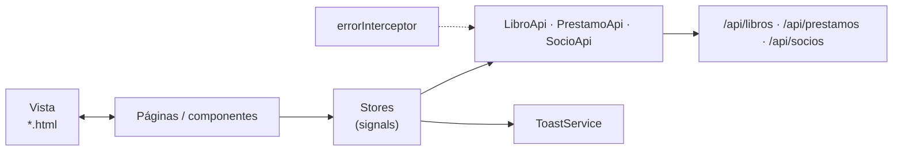

# 08 · Guía del frontend: Angular 21 paso a paso

> Angular 21 · standalone · zoneless · **signals** · Vitest · **sin librerías extra**.
> El proyecto terminado está en `biblioteca-frontend/`. Los bloques de código de esta guía se generan **directamente desde esos archivos**.

## Mapa

```text
src/app
├── core
│   ├── models        api-error.ts · libro.model.ts · socio.model.ts · prestamo.model.ts
│   ├── api           libro.api.ts · socio.api.ts · prestamo.api.ts
│   └── interceptors  error.interceptor.ts
├── shared
│   ├── ui            toast.service.ts · toast.ts
│   └── util          fechas.ts
├── features
│   ├── socios        socios.store.ts
│   ├── catalogo      catalogo.store.ts (+ spec) · pages/catalogo.page · components/libro-card · libro-form
│   └── prestamos     prestamos.store.ts (+ spec) · pages/prestamos.page · components/prestamo-card
├── app.config.ts · app.routes.ts · app.ts/html/css
proxy.conf.json
```



## Teoría previa

| Concepto | Qué es | Dónde se usa |
|---|---|---|
| **Componente standalone** | Componente que declara sus propios `imports`; no hay `NgModule` | Todos |
| **Signal** | Valor reactivo: `signal(0)`, se lee `x()`, se cambia `x.set()` | `libros`, `prestamos`, `socioActualId`… |
| **computed** | Signal derivada que se recalcula sola | `resumen`, `activos`, `historial`, `socioActual` |
| **effect** | Código que se ejecuta cuando cambian los signals que lee | `PrestamosPage` recarga al cambiar de socio |
| **Zoneless** | Angular no usa `zone.js`; la vista se actualiza cuando cambian signals | Toda la app |
| **Store / Facade** | Un servicio que concentra el estado y las operaciones | `CatalogoStore`, `PrestamosStore`, `SociosStore` |
| **Interceptor** | Función que ve toda petición/respuesta HTTP | `errorInterceptor` |
| **`input()` / `output()`** | Datos que entran / eventos que salen de un componente | `LibroCard`, `PrestamoCard`, `LibroForm` |
| **Formularios reactivos** | El formulario se define en TypeScript con `Validators` | `LibroForm`, buscador |

## Paso 1 · Proyecto, proxy y puertos

```powershell
cd biblioteca-frontend
npm install
npm start          # http://localhost:4201
```

El proxy reenvía `/api` al backend (puerto **8084**), así el front no depende de CORS. Está registrado en `angular.json` (`serve.options.proxyConfig`).

{{NG:proxy.conf.json}}

> `npm start` ejecuta `ng serve --port 4201`. Si el puerto está ocupado: `npx ng serve --port 4300` y agrega `http://localhost:4300` a `CORS_ORIGINS` solo si no usas el proxy.

## Paso 2 · Modelos (`core/models`)

Reflejan los DTO del backend. **Los códigos coinciden con los enums de Java.**

{{NG:src/app/core/models/libro.model.ts}}

{{NG:src/app/core/models/socio.model.ts}}

{{NG:src/app/core/models/prestamo.model.ts}}

- `LIMITE_PRESTAMOS_ACTIVOS = 3` repite la regla del backend para **avisar visualmente**; el que manda es el servidor.
- `REGLAS_LIBRO` repite los máximos del DTO para el formulario.

{{NG:src/app/core/models/api-error.ts}}

## Paso 3 · API e interceptor (`core/api`, `core/interceptors`)

Cada `*Api` es **el único lugar que conoce las rutas HTTP** de su recurso:

{{NG:src/app/core/api/libro.api.ts}}

`buscar` arma los parámetros con `HttpParams` (`q` solo si hay texto). Angular se encarga de codificar la URL.

{{NG:src/app/core/api/prestamo.api.ts}}

Un `PATCH` a `/api/prestamos/{id}/devolucion` **sin cuerpo** (`null`) registra la devolución.

{{NG:src/app/core/api/socio.api.ts}}

El interceptor convierte cualquier error en un `ApiError` con **mensaje legible** (el `mensaje` y `detalles` que manda `ApiError.java`; o "No hay conexión…" si el backend está apagado):

{{NG:src/app/core/interceptors/error.interceptor.ts}}

## Paso 4 · Avisos y utilidades (`shared`)

`ToastService` mantiene una lista de avisos en un signal; `Toast` los dibuja. Desaparecen solos a los 4 segundos.

{{NG:src/app/shared/ui/toast.service.ts}}

{{NG:src/app/shared/ui/toast.ts}}

`formatearFecha` **no usa `Date`** para mostrar fechas: así se evitan corrimientos de un día por zona horaria.

{{NG:src/app/shared/util/fechas.ts}}

## Paso 5 · Los Stores

Patrón **Store/Facade con signals**. Las páginas **leen** signals y **llaman** métodos; nunca hablan con la API.

### `SociosStore`: el socio activo

No hay login: quien usa el sistema elige en la cabecera con qué socio actúa. Los demás stores y páginas leen `socioActual`.

{{NG:src/app/features/socios/socios.store.ts}}

### `CatalogoStore`: buscar, disponibilidad, agregar

{{NG:src/app/features/catalogo/catalogo.store.ts}}

| Pieza | Tipo | Para qué |
|---|---|---|
| `libros` | `signal` | Libros que cumplen la búsqueda actual |
| `texto`, `soloDisponibles` | `signal` | El criterio vigente |
| `resumen` | `computed` | `total`, `conCopias` y `agotados` |
| `buscar / cargar` | métodos | Cambian el criterio y consultan |
| `consultarDisponibilidad / crear` | `Observable` | Llaman a la API y **emiten solo si salió bien** |
| `fallar` | función | Muestra el error en un toast y **corta** el flujo con `EMPTY` |

### `PrestamosStore`: prestar y devolver

{{NG:src/app/features/prestamos/prestamos.store.ts}}

| Pieza | Tipo | Para qué |
|---|---|---|
| `prestamos` | `signal` | Todos los préstamos del socio (activos e historial) |
| `activos`, `historial` | `computed` | Separan por `estado` |
| `resumen` | `computed` | `activos`, `vencidos`, `devueltos` y `limiteAlcanzado` (≥ 3) |
| `prestar / devolver` | `Observable<void>` | Llaman a la API, **refrescan la lista** y emiten **solo si salió bien** |

> **Por qué `Observable<void>` que emite solo en éxito:** la página cierra el formulario o recarga el catálogo dentro del `subscribe(next)`. Si el servidor rechaza (p. ej. **409** por límite o por falta de copias), no emite: el usuario ve el toast y la pantalla queda como estaba.

### Pruebas de los stores (Vitest + `HttpTestingController`)

{{NG:src/app/features/catalogo/catalogo.store.spec.ts}}

{{NG:src/app/features/prestamos/prestamos.store.spec.ts}}

```powershell
npx ng test --watch=false     # 14 pruebas en verde
```

## Paso 6 · La tarjeta del libro (`libro-card`)

Componente **presentacional**: recibe el libro por `input()` y avisa con `output()`. No conoce los stores.

{{NG:src/app/features/catalogo/components/libro-card/libro-card.ts}}

{{NG:src/app/features/catalogo/components/libro-card/libro-card.html}}

- Muestra **título, autor, categoría, ISBN** y un chip de **disponibilidad**: verde `2 de 3 disponibles` o rojo `Agotado`.
- **Ver disponibilidad** emite `consultar`; la página guarda el resultado y la tarjeta muestra `La próxima vence el …` si no quedan copias.
- **Prestar** se deshabilita si no hay copias, si no hay socio elegido o mientras se procesa (evita doble clic). El título del botón explica por qué.

{{NG:src/app/features/catalogo/components/libro-card/libro-card.css}}

## Paso 7 · El formulario de libro (`libro-form`)

Formulario reactivo en un diálogo. Las validaciones **reflejan las del DTO**: título, autor y categoría obligatorios; ISBN con patrón; año entre 1000 y 2100; ejemplares entre 1 y 100.

{{NG:src/app/features/catalogo/components/libro-form/libro-form.ts}}

{{NG:src/app/features/catalogo/components/libro-form/libro-form.html}}

- `Validators.required` + `Validators.pattern(/\S/)` rechazan un título de solo espacios (como `@NotBlank`).
- `form.markAllAsTouched()` hace aparecer los mensajes si se intenta guardar un formulario inválido.

## Paso 8 · La página del catálogo (`pages/catalogo.page`)

{{NG:src/app/features/catalogo/pages/catalogo.page.ts}}

- El **buscador** es un `FormControl`; `debounceTime(300)` espera a que el usuario deje de escribir antes de consultar. El filtro *Solo disponibles* consulta de inmediato (`merge`).
- `takeUntilDestroyed` cancela la suscripción cuando se destruye la página.
- `prestar` usa el **socio de la cabecera** y, si sale bien, recarga el catálogo (la copia ya se descontó).

{{NG:src/app/features/catalogo/pages/catalogo.page.html}}

- `@for … @empty` dibuja el mensaje cuando la búsqueda no encuentra nada.
- El aviso amarillo aparece mientras no haya socio elegido.

{{NG:src/app/features/catalogo/pages/catalogo.page.css}}

> **Sin scroll lateral:** el truco es `grid-template-columns: repeat(auto-fill, minmax(min(100%, 17rem), 1fr))`: las tarjetas se reparten el ancho y, en pantallas angostas, pasan a una columna.

## Paso 9 · Mis préstamos (`prestamo-card` y `pages/prestamos.page`)

{{NG:src/app/features/prestamos/components/prestamo-card/prestamo-card.ts}}

{{NG:src/app/features/prestamos/components/prestamo-card/prestamo-card.html}}

{{NG:src/app/features/prestamos/components/prestamo-card/prestamo-card.css}}

La página muestra **lo que el socio tiene en su poder** y su **historial**:

{{NG:src/app/features/prestamos/pages/prestamos.page.ts}}

`effect` observa `socios.socioActual()`: cada vez que cambia el socio de la cabecera se vuelven a pedir sus préstamos.

{{NG:src/app/features/prestamos/pages/prestamos.page.html}}

- El encabezado muestra `n de 3 préstamos activos` y avisa cuando se llega al **límite**.
- Un préstamo `vencido` se destaca en rojo.

{{NG:src/app/features/prestamos/pages/prestamos.page.css}}

## Paso 10 · Cabecera, configuración y rutas

La cabecera tiene la navegación y el **selector de socio**:

{{NG:src/app/app.ts}}

{{NG:src/app/app.html}}

{{NG:src/app/app.css}}

{{NG:src/app/app.config.ts}}

{{NG:src/app/app.routes.ts}}

`loadComponent` hace *lazy loading*: cada pantalla se descarga solo cuando se visita.

## Paso 11 · Estilos globales

Diseño propio, tema claro tipo "papel" con verde bosque (distinto del tablero oscuro de la clase anterior):

{{NG:src/styles.css}}

## Paso 12 · Verificar

| Prueba | Resultado esperado |
|---|---|
| Abrir <http://localhost:4201> | Catálogo con 6 libros, selector de socio (*Ana Pérez*) en la cabecera, **sin scroll lateral** |
| Redimensionar a 1366, 1024, 800 y 375 px | Las tarjetas se acomodan en 4, 3, 2 y 1 columnas; sin scroll horizontal en ninguno |
| Escribir `cervantes` en el buscador | Queda solo *Don Quijote de la Mancha* (tras 300 ms) |
| Marcar *Solo disponibles* | El *Quijote* desaparece de la lista |
| **Ver disponibilidad** en el *Quijote* | Aviso: "Todas las copias están prestadas. La próxima vence el …" |
| **+ Nuevo libro** con el título vacío | Mensaje de validación; no se envía |
| Agregar un libro con un ISBN ya existente | Toast de error 409; el formulario sigue abierto |
| **Prestar** *Cien años de soledad* como Ana | Toast "Préstamo realizado"; el libro baja a *2 de 3 disponibles* |
| Prestar hasta tener 3 préstamos y pedir un cuarto | Toast 409 por límite |
| Ir a **Mis préstamos** | Los libros de Ana en préstamo, con `n de 3 préstamos activos` |
| Cambiar el socio a **Luis Rojas** | Aparece el *Quijote* como **Vencido** |
| **Devolver** el *Quijote* | Toast "Devolución registrada"; pasa al historial; en el catálogo vuelve a *1 de 1 disponibles* |
| Apagar el backend y recargar | Aviso *"No hay conexión con el servidor"* con botón *Reintentar* |

```powershell
npx ng build          # compila para producción
npx ng test --watch=false
```
