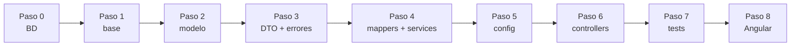
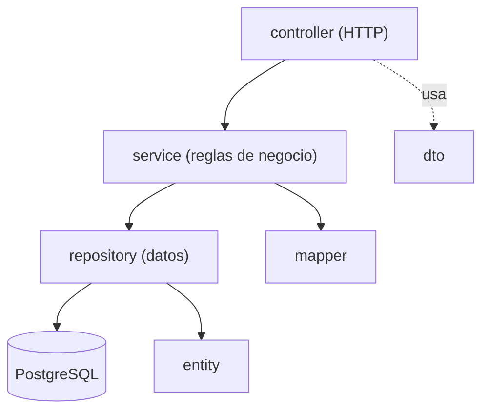
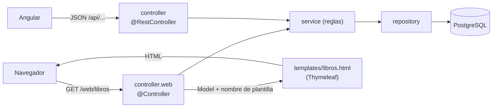

# Guía completa paso a paso: Backend del Sistema de Biblioteca

> Java 21 · Spring Boot 3.5 · PostgreSQL 18 · **Java puro, sin Lombok**.
> Partes de `biblioteca-backend-base` (proyecto en blanco que ya arranca) y lo completas paso a paso hasta tener `biblioteca-backend`.
> **Cada paso termina en: compilar → levantar → verificar.** El proyecto debe poder arrancar al terminar cada paso.

> ### 📌 Ruta de trabajo con los alumnos (partir desde el base)
> `biblioteca-backend-base` **ya trae hechos** los pasos 2 y 3 completos (enums, entity, repository, dto y exception) **y los mappers del Paso 4** (archivos 4.1 a 4.3). Esos archivos están en el base y sus bloques de esta guía sirven para **leerlos y entender cómo funcionan**, no para volver a escribirlos.
>
> **Se continúa desde el Paso 4, Archivo 4.4 (`LibroService`)** y se completan:
> 1. **service** (interfaces, archivos 4.4 a 4.6) y **service.impl** (archivos 4.7 a 4.9, donde viven las reglas de negocio),
> 2. **Paso 4B (opcional): controllers web con Thymeleaf**, para ver el sistema funcionando en el navegador *antes* de tener Swagger y Angular. Las plantillas HTML ya vienen en el base,
> 3. **config** (Paso 5),
> 4. **controller** REST (Paso 6),
> 5. y luego los tests (Paso 7) y Angular (Paso 8). Al pasar a Angular, Thymeleaf se **apaga con una propiedad**, sin borrar código.
>
> El base **compila y arranca sin errores** aunque esos paquetes estén vacíos: nada de lo que ya trae depende de ellos. Solo falta que aparezcan los endpoints en Swagger (Paso 6).

## Mapa del proceso

| Paso | Qué haces | Paquetes | Verificas | En el base |
|---|---|---|---|---|
| 0 | Preparar entorno y base de datos | — | Conexión con `psql` | — |
| 1 | Levantar el proyecto base | — | Flyway aplica V1 y V2; Swagger vacío | — |
| 2 | Modelo | `enums`, `entity`, `repository` | Hibernate valida las tablas | ✔ ya hecho |
| 3 | DTOs, excepciones y handler | `dto`, `exception` | Arranca sin errores | ✔ ya hecho |
| 4 | Mappers y Services | `mapper`, `service`, `service.impl` | Spring inyecta los beans | mappers ✔ ya hechos · **services: continuar desde 4.4** |
| 4B | **Opcional:** primera pantalla con Thymeleaf | `controller.web` (+ `templates`) | Catálogo y préstamos en `http://localhost:8084/web/libros` | plantillas y CSS ✔ ya hechos · **`controller.web` ✎ falta** |
| 5 | Configuración | `config` | Título en Swagger | ✎ falta |
| 6 | Controllers | `controller` | Probar los endpoints en Swagger (incluidos los 409) | ✎ falta |
| 7 | Tests | `src/test` | `.\mvnw.cmd test` en verde | ✎ falta |
| 8 | Conectar con Angular | — | Catálogo y préstamos funcionando | ✎ falta |



---

## Fase de análisis: diagrama de casos de uso (antes de construir)


*(Detalle y teoría en [00-casos-de-uso.md](00-casos-de-uso.md).)*

- El **actor** (el monito) es el **Usuario**; está fuera del sistema.
- Cada **óvalo principal** (Buscar, Consultar disponibilidad, Prestar, Devolver, Ver mis préstamos, Agregar libro) se convierte en **un endpoint**.
- **«include» = siempre** (*Realizar préstamo* siempre verifica las reglas). **«extend» = a veces** (*Rechazar préstamo* solo si no hay copias, hay límite o hay duplicado).
- Los óvalos auxiliares son **reglas de negocio**: vivirán en el **Service**.

| Óvalo | Endpoint | Método del service |
|---|---|---|
| CU-01 Buscar libros | `GET /api/libros?q=...` | `LibroService.buscar()` |
| CU-02 Consultar disponibilidad | `GET /api/libros/{id}/disponibilidad` | `LibroService.consultarDisponibilidad()` |
| CU-03 Realizar préstamo | `POST /api/prestamos` | `PrestamoService.prestar()` |
| CU-04 Devolver libro | `PATCH /api/prestamos/{id}/devolucion` | `PrestamoService.devolver()` |
| CU-05 Ver mis préstamos | `GET /api/prestamos?socioId=...` | `PrestamoService.listar()` |
| CU-06 Agregar libro | `POST /api/libros` | `LibroService.crear()` |

---

## Teoría previa (léela antes de empezar)

### 0. Vocabulario Java que usarás

| Término | Qué es | Ejemplo |
|---|---|---|
| **package** | Carpeta lógica que agrupa clases | `cl.ipss.biblioteca.entity` |
| **class** | Molde para crear objetos | `Libro` |
| **interface** | Contrato: qué métodos existen, sin implementarlos | `PrestamoService` |
| **enum** | Conjunto cerrado de valores | `EstadoPrestamo` |
| **record** | Clase inmutable concisa para datos | `PrestamoResponse` |
| **annotation** | Etiqueta `@Algo` que da instrucciones a Spring/JPA/Validation | `@Entity`, `@Service` |
| **constructor** | Método que crea el objeto | `public Libro() {}` |
| **getter / setter** | Métodos para leer / modificar un campo | `getTitulo()`, `setTitulo(...)` |
| **excepción** | Objeto que representa un error | `LibroSinEjemplaresException` |
| **bean** | Objeto que **Spring crea y administra** | un `@Service` |
| **relación** | Una entity que apunta a otra (clave foránea) | `Prestamo` → `Libro` y `Socio` |

> **Sin Lombok:** en este proyecto los getters, setters y logs se escriben **a mano**. Así compila en cualquier IDE sin plugins.

### 1. Arquitectura MVC en capas



Una capa **solo habla con la de abajo**. Más detalle en [02-teoria-mvc.md](02-teoria-mvc.md).

### 2. DTO vs Entity

La **Entity** representa la tabla; el **DTO** representa lo que viaja por HTTP. Si mezclaras ambos, el cliente podría enviar campos que no debe (p. ej. fijar `ejemplaresDisponibles` o la fecha de vencimiento). Por eso `CrearPrestamoRequest` solo trae `libroId` y `socioId`.

### 3. Programar contra interfaces

Los controllers usan `LibroService`, `SocioService` y `PrestamoService` (interfaces). La lógica está en los `*ServiceImpl`. En los tests se reemplazan por un *mock*.

### 4. Patrones y SOLID

Resumen en [03-patrones-de-diseno.md](03-patrones-de-diseno.md): Service Layer, Repository, DTO, Mapper, Dependency Injection, Singleton, JavaBean, Front Controller, Advice, bloqueo pesimista.

### 5. Reglas de negocio de este proyecto

1. **Sin copias no hay préstamo** (`ejemplaresDisponibles` = 0) → **409**.
2. **Máximo 3 préstamos activos por socio.** El cuarto → **409**.
3. **No se pide dos veces el mismo libro** sin devolverlo → **409**.
4. **Una devolución se registra una vez**; la segunda → **409**. Al devolver se **suma una copia**.
5. **Plazo de 14 días**: lo calcula el sistema (el cliente no envía fechas).
6. Errores: **404** no existe · **400** datos inválidos · **409** conflicto · **500** inesperado.

---

## Paso 0 · Preparar el entorno y la base de datos

### Requisitos

| Herramienta | Versión | Comprobar |
|---|---|---|
| JDK | **21** | `java -version` |
| PostgreSQL | 18 | `psql --version` |
| IDE | IntelliJ, VS Code o Eclipse | — |

> **Windows:** si `java -version` muestra otra versión (p. ej. 1.8), apunta `JAVA_HOME` a un JDK 21 en la misma terminal:
> ```powershell
> $env:JAVA_HOME = "C:\ruta\a\jdk-21"
> $env:Path = "$env:JAVA_HOME\bin;$env:Path"
> ```

### 1. Crear la base de datos (una sola vez)

Usa el puerto y la clave de **tu** PostgreSQL 18:

```powershell
psql -U postgres -h localhost -p 5432 -c "CREATE DATABASE biblioteca_db;"
```

> Si tienes PostgreSQL 14 y 18 instalados, uno usa el 5432 y el otro el 5433. Para saber a cuál te conectaste:
> `psql -U postgres -h localhost -p 5433 -c "SHOW server_version;"`

> **¿Prefieres pgAdmin?** Es lo mismo: clic derecho en *Databases → Create → Database…* → nombre `biblioteca_db`.

**✅ Verificar:** `psql -U postgres -h localhost -p 5432 -c "\l"` muestra la base `biblioteca_db`.

### 2. ¿Con qué usuario se conecta el backend?

Crear la base **no define el usuario**: el usuario es el de la conexión con la que el backend entra a PostgreSQL. El backend lee estas variables (valores por defecto entre paréntesis):

| Variable | Qué es | Por defecto |
|---|---|---|
| `DB_USER` | Usuario de PostgreSQL | `biblioteca` |
| `DB_PASSWORD` | Su clave | `biblioteca` |
| `DB_PORT` | Puerto del servidor | `5432` |
| `DB_NAME` | Nombre de la base | `biblioteca_db` |

**Opción A · Usar el mismo usuario con el que entras a pgAdmin.** Casi siempre es `postgres` con la clave que definiste al instalar PostgreSQL 18. Como el proyecto trae por defecto el usuario `biblioteca`, aquí **sí** debes indicar el usuario y la clave antes de levantar el backend (y el puerto si no es el 5432):

```powershell
$env:DB_USER = "postgres"
$env:DB_PASSWORD = "la_clave_de_postgres"
# $env:DB_PORT = "5433"     # solo si tu PostgreSQL 18 no usa el 5432
```

> ¿Cuál es mi puerto? En pgAdmin: clic derecho sobre el servidor → *Properties → Connection → Port*. O en el *Query Tool*: `SHOW port;`

**Opción B · Crear un usuario propio para esta aplicación** (es la que usa el proyecto por defecto: usuario `biblioteca`, clave `biblioteca`). Es lo habitual: un usuario por aplicación. En pgAdmin abre el **Query Tool sobre la base `biblioteca_db`** (clic derecho en `biblioteca_db` → *Query Tool*), pega este script y ejecútalo con **F5**. Es el archivo [`crear-bd-pgadmin.sql`](../biblioteca-backend-base/crear-bd-pgadmin.sql):

{{CODE:../crear-bd-pgadmin.sql}}

> ⚠️ **En pgAdmin usa SOLO este script.** El archivo `crear-bd.sql` (más abajo) contiene comandos de `psql` (`\gexec`, `\connect`) y en el Query Tool de pgAdmin **falla completo sin crear el usuario**.

**✅ Verificar:** en el mismo Query Tool ejecuta `SELECT rolname FROM pg_roles WHERE rolname = 'biblioteca';`. Debe devolver una fila.

Luego levanta el backend con ese usuario (o no definas nada: `biblioteca` / `biblioteca` ya son los valores por defecto):

```powershell
$env:DB_USER = "biblioteca"
$env:DB_PASSWORD = "biblioteca"
.\mvnw.cmd spring-boot:run
```

> **Alternativa por terminal (solo `psql`):** el proyecto trae [`crear-bd.sql`](../biblioteca-backend-base/crear-bd.sql), que hace **todo de una vez**: crea (o actualiza) el usuario, crea la base si no existe y da los permisos. Se puede ejecutar varias veces sin errores. Ejecútalo como `postgres` desde la carpeta del proyecto:
>
> ```powershell
> psql -U postgres -h localhost -p 5432 -f crear-bd.sql
> ```
>
> Usa comandos propios de `psql` (`\gexec`, `\connect`), por eso se ejecuta con `psql` y **no** en el Query Tool de pgAdmin; en pgAdmin usa `crear-bd-pgadmin.sql` (Opción B).

Contenido de `crear-bd.sql`:

{{CODE:../crear-bd.sql}}

**¿Por qué hace falta `GRANT ALL ON SCHEMA public`?** Desde PostgreSQL 15 los usuarios normales ya no pueden crear tablas en el esquema `public` por defecto. Como el dueño de la base ya puede, el `GRANT` es una segunda garantía. Sin ellos Flyway fallaría con *permission denied for schema public*.

**¿Cómo saber si el usuario y la clave están bien?** Antes de levantar el backend prueba la conexión:

```powershell
psql -U biblioteca -h localhost -p 5432 -d biblioteca_db -c "SELECT current_user;"
```

Si pide clave y responde `biblioteca`, el backend podrá conectarse igual. Si dice *password authentication failed*, el usuario o la clave no coinciden.

### 3. Las 3 formas de configurar usuario y clave

Por defecto el backend usa `biblioteca` / `biblioteca` (valores por defecto de `application.yml`: `${DB_USER:biblioteca}`).

**Forma 1 · Editar `application.yml`** (la más simple, pero cambia un archivo versionado):

```yaml
spring:
  datasource:
    username: tu_usuario
    password: tu_clave
```

**Forma 2 · Variables de entorno en la terminal** (PowerShell):

```powershell
$env:DB_USER = "postgres"
$env:DB_PASSWORD = "tu_clave"
# $env:DB_PORT = "5433"     # solo si tu PostgreSQL no usa el 5432
.\mvnw.cmd spring-boot:run
```

**Forma 3 · Variables en el IDE** (no ensucia el repositorio):
- IntelliJ: *Run → Edit Configurations → Environment variables* → `DB_USER=...;DB_PASSWORD=...`
- VS Code: en `launch.json`, la clave `"env": { "DB_USER": "...", "DB_PASSWORD": "..." }`
- Eclipse: *Run Configurations → Environment*.

Variables disponibles: `DB_HOST, DB_PORT, DB_NAME, DB_USER, DB_PASSWORD, SERVER_PORT, CORS_ORIGINS, LOG_LEVEL_APP, WEB_THYMELEAF`.

### Errores de conexión comunes

| Mensaje | Causa | Solución |
|---|---|---|
| `password authentication failed for user "biblioteca"` (o *la autentificación password falló*) | El usuario no existe o la clave no coincide (por ejemplo, el script no se ejecutó completo) | Revisa `DB_PASSWORD`/`DB_USER`. Para reponer la clave en pgAdmin: `ALTER USER biblioteca WITH PASSWORD 'biblioteca';` |
| `syntax error at or near "\"` al ejecutar el script en pgAdmin | Se pegó `crear-bd.sql` (comandos de `psql`) en el Query Tool y no se creó el usuario | Usa [`crear-bd-pgadmin.sql`](../biblioteca-backend-base/crear-bd-pgadmin.sql) (Opción B) |
| `role "biblioteca" does not exist` | El usuario por defecto del proyecto aún no existe | Ejecuta el script de la **Opción B** (o usa `postgres` con la Opción A) |
| `database "biblioteca_db" does not exist` | No creaste la base, o está mal escrito `DB_NAME` | Crea `biblioteca_db` (punto 1 de este paso) |
| `Connection refused` | Puerto equivocado o PostgreSQL apagado | Verifica el puerto con `SHOW port;` y defínelo con `DB_PORT`; revisa que el servicio esté en ejecución |
| `permission denied for schema public` (Flyway) | El usuario no puede crear tablas (PostgreSQL 15+) | Conectado a `biblioteca_db`: `ALTER DATABASE biblioteca_db OWNER TO biblioteca;` y `GRANT ALL ON SCHEMA public TO biblioteca;` |
| `Port 8084 was already in use` | Otro proceso usa el puerto | Ciérralo o define `SERVER_PORT` |
| Cambié el `application.yml` y sigue igual | La aplicación no se reinició | Detén y vuelve a ejecutar; en Eclipse: *Project → Clean…* |
| En otra terminal vuelve a fallar | Las variables `$env:` valen solo para la terminal donde se definieron | Defínelas de nuevo, o usa la Forma 1 o la Forma 3 |

### ✅ Verificar

```powershell
$env:PGPASSWORD = "biblioteca"
psql -U biblioteca -h localhost -p 5432 -d biblioteca_db -c "select 1"
```

Debe responder `1`.

---

## Paso 1 · Levantar el proyecto base y verificar la conexión

Abre la carpeta `biblioteca-backend-base`. Trae:

| Archivo | Para qué |
|---|---|
| `pom.xml` | Dependencias (solo las necesarias: web, validation, **thymeleaf (vista opcional)**, data-jpa, postgresql, flyway, springdoc, test) |
| `src/main/resources/templates/`, `static/web.css` y `static/favicon.ico` | Las 4 plantillas HTML de Thymeleaf, su CSS y el icono de la pestaña (**ya vienen hechos**; se usan en el Paso 4B) |
| `src/main/resources/application.yml` | Puerto, base de datos, logs |
| `db/migration/V1__crear_tablas_biblioteca.sql` y `V2__datos_iniciales.sql` | Esquema y datos de ejemplo (6 libros, 3 socios, 3 préstamos) |
| `BibliotecaApplication.java` | Punto de entrada |
| `enums`, `entity`, `repository`, `dto`, `exception`, `mapper` | **Ya vienen hechos** (pasos 2, 3 y los mappers del 4) |
| `package-info.java` en `service`, `service.impl`, `controller.web`, `config` y `controller` | Un `TODO` que indica qué crear en cada paso (**se continúa desde `service`**) |

### `application.yml`

{{CODE:main/resources/application.yml}}

**Explicación:** `app.web.enabled` (variable `WEB_THYMELEAF`) enciende o apaga las páginas Thymeleaf del Paso 4B, y `spring.thymeleaf.cache: false` hace que al editar una plantilla se vea el cambio sin reiniciar. `ddl-auto: validate` hace que Hibernate **solo compruebe** que las tablas coinciden con las entities; el esquema lo crea Flyway. `${DB_USER:biblioteca}` significa "usa la variable `DB_USER`, o `biblioteca` si no existe". El log va a `logs/biblioteca-backend.log` con rotación (10 MB, 7 días). Puertos: backend **8084**, Angular **4201**, para poder tener abiertos a la vez los proyectos de las clases anteriores.

### Migraciones Flyway

`V1__crear_tablas_biblioteca.sql`:

{{CODE:main/resources/db/migration/V1__crear_tablas_biblioteca.sql}}

`V2__datos_iniciales.sql` (6 libros, 3 socios y 3 préstamos: uno vigente, uno vencido y uno devuelto):

{{CODE:main/resources/db/migration/V2__datos_iniciales.sql}}

> ⚠️ **Una migración ya aplicada no se edita nunca.** Los cambios van en `V3`, `V4`…

### `BibliotecaApplication`

{{CODE:main/java/cl/ipss/biblioteca/BibliotecaApplication.java}}

`@SpringBootApplication` activa la configuración automática y el escaneo de componentes del paquete `cl.ipss.biblioteca` y sus subpaquetes.

### ✅ Compilar → levantar → verificar

```powershell
.\mvnw.cmd spring-boot:run
```

En el log debes ver:

```text
Migrating schema "public" to version "1 - crear tablas biblioteca"
Migrating schema "public" to version "2 - datos iniciales"
Started BibliotecaApplication in ... seconds
```

Abre <http://localhost:8084/swagger-ui.html>: debe cargar **sin endpoints** (aún no hay controller).

---

## Paso 2 · Crear el MODELO: enum, entities y repositories

> ✔ **En `biblioteca-backend-base` este paso ya viene hecho.** Léelo para entender el modelo; no hace falta volver a escribirlo.

{{FILES:2}}

### ✅ Compilar → levantar → verificar (Paso 2)

```powershell
.\mvnw.cmd spring-boot:run
```

Sin errores de Hibernate (`Schema-validation`) y `Started BibliotecaApplication`. Si aparece `missing column`, el nombre de un campo no coincide con la tabla.

---

## Paso 3 · Crear DTOs, excepciones y manejo de errores

> ✔ **En `biblioteca-backend-base` este paso ya viene hecho.** Léelo para entender los DTO y los errores; no hace falta volver a escribirlo.

{{FILES:3}}

### ✅ Compilar → levantar → verificar (Paso 3)

`.\mvnw.cmd spring-boot:run` debe arrancar igual que antes. Aún no hay endpoints que probar.

---

## Paso 4 · Crear Mappers y Services (interface + implementación)

### 📝 Logs con SLF4J (sin Lombok)

SLF4J es la fachada de logs de Spring Boot. Sin Lombok, cada clase declara su logger **a mano**:

```java
private static final Logger log = LoggerFactory.getLogger(PrestamoServiceImpl.class);
```

Criterio del proyecto:

| Dónde | Nivel | Formato |
|---|---|---|
| Service, al recibir/terminar una operación | `info` | `--- command receive to ... ---` / `--- finish ... ---` |
| Service, cuando rechaza algo (sin copias, límite, duplicado, no encontrado) | `warn` | `--- loan limit reached: ... ---` |
| Handler: datos inválidos | `warn` | `--- invalid request: ... ---` |
| Handler: error inesperado | `error` (con la excepción) | `Unexpected error processing request` |
| Handler: 404 y 409 | `debug` | para no duplicar lo que ya dijo el service |

Reglas: mensajes en **inglés**, entre `--- ... ---`, con `{}` para los valores y **sin datos sensibles** (por eso no se registran correos).

> ✔ **Los mappers (archivos 4.1, 4.2 y 4.3) ya vienen hechos en `biblioteca-backend-base`.**
> ### ➡️ CONTINUAR DESDE AQUÍ: Archivo 4.4 (`LibroService`)
> Los archivos 4.4 a 4.9 (interfaces e implementaciones de los services) son los que se **completan con los alumnos**.

{{FILES:4}}

### ✅ Compilar → levantar → verificar (Paso 4)

Debe arrancar sin `NoSuchBeanDefinitionException`: Spring crea los tres mappers y los tres services e inyecta los repositories.

---

## Paso 4B · (Opcional) Primera pantalla con Thymeleaf

Con los services terminados ya se puede **ver el sistema funcionando en el navegador**, sin esperar a Swagger ni a Angular. Sirve para probar *front ↔ back* de inmediato y entender cómo una pantalla usa las reglas de negocio.



| | Thymeleaf (`/web/...`) | API REST + Angular (`/api/...`) |
|---|---|---|
| Quién dibuja la pantalla | El **servidor** (HTML ya armado) | El **navegador** (Angular) con el JSON |
| El controller devuelve | El **nombre de una plantilla** | **JSON** |
| Anotación | `@Controller` | `@RestController` |
| Reglas de negocio | **Los mismos services** | **Los mismos services** |

> **No se duplica lógica:** ambas vistas llaman a los mismos `LibroService`, `PrestamoService` y `SocioService`. Solo cambia la capa de presentación.

### 1. El starter y la configuración (ya están en el base)

En el `pom.xml` aparece un starter más (la regla de "solo dependencias necesarias" se cumple porque es una **vista opcional**):

```xml
<dependency>
    <groupId>org.springframework.boot</groupId>
    <artifactId>spring-boot-starter-thymeleaf</artifactId>
</dependency>
```

Y en `application.yml` (ver Paso 1) la propiedad `app.web.enabled` y `spring.thymeleaf.cache: false`.

### 2. Las plantillas HTML (ya vienen en el base)

Están en `src/main/resources/templates/`. **No hay que escribirlas**: se leen para entender cómo se usan los atributos `th:`.

| Atributo | Para qué |
|---|---|
| `th:text="${libro.titulo}"` | Escribe un dato del `Model` dentro de la etiqueta (escapa el HTML) |
| `th:each="libro : ${libros}"` | Repite la etiqueta por cada elemento de la lista |
| `th:if` / `th:unless` | Muestra u oculta según una condición |
| `th:href="@{/web/libros(socioId=${socioId})}"` | Arma un enlace con parámetros |
| `th:action="@{/web/prestamos}"` | Dirección a la que envía el formulario |
| `th:replace="~{fragments :: menu(...)}"` | Incluye un trozo reutilizable (la cabecera) |
| `${#temporals.format(fecha, 'dd-MM-yyyy')}` | Da formato a una fecha |

`fragments.html` (cabecera y menú reutilizables):

{{CODE:main/resources/templates/fragments.html}}

`libros.html` (catálogo: búsqueda, disponibilidad y botón **Prestar**):

{{CODE:main/resources/templates/libros.html}}

`disponibilidad.html` (consultar disponibilidad):

{{CODE:main/resources/templates/disponibilidad.html}}

`prestamos.html` (mis préstamos y **Devolver**):

{{CODE:main/resources/templates/prestamos.html}}

`static/web.css` (junto a él está `static/favicon.ico`, el icono de la pestaña: el navegador lo pide solo, y sin él el log mostraría un 404 por cada página):

{{CODE:main/resources/static/web.css}}

### 3. Los controllers web (lo que se completa)

{{FILES:4B}}

### ✅ Compilar → levantar → verificar (Paso 4B)

```powershell
.\mvnw.cmd spring-boot:run
```

Abre <http://localhost:8084/web/libros>. Prueba (con los datos de ejemplo):

| # | Prueba | Resultado esperado |
|---|---|---|
| 1 | Abrir `/web/libros` | Tabla con 6 libros; *Don Quijote* aparece **Agotado** y su botón *Prestar* está deshabilitado |
| 2 | Buscar `clean` y pulsar **Buscar** | Solo *Clean Code* |
| 3 | Marcar **Solo disponibles** | El *Quijote* desaparece |
| 4 | **Ver disponibilidad** del *Quijote* | "Todas las copias están prestadas. La próxima vence el …" |
| 5 | Con *Ana Pérez*, **Prestar** *Cien años de soledad* | Mensaje verde "Préstamo realizado…" y el libro baja a *2 de 3* |
| 6 | **Prestar** el mismo libro otra vez | Mensaje rojo: el socio ya lo tiene |
| 7 | Prestar dos libros más a Ana y un cuarto | Mensaje rojo: **máximo de 3 préstamos activos** |
| 8 | Ir a **Mis préstamos** y **Devolver** | Mensaje verde; el libro pasa al historial |
| 9 | Elegir *Luis Rojas* en *Mis préstamos* | El *Quijote* aparece como **Vencido** |

En el log verás `--- start process web page: GET /web/libros ---`. Las mismas reglas que en la API: si fallan, el mensaje sale en la página.

### 🔁 Cuando pases a Angular: apagar Thymeleaf (sin comentar código)

| Cómo | Qué hace |
|---|---|
| `$env:WEB_THYMELEAF = "false"` y volver a levantar | Los controllers web **no se crean**: `/web/...` deja de existir y la API REST sigue igual |
| Editar `app.web.enabled: false` en `application.yml` | Lo mismo, de forma permanente |
| Borrar el paquete `controller.web`, la carpeta `templates`, `static/web.css` y el starter del `pom.xml` | Elimina Thymeleaf por completo |

La API REST (`/api/...`), Swagger y Angular **no dependen** de Thymeleaf.

---

## Paso 5 · Crear la configuración: Swagger y CORS

{{FILES:5}}

### ✅ Compilar → levantar → verificar (Paso 5)

Abre <http://localhost:8084/swagger-ui.html>: arriba debe leerse **API Sistema de Biblioteca** (aún sin endpoints).

---

## Paso 6 · Crear los CONTROLLERS, levantar y probar todo en Swagger

{{FILES:6}}

### ✅ Compilar → levantar → verificar en Swagger

```powershell
.\mvnw.cmd spring-boot:run
```

Abre <http://localhost:8084/swagger-ui.html>. Deben aparecer los grupos **Libros**, **Socios** y **Préstamos**. Prueba en este orden (parte con los datos de ejemplo: libros 1 a 6, socios 1 Ana · 2 Luis · 3 Camila, y los préstamos 1 —Ana tiene *Clean Code*—, 2 —Luis tiene *Don Quijote*, vencido— y 3 —devuelto—):

| # | Prueba | Petición | Resultado esperado |
|---|---|---|---|
| 1 | Listar el catálogo | `GET /api/libros` | **200** con 6 libros ordenados por título |
| 2 | **Buscar** por título | `GET /api/libros?q=clean` | **200** con 1 libro (*Clean Code*) |
| 3 | Buscar por autor | `GET /api/libros?q=cervantes` | **200** con *Don Quijote de la Mancha* |
| 4 | Solo disponibles | `GET /api/libros?soloDisponibles=true` | **200** con 5 libros (el *Quijote* no aparece) |
| 5 | Obtener uno | `GET /api/libros/2` | **200** |
| 6 | Obtener inexistente | `GET /api/libros/999` | **404** `No existe un libro con id 999` |
| 7 | **Disponibilidad** con copias | `GET /api/libros/2/disponibilidad` | **200** `disponible: true`, `ejemplaresDisponibles: 1`, `proximaDevolucion: null` |
| 8 | Disponibilidad sin copias | `GET /api/libros/3/disponibilidad` | **200** `disponible: false` y `proximaDevolucion` = el vencimiento del préstamo de Luis (ya pasado) |
| 9 | Agregar un libro | `POST /api/libros` `{"titulo":"Refactoring","autor":"Martin Fowler","isbn":"978-0134757599","categoria":"Informática","anioPublicacion":2018,"ejemplares":2}` | **201**, cabecera `Location: /api/libros/7`, 2 de 2 disponibles |
| 10 | Libro inválido | `POST /api/libros` con `"isbn":"abc"` | **400** con `detalles: ["isbn: El ISBN debe tener entre 10 y 17 dígitos o guiones"]` |
| 11 | ISBN repetido | `POST /api/libros` con el mismo ISBN de la prueba 9 | **409** `Ya existe un registro con ISBN …` |
| 12 | Listar socios | `GET /api/socios` | **200** con 3 socios |
| 13 | **Prestar** (feliz) | `POST /api/prestamos` `{"libroId":1,"socioId":1}` | **201**, `Location`, `estado: ACTIVO`, vence en 14 días; el libro 1 queda en 2 de 3 |
| 14 | **Mismo libro otra vez** | La misma petición de la prueba 13 | **409** `El socio ya tiene prestado «Cien años de soledad»…` |
| 15 | **Sin copias** | `POST /api/prestamos` `{"libroId":3,"socioId":1}` | **409** `No quedan ejemplares disponibles de «Don Quijote de la Mancha»…` |
| 16 | Tercer préstamo de Ana | `POST /api/prestamos` `{"libroId":4,"socioId":1}` | **201** (Ana ya tiene 3 activos) |
| 17 | **Límite de 3** | `POST /api/prestamos` `{"libroId":5,"socioId":1}` | **409** `El socio ya tiene el máximo de 3 préstamos activos…` |
| 18 | Socio inexistente | `POST /api/prestamos` `{"libroId":5,"socioId":999}` | **404** `No existe un socio con id 999` |
| 19 | Cuerpo vacío | `POST /api/prestamos` `{}` | **400** con `detalles` de `libroId` y `socioId` |
| 20 | Préstamos de Ana | `GET /api/prestamos?socioId=1&estado=ACTIVO` | **200** con 3 préstamos |
| 21 | **Devolver** | `PATCH /api/prestamos/2/devolucion` | **200**, `estado: DEVUELTO`, `fechaDevolucion` = hoy; el libro 3 pasa a 1 de 1 |
| 22 | **Devolver otra vez** | La misma petición de la prueba 21 | **409** `El préstamo 2 ya fue devuelto` |
| 23 | Devolver inexistente | `PATCH /api/prestamos/999/devolucion` | **404** |
| 24 | Ya hay copia del Quijote | `POST /api/prestamos` `{"libroId":3,"socioId":3}` | **201** (el libro volvió a estar disponible) |
| 25 | Filtro desconocido | `GET /api/prestamos?estado=PERDIDO` | **400** `La solicitud está mal formada` |

Todos los errores salen con el mismo formato:

```json
{ "fecha": "2026-10-27T22:00:00", "status": 409, "error": "Conflict", "mensaje": "…", "detalles": [] }
```

En el log (`logs/biblioteca-backend.log`) verás, por ejemplo, para la prueba 17:

```text
--- start process endpoint: POST /api/prestamos ---
--- command receive to lend book: 5 to member: 1 ---
--- loan limit reached: member 1 ---
```

(sin `end process endpoint`, porque hubo error).

---

## Paso 7 · Tests automáticos

Los tests **no necesitan base de datos**: los services se prueban con Mockito y los controllers con `@WebMvcTest`.

{{FILES:7}}

### ✅ Ejecutar

```powershell
.\mvnw.cmd test
```

Debe terminar con `BUILD SUCCESS` y `Tests run: 55, Failures: 0, Errors: 0` (44 de la API y los services + 11 de las páginas Thymeleaf; estos últimos solo si hiciste el Paso 4B).

---

## Paso 8 · Conectar con Angular (el front ya está listo)

El frontend terminado está en `biblioteca-frontend/`. Guía completa: [08-guia-angular-paso-a-paso.md](08-guia-angular-paso-a-paso.md).

> Si hiciste el Paso 4B, Thymeleaf puede seguir encendido: Angular usa `/api/...` y Thymeleaf `/web/...`, no se molestan. Para dejar solo Angular, usa `WEB_THYMELEAF=false` (ver Paso 4B).

1. Backend levantado en el puerto **8084**.
2. En otra terminal:

```powershell
cd biblioteca-frontend
npm install
npm start
```

3. Abre <http://localhost:4201>: verás el catálogo con los 6 libros de ejemplo y, en la cabecera, el selector de socio.
4. Prueba: buscar, *Ver disponibilidad*, prestar con el socio elegido, ir a *Mis préstamos* y devolver, y llegar al límite de 3 préstamos para ver el aviso.

`proxy.conf.json` reenvía `/api` al backend, por lo que Angular no depende de CORS (igual se deja `CorsConfig`).

---

## Anexo A · Problemas frecuentes

| Síntoma | Causa | Solución |
|---|---|---|
| `Unsupported class file major version` / `release version 21 not supported` | Maven usa otro JDK | Apuntar `JAVA_HOME` a un JDK 21 |
| `Schema-validation: missing column [...]` | Campo de la entity distinto de la columna | Revisar `@Column(name = ...)` |
| `FlywayException: Validate failed: Migration checksum mismatch` | Editaste una migración ya aplicada | Revertir el cambio y crear `V3` |
| Marcadores rojos en Eclipse sobre las excepciones | Falta `serialVersionUID` | Agregarlo (ya está en las 6 excepciones) |
| `LazyInitializationException` al mapear un préstamo | El mapper se ejecutó fuera de la transacción | Llamar al mapper dentro del método del service |
| `could not determine data type of parameter` en la búsqueda | El texto llegó `null` a la consulta | Convertir `null` en `""` en el service (ya está hecho) |
| `404` en `/swagger-ui.html` | El backend no arrancó | Revisar el log |
| `404` en `/web/libros` | `WEB_THYMELEAF=false`, o aún no existe el paquete `controller.web` | Quitar la variable (por defecto está activo) y completar el Paso 4B |
| `TemplateInputException: Error resolving template [libros]` | La plantilla no está en `src/main/resources/templates/` o el nombre no coincide | El `return "libros"` debe coincidir con `libros.html` |
| La página de error muestra JSON en vez de HTML | Una excepción de negocio no capturada en el controller web | Agregarla al `catch` del método (el handler global responde JSON) |
| Tras editar una plantilla no cambia nada | Caché de plantillas activa | Dejar `spring.thymeleaf.cache: false` en desarrollo |
| `400` al prestar con ids correctos | JSON mal escrito (`"libroId"` sin comillas) | Revisar el cuerpo |
| El front muestra *No hay conexión con el servidor* | Backend apagado o puerto distinto | Levantar el backend en 8084 |
| `CORS` en el navegador | Front sin proxy | Usar `npm start` (con proxy) o `CORS_ORIGINS` |

## Anexo B · Checklist de calidad

- [ ] Sin Lombok ni librerías de generación de código
- [ ] Entities con constructor vacío, getters y setters a mano (sin setter de `id` ni de fechas de auditoría)
- [ ] DTO como `record`
- [ ] Las reglas viven en el service, no en el controller
- [ ] Errores documentados una sola vez en el `@RestControllerAdvice`
- [ ] `serialVersionUID` en cada excepción
- [ ] Logs con el formato `--- texto: {} ---`, en inglés, sin datos sensibles
- [ ] `.\mvnw.cmd test` en verde
- [ ] Probados en Swagger el 409 por falta de copias, por límite de 3 y por devolución repetida
- [ ] Después de prestar y devolver, `ejemplares_disponibles` cuadra con los préstamos activos (consulta del documento 06)

## Anexo C · Resumen: qué se crea en cada paso

> En `biblioteca-backend-base` ya existen los pasos 2 y 3 y los mappers del paso 4. Se continúa desde `LibroService` (4.4).

| Paso | Archivos |
|---|---|
| 2 | `EstadoPrestamo`, `Libro`, `Socio`, `Prestamo`, `LibroRepository`, `SocioRepository`, `PrestamoRepository` |
| 3 | `CrearLibroRequest`, `CrearSocioRequest`, `CrearPrestamoRequest`, `LibroResponse`, `DisponibilidadResponse`, `SocioResponse`, `PrestamoResponse`, `RecursoNoEncontradoException`, `LibroSinEjemplaresException`, `LimitePrestamosExcedidoException`, `PrestamoDuplicadoException`, `PrestamoYaDevueltoException`, `DatoDuplicadoException`, `ApiError`, `GlobalExceptionHandler` |
| 4 | `LibroMapper`, `SocioMapper`, `PrestamoMapper`, `LibroService`, `SocioService`, `PrestamoService`, `LibroServiceImpl`, `SocioServiceImpl`, `PrestamoServiceImpl` |
| 4B (opcional) | `LibroWebController`, `PrestamoWebController` (las plantillas y el CSS ya vienen en el base) |
| 5 | `SwaggerConfig`, `CorsConfig` |
| 6 | `LibroController`, `SocioController`, `PrestamoController` |
| 7 | `PrestamoServiceImplTest`, `LibroServiceImplTest`, `SocioServiceImplTest`, `PrestamoControllerTest`, `LibroControllerTest`, `SocioControllerTest`, `LibroWebControllerTest`, `PrestamoWebControllerTest` |

## Anexo D · Cómo validar tu trabajo contra el proyecto terminado

1. Compara tu carpeta `src/main/java` con [`biblioteca-backend`](../biblioteca-backend): mismos paquetes y mismos nombres.
2. Ejecuta `.\mvnw.cmd test`: debe dar `BUILD SUCCESS`.
3. Repite la tabla de pruebas del Paso 6 en Swagger.
4. Levanta el front (Paso 8) y prueba el catálogo y los préstamos.

> Los bloques de código de esta guía se generan **directamente desde los archivos reales** de `biblioteca-backend`, por lo que son idénticos a ellos.
